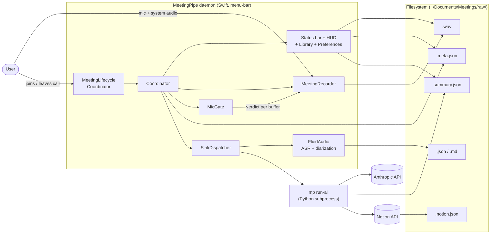
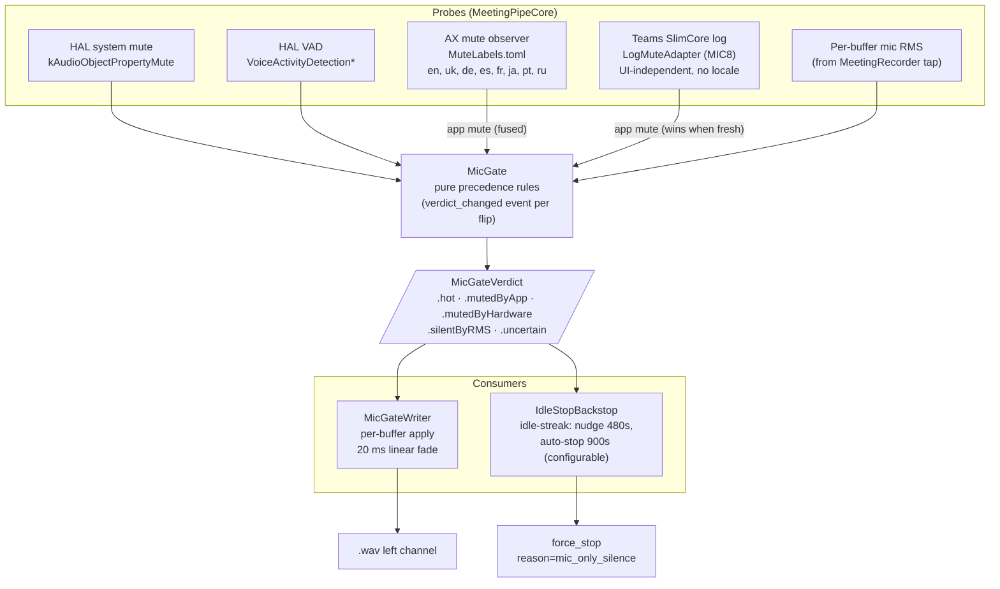
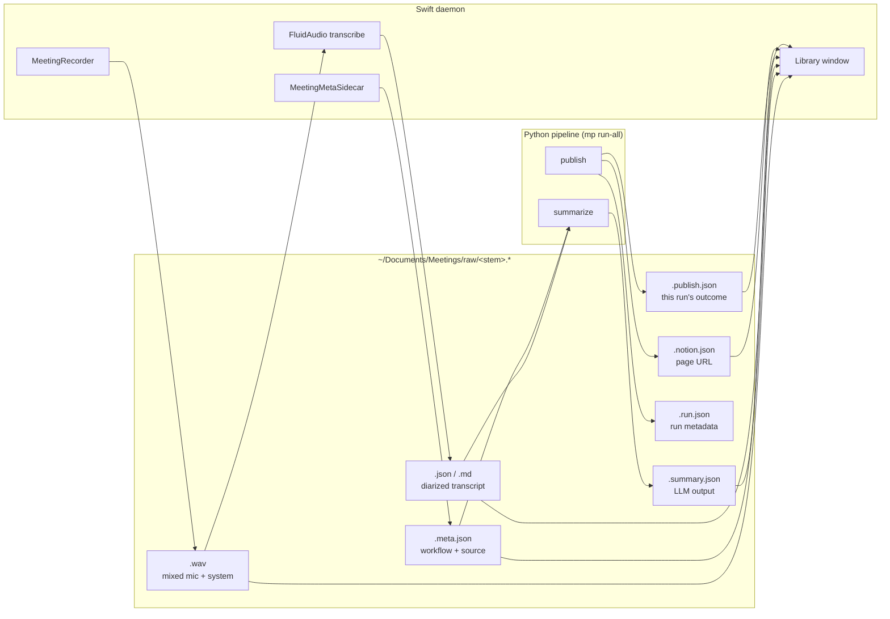
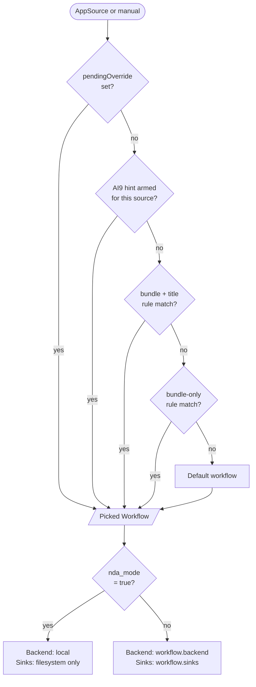

# Architecture

Fast subsystem map for finding code. For the *why* behind shape decisions, see the README ["Why it is shaped this way"](./README.md#why-it-is-shaped-this-way) and the [ADRs](./docs/decisions/). For terminology, see the [Glossary](#glossary) below. For coding patterns, see [`CONVENTIONS.md`](./CONVENTIONS.md).

```
meeting-pipe/
├── daemon/      Swift menu-bar app (detection, recording, transcription, UI, hotkeys)
├── pipeline/    Python CLI invoked as `mp <subcommand>` (summarize, publish)
└── scripts/    install.sh, rebuild.sh, uninstall.sh, dev tools
```

The daemon records the WAV, writes the `.meta.json` sidecar, and transcribes on-device (FluidAudio); then it spawns the pipeline as a subprocess and forgets about it. The pipeline reads the transcript and the sidecar, decides what to do per workflow, and summarizes / publishes. The two processes share contracts via files on disk: `.meta.json` (per recording) and `events.jsonl` / `pipeline_events.jsonl` (append-only logs).

---

## Visual overview

Five diagrams for the high-level picture. Each answers one question; jump to the section that matches what you need.

### Subsystem map

Who-talks-to-whom across the whole system. The daemon is one Swift process that owns detection, recording, and routing; the pipeline is a short-lived Python subprocess invoked per meeting.



### Meeting lifecycle

What happens between "you join a Teams call" and "the Notion page appears". MicGate runs in parallel with the recorder for the whole call; the pipeline subprocess runs after the recorder closes the WAV.

```mermaid
sequenceDiagram
    actor User
    participant LC as Lifecycle subsystem
    participant Coord as Coordinator
    participant Rec as MeetingRecorder
    participant Gate as MicGate
    participant Sink as SinkDispatcher
    participant Pipe as Pipeline (mp run-all)
    participant N as Notion

    User->>LC: opens Teams call
    LC->>Coord: verdict .starting
    Coord->>User: prompt panel (Record? Skip?)
    User->>Coord: Record
    Coord->>Rec: start(outputDir, captureMode, voiceProcessing)
    Coord->>Gate: engage(handles)
    loop every audio buffer
        Rec->>Gate: per-buffer mic RMS
        Gate-->>Rec: MicGateVerdict
        Note right of Rec: capture-first records the verdict to the<br/>mute timeline; only regulated/NDA zeros<br/>the mic in place (20 ms fade, frame parity)
    end
    User->>LC: clicks Leave
    LC->>Coord: verdict .ended
    Coord->>Rec: stop()
    Rec->>Rec: ffmpeg merge mic + system
    Coord->>Sink: enqueue(wav)
    Sink->>Sink: FluidAudio transcribe + diarize
    Sink->>Pipe: mp run-all
    Pipe->>Pipe: summarize
    Pipe->>N: publish
    N-->>User: notifier opens page URL
```

### Verdict-fusion stack

The post-detection layer that reads, every audio buffer, whether you look muted in the meeting client. Five signals feed `MicGate`; by default (capture-first, ADR 0016) its verdict drives the muted-span timeline for opt-in offline redaction and the silence backstop (auto-stops dead meetings), never the recorded mic. Only under the regulated / NDA gate does the verdict silence the mic in real time through `MicGateWriter`.

The app-mute read is the one signal with two oracles (MIC8). The AX mute observer scrapes a localized button label; for Teams, `LogMuteAdapter` additionally reads the client's own SlimCore media log, which is UI-independent, locale-independent, and measured to lead the AX read on 59 of 61 paired transitions. They share one state field and `MuteSourceFusion` decides which wins: **the log wins when present, the AX read carries when absent**, so a client redesign cannot blind the gate and a missing log line degrades to unknown rather than to unmuted.



`MeetingLifecycleCoordinator` is the sibling system for meeting-level verdicts (`.idle`, `.starting`, `.inMeeting`, `.endingProvisional`, `.ended`). It runs alongside MicGate; its `.ended` verdict drives stop-recording (TECH-C13 step 5, shipped).

### Data contracts

The daemon and pipeline share state through files on disk, not IPC. Six sidecars per meeting; the schemas live in [`CONVENTIONS.md`](./CONVENTIONS.md). The library window also reads the same files.



### Workflow resolution

How a recording gets routed: precedence top-down. The prompt window's chevron menu sets an explicit override; failing that, a learned routing hint (AI9) may be armed from repeated WF8 corrections; failing that, rules match by bundle ID and window title; failing that, the default workflow runs. `nda_mode` then forces local backend + filesystem-only sinks regardless of the resolved workflow's preferences.



The AI9 hint is armed only when the prompt showed it (never on auto-consent, a hotkey start, or a manual recording), only for the source it was computed for, and never in the direction that would take a meeting out of an NDA workflow. It is a per-meeting suggestion the user can undo before recording, not a rule: nothing is ever written back into `[[matching_rules]]`.

---

## Daemon — `daemon/Sources/MeetingPipe/`

### File index

One hop to the right file. Moved here from `daemon/CLAUDE.md` by DOC15: that file is prepended to every prompt in its subtree, so an orientation table nobody obeys was paying a per-turn cost for a lookup done occasionally, and its own intro already deferred to this section for what each file does and why. The subsections below carry that detail; `daemon/docs/gotchas.md` carries the traps.

| Subsystem | Entry file(s) |
| State machine + dispatch | `Coordinator.swift` (+ `Coordinator+*.swift`), `MeetingSessionController.swift`, `SessionHost.swift`, `Coordination/` (`DetectionStateMachine`, `SinkDispatcher`, `PipelineJobDispatcher`, `ConfigRefreshCoordinator`, `SessionWatchers`) |
| Meeting detection (start + end) | `MeetingPipeCore/Lifecycle/`, `MeetingDiscoveryWatcher.swift`, `MeetingSourceScanner.swift`, `MeetingSourceScorer.swift`, `MeetingAppRegistry.swift`, `MicBusySpanTracker.swift`, `MicInUseTier.swift`, `MicInputAvailability.swift`, `Resources/meeting_apps.toml` |
| Mute gating | `MeetingPipeCore/MicGate/`, `MicGateWriter`, `AXMuteButtonProbe`, `MeetingAXWindowWatcher`, `Adapters/LogMuteAdapter.swift`, `SlimCoreMuteLog.swift`, `MuteSourceFusion.swift` |
| Recording | `MeetingRecorder.swift`, `RecordingPostProcessor.swift`, `RecordingDurationParity.swift`, `SystemAudioCapture.swift`, `SystemCaptureStartAttempt.swift`, `SystemCaptureRetryPlanner.swift`, `CaptureRecoveryPlanner.swift`, `SerialBufferWriter.swift`, `MuteRedactor.swift`, `AudioRetention.swift` |
| Bounding a wedged audio engine (REC13) and a hung SCStream start (REC17) | `RunWithTimeout.swift`, `BoundedEngineStart.swift`, `SystemCaptureStartAttempt.swift`, `EngineTeardown.swift`, `MainQueueObserver.swift`, `StopStallWatchdog.swift` |
| Surviving an ObjC raise (REC12) | `GuardedTapInstall.swift`, `UncaughtExceptionLogger.swift`, `Sources/MeetingPipeObjC/` (the `@try` barrier; a target of its own only because SwiftPM has no mixed ObjC/Swift target) |
| Transcription (ASR + diarization) | `Transcription/` (`FluidAudioRunner`, `TranscriptionRunner`, `SegmentBuilder`, `TranscriptionService`), `SpeakerAccuracy.swift`, `TranscriptOverlayCarry.swift` |
| Derived copy (engines, sinks, clamps) | `SummarizationEngine.swift` (UX31), `PublishLanding.swift` (UX49), `RegulatedMode.swift` (UX60), `DigestNarration.swift` (UX63), `SummaryStaleness.swift` (UX65), `PrivacyReach.swift` (DOC12) |
| Workflows | `Workflow.swift`, `WorkflowStore.swift`, `WorkflowMatcher.swift`, `WorkflowsView.swift`, `PublishTargets.swift`, `WorkflowContextHint.swift`, `WorkflowDeletion.swift`, `WorkflowRowActions.swift`, `WorkflowInspectorPresentation.swift`, `WorkflowInspector.swift`, `WorkflowRoutingHint.swift`, `WorkflowCorrectionStore.swift` |
| Library UI | `LibraryWindow.swift`, `LibraryListView.swift`, `MeetingDetailView.swift`, `MeetingStore.swift`, `LibraryProcessing.swift`, `ReSummarizeMenu.swift`, `LibraryDialogs.swift`, `BatchActionConfirmation.swift` |
| Library: search + smart folders | `SearchIndex.swift` (SQLite FTS5), `SearchIndexer.swift`, `SearchQuery.swift`, `SavedSearch.swift`, `SavedSearchStore.swift`, `SavedSearchViews.swift` |
| Library: Ask (AI3) | `AskModel.swift`, `AskPane.swift`, `AskContextWidth.swift`, `AskView.swift` |
| Library: Facts + evidence | `Facts.swift`, `FactsView.swift`, `SummaryRenderedView.swift` (`EvidenceChips`) |
| Quick Find (Cmd+K) | `QuickFindWindow.swift`, `QuickFindRanker.swift`, `QuickFindList.swift` |
| Speaker naming | `TranscriptTab.swift`, `MeetingCast.swift`, `SpeakerLabelStore.swift`, `Library/MeetingLibraryService.swift`, `VoiceResolution.swift`, `VoiceResolutionBar.swift` |
| People rail (DV3) | `PeopleRail.swift`, `PeopleView.swift`, `RosterProfile.swift`, `RosterRename.swift` |
| Meeting time rail (AI8) | `MeetingStats.swift`, `StatsView.swift` |
| Preferences | `PreferencesWindow.swift`, `Preferences/` (`PreferencesView.swift`, `PreferencesControls.swift`, `UISettings.swift`, `VocabularyEditor.swift`), `NotionDatabasePicker.swift`, `GlossaryStore.swift`, `RestoreFlow.swift` |
| Vocabulary + clarify | `VocabularyCandidate.swift` (FEAT12), `Clarify.swift` + `ClarifySheet.swift` (FEAT13) |
| Menu bar + onboarding | `StatusBarController.swift`, `StatusBarModel.swift`, `SetupChecklist.swift`, `Onboarding/`, `OnboardingGate` |
| Application menu bar | `MainMenu.swift` (UX48) - the App / Edit / Window bar, distinct from the menu-bar *extra* above |
| Window activation | `WindowActivationManager.swift` (UX39/UX56) - owns the policy flip, and installs/removes `MainMenu` with it |
| Permissions | `PermissionsCenter.swift` |
| Pipeline subprocess | `PipelineLauncher.swift`, `LocalServerReaper.swift`, `LocalModelPreloader.swift`, `LocalModelTier.swift` |
| Failure presentation (UX80) | `FailurePresentation.swift` (pure cause, copy, report allowlist), `FailureNotice.swift` (bounded notice, Details, local copy, dialogs), `PipelineFailureSidecar.swift` (durable daemon-owned evidence); Python `failure_details.py` classifies native errors into an optional process-scoped result |
| Scheduled `mp` jobs | `LaunchAgentScheduler.swift`, `DigestSchedulerService.swift` (AI4), `BackupSchedulerService.swift` (STOR4) - a new job adds a thin service here, not a second plist writer |
| Launch at login | `LaunchAtLoginService.swift` (UX42) - the agent that installs the app, distinct from the one-shots above |
| One instance only | `SingleInstanceGuard.swift` (UX54) |
| Event log | `Logger.swift` (`Log.event` / `Log.writeLine` / `Log.main`, size-rotated) |
| Diagnostics viewer (UX20) | `DiagnosticsWindow.swift`, `DiagnosticsView.swift`, `DiagnosticsLog.swift`, `DoctorRunner` |
| User guide (DOC11) | `GuideWindow.swift`, `GuideView.swift`, `GuideDocument.swift` - text is `docs/GUIDE.md` and *only* that; never paste guide prose into Swift |
| Clipboard share (FEAT16) | `RichTextShare.swift` (`RichTextShare` = the flavors + the pasteboard write; `MeetingShare` = what a meeting's two documents are), reached from `MeetingDetailView+Header.swift`'s `actionsMenu` |
| Automation (`meetingpipe://` + App Intents) | `Automation/` (`AutomationCommand.swift`, `AutomationReference.swift`, `Coordinator+Automation.swift`, `TranscriptDeeplink.swift`, `MeetingPipeAppIntents.swift`), `AppDelegate.application(_:open:)` |

### Lifecycle entry points

- `App.swift` - `@main`. NSApplication accessory app. Stands down through `SingleInstanceGuard` if another copy is already running, then reads `UISettings`, applies theme, sets up `ConfigStore` + `SecretsStore`, constructs `Coordinator`, wires `StatusBarController`, kicks off `SystemAudioCapture.prewarm`.
- `SingleInstanceGuard.swift` - refuses to be a second MeetingPipe (UX54). Runs in `App.main()` before `NSApplication` exists and after the one-shot CLI subcommands intercept, so a rejected instance never migrates secrets, sets an activation policy, installs a status item or a main menu, constructs the `Coordinator`, or touches the recorder or launchd; the one thing it writes is a single `main` / `second_instance_stood_down` event line. Two live daemons is not a duplicate icon: it is two detectors polling the same AX trees, two recorders that can answer the same meeting, and a second process outside the one job lane PIPE11 built so same-stem runs serialize. **The newcomer is always the one that dies**, since the incumbent may be mid-recording. `decide` is pure and orders copies by launch date with the lower pid as tie-break, which states that rule in the one form that survives two copies launching at the same instant: a bare "is anyone else there?" would stand both down and leave none. It stands down for nobody it cannot identify (a bare SPM binary has no bundle identifier and Launch Services does not list it either) and for nobody already terminated. Deliberately not a second login-start mechanism: UX42's LaunchAgent remains the single owner of that, and the stand-down exit status is 0 precisely so its `KeepAlive = { SuccessfulExit = false }` does not respawn the copy that just stood down. **Both dates in that order come from the kernel, not from AppKit**, and that is the invariant the first version broke: `NSRunningApplication.current` is a placeholder describing pid -1 as terminated until `NSApplication` is up, so a guard that read its own identity from it could never stand down and never did, once, while two and three daemons ran. This process dates itself with `ProcessInfo` plus a `sysctl` start-time read, and a peer whose Launch Services `launchDate` is nil (which is most of them, including the launchd-started MeetingPipe itself) is dated the same way rather than falling back to a pid comparison.
- `Coordinator.swift` - the spine (633 lines, plus the `Coordinator+Session` / `+Delegates` / `+MenuActions` extensions). Constructs and owns every subsystem and routes between them. The place where everything meets.
- `MeetingSessionController.swift` - one meeting's lifetime, lifted out of the Coordinator by TECH-ARCH2 (915 lines): the two verdict-consumer Tasks, the recording begin/stop path, the prompt timeout, the MicGate and lifecycle engage/disengage, and meta-sidecar writing. It reaches its host through `unowned let coordinator: any SessionHost` (ARCH4), not through `Coordinator` itself, so `MeetingSessionControllerBranchTests` drives the real controller against `FakeSessionHost`.
- `SessionHost.swift` - the seam the session controller sees: every member it reads through `coordinator.`, and nothing else. The six UI / I/O collaborators (status bar, notifier, recorder, HUD, prompt window, job dispatcher) are protocol-typed because a test cannot have the real ones; everything else stays concrete because a test can already build it. `micAuthorizationStatus` lives here too, so the permission-denied branch is reachable without TCC. `Coordinator+SessionHost.swift` is the production conformance.

The collaborators the spine delegates to, in `Coordination/`:

- `DetectionStateMachine.swift` - the recording-side state machine (`.idle`, `.prompting` / `.suppressed`, `.recording`, `.stopping`) and the `RepromptCooldown` facade. Main queue only.
- `SinkDispatcher.swift` - the post-recording queue: FluidAudio transcription, then `mp run-all`, serially. Owns the failure-sidecar stage attribution. It is also the one lane every *later* re-run of a meeting takes: the `.retranscribe` kind (ASR3) and, since PIPE11, the `.libraryRun` kind that carries a Library regenerate / republish. Those two skip the transcription stage; a library run supplies its own body (the chain lives in `MeetingLibraryService`) and the queue supplies only the slot. An identical job requested while one is still queued is coalesced rather than run twice, and since PIPE18 that guard lives in the private `enqueue(job:completion:)` every path funnels through rather than at the call sites, because that is where it went missing: PIPE11 put it on `enqueueLibraryRun` alone, so for a month a `.full` retry could queue seven times, which is what happened on 2026-08-14. Identity is per kind, the recording URL for `.full` and `.retranscribe` and PIPE11's `(verb, stem, backend)` for a library run, so different kinds and different backends stay separate asks; `isAlreadyQueued` is pure and is what a fifth entry point now inherits instead of having to remember. It also publishes what is *waiting* (UX28): `pendingJobs` names each queued job, `removePending(id:)` drops one that has not started (answering its caller with a dequeue failure rather than leaving an awaiting Task suspended), and `onActiveLibraryRun` is the busy signal for a re-run, which has no progress heartbeat to ride. A **cancelled** job (UX50) is still completed as a failure, which is what keeps the row retryable, but as `LaunchError.cancelled` rather than `nonZeroExit(15, …)`: the daemon sent that SIGTERM itself, so `stage(for:)` labels it PIPE3's `.interrupted`, `pipeline_failed` does not fire, and the marker's reason says the owner stopped it instead of quoting an exit code. `onActiveProgressEnded` is the sibling of that quiet: the row's live heartbeat entry ends with the job on **every** completion path, including the ones nothing is told about, so a cancelled run cannot leave a row stuck on its last stage in the In progress block. UX69 is the other end of that entry's life. It used to begin at the pipeline's first heartbeat, which on a 110 minute meeting was 58.6 s after the click, so a running job could not be stopped for its first minute; it now begins when the daemon's own transcription pass starts and moves to a second phase when the subprocess is spawned. Publishing it that early is only honest because the pass is interruptible: `runDaemonTranscription` runs in a retained `transcriptionTask`, `cancelActiveJob` signals both it and `cancelActiveRun` (each a no-op for the half that is not running), and a cancelled pass lands exactly as a cancelled run-all does, as `.interrupted` with the same reason and nothing reported. `PipelineLauncher.isCancellation` answers for both, since a click reports itself as `LaunchError.cancelled` or as a `CancellationError` depending on which half it landed in.
- `PipelineJobDispatcher.swift` - routes job completion to the user-facing surfaces (done notification, error banner, queue badge, plus the UX28 pending list and busy chip). Since UX77 the queue seam carries `QueueActivity` (depth plus whether the head job has started) rather than a bare depth, because the three aggregate surfaces rendering that number all called waiting work "Processing"; `QueueActivityPresentation` in `LibraryProcessing.swift` derives their shared word. Side effects injected as closures. Also the `LibraryRunLane` the library service enqueues through, so the queue coupling is one named seam a test can fake. A library re-run lands on the same done notification a run-all does; its failures are left to `MeetingLibraryService`, which already names the verb the user asked for. A cancellation raises neither surface (UX50), on any leg: the Library's Cancel reaches run-all here and, through the same retain slot, the regenerate and republish legs in `MeetingLibraryService`, and all three stay quiet. Staying quiet is `route`'s business alone, which is why the row's live-entry clear is forwarded past it rather than through it: `route` returns early for exactly the completions nobody is told about, and the row has to stop showing progress whether or not anything is said.
- `ConfigRefreshCoordinator.swift` - the daemon's response to configuration changes (eager reload, model pre-fetch on a backend flip).
- `SessionWatchers.swift` (T7) - the session-lifetime watchers `Coordinator.start()` brings up with one `watchers.startAll()`: discovery, call-teardown and config refresh, held as `Startable` so `SessionWatchersTests` can check from fakes that every member starts once. It exists because the real `Coordinator` does not stand up headless and END9 shipped a watcher nothing started; a new session-lifetime watcher joins this set rather than getting its own `start()` line.

### Detection - "is the user in a meeting?"

Detection is the `MeetingPipeCore` lifecycle subsystem plus the daemon-side discovery scan.

- `MeetingPipeCore/Lifecycle/MeetingLifecycleCoordinator.swift` - owns the per-app adapters and fuses their signals into a `MeetingLifecycleVerdict` stream (`.idle`, `.starting`, `.inMeeting`, `.endingProvisional`, `.ended`).
- `MeetingPipeCore/Lifecycle/PromotionEngine.swift` - the pure verdict-fusion rules: a debounce that promotes provisional signals to a confirmed verdict.
- `MeetingPipeCore/Lifecycle/CallTeardownOracle.swift` + `SlimCoreTeardownLog.swift` + `CallTeardownWatcher.swift` (END9) - the independent answer to "did the call really end?". `CallTeardownOracle.decide` is pure; `SlimCoreTeardownLog` parses the one line Teams writes when a call's DRM registration is released (`UnregisterCall`), reusing `SlimCoreMuteLog`'s generation resolver, byte-range tail and UTC parse rather than growing a second reader; `CallTeardownWatcher` tails it at 1 Hz on its own queue for the whole session, started from `Coordinator.start()` (END10: it was constructed and never started for END9's whole life, so the oracle reported "no opinion" on every consult and every provisional end confirmed on it; `CoordinatorWiringFenceTests` now pins that call, and the tail re-arms on a `DispatchSourceTimer` because a run-loop `Timer` scheduled from its read queue fires exactly once). Consulted by `MeetingSessionController.beginTeardownHold` when the AX rescue re-walk comes up empty. END13 gave `decide` one more input, `LiveCallSignal`: a live cross-class reading (process audio, cached on `MeetingLifecycleCoordinator` and reaching the controller through `SessionHost.liveCallSignal`) vetoes the 150 s cap, because on 2026-09-04 that cap confirmed an end four independent readings were contradicting. The reading is tri-state, so an unresolved probe is `.unknown` and keeps today's bound; a vetoed hold still ends at a 7200 s ceiling, under its own `live_signal_ceiling_reached` reason.
- `MeetingPipeCore/Lifecycle/Signals/` - the signal sources: ScreenCaptureKit shareable-content windows, the AX Leave button, per-process audio activity (live for Teams and Zoom since DET8, 2026-08-05: DET2 closed it NO-GO 2026-07-20 after no mechanism revived the read, not even a Core Audio process tap, but every one of those reads asked about the `MSTeams` shell PID, which never registers as a CoreAudio client, so enumerating `kAudioHardwarePropertyProcessObjectList` and matching by bundle prefix resolves the SlimCore `ModuleHost` helper that holds the mic, with no TCC grant; an owner-run live-call probe returned GO across two calls, and the signal carries `requiresCorroboration` so a lone input drop cannot confirm an end. Webex and Slack stay off, since Cisco holds the mic open post-call for ultrasound), plus corroborating window-title / workspace signals. `ProcessAudioScanProbe` sits beside `ProcessAudioSignal` and reads the same property for the START side (DET12), sharing its matcher and its property reads rather than growing a second spelling; it differs only in caching shape, taking one process-object enumeration per discovery scan instead of one long-lived resolution per meeting, and it asks `NativeLifecycleConfig.usesProcessAudio` who may be read so the two ends cannot disagree about which apps that read is trusted for. There is no input-device signal: a device-scope read cannot see the meeting client while the daemon itself holds the device (END6, refuted by measurement in [`docs/spikes/end6-device-idle-corroborator.md`](./docs/spikes/end6-device-idle-corroborator.md)).
- `MeetingPipeCore/Lifecycle/Adapters/` - one adapter per meeting client (Teams, Zoom, Webex, Slack, browser), wiring the right signals with locale-tolerant title patterns.
- `MeetingDiscoveryWatcher.swift` / `MeetingSourceScanner.swift` / `MeetingSourceScorer.swift` - start-side discovery: enumerate every concurrent candidate app, score each on "I am in a meeting" evidence, pick the strongest. **Accessibility is load-bearing for the whole of it, not just for end-detection** (DET11): `collectSignals` gates every AX-derived native signal on AX trust and the browser / PWA branches `guard axTrusted` before enqueueing at all, so an untrusted process detects no meeting of any kind. DET12 put exactly one signal outside that gate, `processAudioIsRunningInput`, because a per-process mic read needs neither Accessibility nor Screen Recording; that does not restore start-detection under a denied grant, since one signal never clears `MeetingSourceScorer.isConfidentNativeMeeting`, but a Teams or Zoom candidate actually on the mic now carries evidence and is reported as a drop rather than as an unreadable native. That blackout used to be silent, since a zero-signal native is filtered out before `droppedCandidates` is built; `MeetingSourceScanner.unreadableNatives` names it and the watcher emits `detector.candidate_unreadable` for each one, throttled per batch like `candidate_dropped`. The plain-browser admission gate is a third such case and is now equally observable (DET6): `MeetingSourceScanner.decideBrowserAdmission` is a pure `decide` over the browser's window titles returning `admit` / `noMeetingSignal` / `weakTitleOnly`, the refused tabs ride out on `Result.rejectedBrowserTabs`, and the watcher emits `detector.browser_tab_rejected`. Only Google Meet clears that gate today, so a browser tab hosting Teams, Webex or a Slack huddle is refused; whether it should be admitted is an open measurement, probe-first (DET6, `daemon/scripts/det6-browser-url-probe.swift`, verdict tree in [`docs/spikes/det6-browser-url-readability.md`](./docs/spikes/det6-browser-url-readability.md)).
- `Resources/meeting_apps.toml` - per-bundle-id table of known meeting apps and their window-title regex hints. Native (adapter-backed), browser, and a `mic_plausible` tier of adapterless audio apps (FaceTime/Discord/WhatsApp/Telegram, named by DET1's mic-in-use tier).
- `MeetingAppRegistry.swift` - the single source of truth for those bundle lists (DET4): bundled `meeting_apps.toml` unioned with an optional `~/.config/meeting-pipe/meeting_apps.toml` user overlay (add an app without a rebuild). The scanner reads its sets here; the Coordinator builds the browser lifecycle adapter over the same set. `MeetingAppRegistryFenceTests` fails on TOML/adapter drift (every native has an adapter + recognizer; the browser set equals `BrowserMeetingLifecycleAdapter.defaultBrowserBundleIDs`).
- `MicBusySpanTracker.swift` - pure mic-busy span state machine (DET3): fed by `MeetingDiscoveryWatcher`'s mic KVO + poll, emits `mic_busy_started`/`mic_busy_ended` for `mp analyze-detection` to correlate against prompts/recordings. Its one input is `AVCaptureDevice.isInUseByAnotherApplication`, resolved once at daemon start and never retried, and it has produced zero spans across the whole dogfood log; whether that is the nil-device branch or the property itself is unestablished and probe-first (DET10, `daemon/scripts/det10-mic-busy-probe.swift`). `MicInputAvailability.swift` is the reporting half that landed regardless: a failed resolve now emits `detector.mic_device_unavailable` instead of returning silently, so a dead detection input is observable rather than an absence.
- `MicInUseTier.swift` - the DET1 catch-all: a pure `decide` that, on a sustained mic-busy dwell (default 30 s) with no whitelist winner, names the plausible holder so a call on an unlisted domain (FaceTime, Discord, an unlisted WebRTC site) still prompts. The plausible set is **browsers plus the `mic_plausible` apps, and deliberately not the native whitelist**: discovery owns the natives, and a native pre-join holds the mic before its meeting window exists, so a tier that named one would pre-empt the real detection (taking its lifecycle end-detection with it) and could name whichever app happened to be frontmost. This line claimed the opposite until DET11 corrected it; the exclusion is a shipped fix with its reasons at `MicInUseTier.swift:36-40` and `MeetingDiscoveryWatcher.swift:31-36`, not an oversight to close. `MeetingDiscoveryWatcher` runs it once per span and routes the source through the normal prompt path; permission-light (no AX / Screen Recording), so its recordings end via the idle backstop.
- `MeetingPipeCore/MicGate/IdleStopBackstop.swift` - meeting-idle backstop (TECH-END3): the "Still meeting?" nudge (default 480s) and the forgotten-recording auto-stop (default 900s). Detailed under Mute gating below.
- `RepromptCooldown.swift` - per-bundle, fixed-duration suppression window after a recording / skip so a post-call mic flicker can't spawn a fresh prompt.
- `SkippedMeetingLatch.swift` - per-bundle suppression anchored to discovery liveness (not a fixed clock): once you dismiss a prompt, every discovery sighting of that app refreshes the latch, so the meeting stays skipped for its whole lifetime and lapses ~15 s after it ends. Paired with `RepromptCooldown` in `abandonPrompt`.

### Recording - "capture what's playing + what I say"

- `MeetingRecorder.swift` - AVAudioEngine for mic capture + the `SystemAudioCapture` source for everything else, mixed and written to disk. `MicGateWriter` applies the per-buffer mute verdict in place. At start it resolves the bound input device (`MeetingPipeCore/Infra/InputDeviceIdentity`) and snapshots whole-recording mic coverage; `MeetingSessionController` reads both at stop to persist which mic was used (`mic_device_name`) and to fire the dead-mic warning (`MicCoverageWarning`, the mirror of `RemoteAudioWarning`) when the mic stayed silent under a live system channel (MIC15).
- `RecordingPostProcessor.swift` - everything that happens to a recording's files after capture stops, extracted from `MeetingRecorder` (ARCH5): the ffmpeg merge (mic left / system right) or single-side downmix, the temp-then-promote dance that keeps a truncated merge off the canonical path, the `.recordfail.json` breadcrumb, `recoverOrphan` for intermediates a crash left behind, and the `findFFmpeg` / `audioDurationSec` helpers `MuteRedactor` and `AudioTranscoder` also use. `audioDurationSec` measures the `data` payload against the file's real size rather than trusting the chunk's size field (REC14), because that field is a placeholder until the writing handle closes: a killed process leaves it at 0 with the samples on disk, which used to read as a duration of zero rather than as unreadable and cut a merge to the shorter leg. `byteRate` comes from `fmt `, written at creation, so the arithmetic is exact on exactly the path where the header cannot be trusted. Pure file work with no capture state, which is what made the split a move. The merge runs under an explicit length policy (`mergeLengths`, REC9): `amerge` has no length option and ends at the SHORTER input, so the filter pads both legs, `adelay`s a system channel that started late to the offset it was captured at, and cuts at `max(mic, offset + system)`; the promote gate then re-measures the result against that target and refuses anything short, keeping both intermediates instead. Until REC9 the gate was a 4 KiB byte floor, which a merge holding 5.28 s of a 41.2 s meeting passed at 192 KB.
- `RecordingDurationParity.swift` - the pure stop-time verdict over a finished recording's audio seconds against the wallclock it spanned (REC9), snapshotted by `MeetingRecorder.checkDurationParity` into `lastDurationParity` and read by `MeetingSessionController` for the "Recording is shorter than the meeting" notice. Third in the same family as `RemoteAudioWarning` (which channel is missing) and `MicCoverageWarning` (the mic carried nothing): this one asks whether the file is as long as the meeting, whatever the cause.
- `SystemCaptureRetryPlanner.swift` - the pure "what does a system-audio retry do with the WAV the dead SCStream was writing" rule (REC10). A retry used to re-enter `startSystemCapture` with the same URL, and `AVAudioFile(forWriting:)` truncates, so REC8's hands-off automatic recovery destroyed every system sample captured before the death: exactly the partial `handleSystemAudioLost` keeps on disk for the merge, and exactly what REC4 and REC8 both claimed the retry preserved. The retry now resumes the still-open file behind a silence pad covering the outage, so the pre-loss audio survives and the recovered audio lands where it was captured rather than at sample 0; opening the path fresh is one branch of this decision and the only one allowed to truncate. It shares `CaptureRecoveryPlanner.silenceFrames` with the mic side's device-switch pad rather than carrying its own copy of the gap arithmetic. It has now run: `system_capture_lost` appears 4 times across the log (2026-08-14, 08-17, 08-19, 08-21) with 3 resumes, so the sentence that stood here saying it had never executed is retired rather than edited. The measured outages are 7.68 s, 7.83 s and one of 557.0 s that spanned a system sleep. **REC16 moved the span to the wall clock for that last one:** both marks came from `systemUptime`, which does not advance while the Mac is asleep, so the 557 s outage padded 106.8 s and left the finished file seven and a half minutes short with every system sample after the wake stamped that far early against the mic channel, which the mic side had measured correctly on `Date()` all along. `maxPadSeconds` moved 300 to 900 with it, since the cap only starts binding once the gap is measured truthfully.
- `SystemAudioCapture.swift` - ScreenCaptureKit display stream, audio output only: every other process's audio, with `excludesCurrentProcessAudio` keeping the daemon's own out. SCStream refuses to start without a screen output, so one is attached at 2x2 pixels and one frame a second and its frames are discarded; this is what the Screen Recording usage string in `scripts/install.sh` describes. The package's macOS 14 floor comes from FluidAudio and the two-parameter SwiftUI `onChange(of:)`, not from this file (`excludesCurrentProcessAudio` is macOS 13.0). Its `start()` is two unbounded ScreenCaptureKit awaits, and on 2026-09-17 they took **64 minutes** between them (REC17); the recorder now awaits it only through `boundedSystemCaptureStart`, and the capture carries a per-attempt ledger so the abandoned call's eventual completion stops the stream it produced instead of adopting it.
- `SystemCaptureStartAttempt.swift` - the pure ledger for one system-audio start attempt plus `boundedSystemCaptureStart`, the async sibling of `boundedEngineStart` (REC17). `timedOut()` or `stopped()` before `completed()` yields `.discard`, `completed()` first yields `.adopt`, and both delegate callbacks gate on the abandonment, so a late stream delivers no buffers and reports no death. What it closes: a start that neither returned nor threw was a state none of the recording-integrity fences could see. The liveness watchdog engages only after a first buffer (and counted from zero rather than from the attempt, so every retry was already past its gate), `retrySystemAudio` no-ops on the non-nil hung capture, the idle backstop read the channel that never came up as a silent one, and the stop-time warning saw `systemFires > 0` once the stream finally came up. The budget is `MeetingRecorder.systemStartBudgetSeconds` (10 s: 3.5x the slowest healthy start on record, under the earliest nudge the slider allows), a timed-out first start takes REC8's one automatic retry, and a timed-out retry falls back to the banner without another.
- **Teardown isolation (REC11).** `MeetingRecorder.stop()` is `@MainActor`, like `start`, `recoverCapture` and `flushIntermediatesForTermination`. It was `nonisolated async`, which per SE-0338 does not inherit the caller's actor, so the whole teardown ran off the main thread while writing the four timer handles, the wake observer and the idle-sleep assertion that the termination flush claims exclusive main-thread ownership of, with `IOPMAssertionRelease` guarded only by a non-atomic bool reachable from both. Main-isolated is not main-blocking: the SCStream stop, the recovery drain and the ffmpeg merge were already `async` and bounded, and the writer drains moved to `SerialBufferWriter.drain(timeout:)`, which suspends rather than blocking so a wedged disk cannot freeze the app for the drain budget. The termination flush cannot await (it runs under `applicationWillTerminate` and the SIGTERM handler), so it keeps the synchronous drain but is bounded too, at a tighter budget than the graceful path; it shipped calling the unbounded `finish()` while `stop()` used REC7's bounded variant on the same writers, so a full disk or a stalled volume hung quit forever on the main thread. Both paths emit `writer_drain_timed_out` with a `path` attribute naming which one abandoned.
- **Nothing calls the audio engine synchronously and unbounded (REC13).** The engine teardown REC11 left on main (`removeTap` / `engine.stop()`, plus the VoiceProcessing revert) is `EngineTeardown` now, in an async form for `stop()` and a tighter synchronous one for the termination flush, both abandon-on-timeout and both emitting `engine_teardown_timed_out` with a `path`. `MicLevelMonitor.startBounded` covers the last unbounded `engine.start()`. The reason is a deadlock, not a slow device: `MeetingRecorder` registered its `.AVAudioEngineConfigurationChange` observer with `queue: .main`, which makes NotificationCenter wrap the handler in an `NSOperation` and have the **poster** wait on it, and the poster is AVFAudio's own engine serial queue. On 2026-08-14 that queue blocked in 2516 of 2516 samples, every engine call queued behind it, and a stop the owner pressed sat in `.stopping` for 52 minutes while `system.wav` grew to 1.28 GB. `addMainQueueObserver` (nil queue plus an explicit main hop) is the one registration now. Two backstops sit behind the fix because the incident had a second half: `AppDelegate.flushAndExit` arms a 9 s process-wide ceiling on a global queue before `shutdown()` runs, since the termination flush never executed at all that day and the block was upstream of it; and `StopStallWatchdog` emits `stop_exceeded_ceiling` with the elapsed time, so a stop that does not complete is readable from `events.jsonl` rather than needing a live `sample`. Full incident, and what it does **not** establish, in `daemon/docs/gotchas.md`.
- **Nothing hands a format to `installTap` unchecked, and a raise no longer reaches the process (REC12).** `GuardedTapInstall` is the one seam. It refuses a zero sample rate or zero channel count (logging `mic_tap_install_skipped` with the calling site), then runs the install inside an Objective-C `@try` barrier. Both call sites go through it, `MicLevelMonitor.arm` (the prompt's live waveform, which then stays flat, its documented degradation) and `MeetingRecorder.installMicTap` (`start()` plus device-change recovery, where a failure ends recovery rather than recording silence). The reason is not tidiness: `installTap` *raises* an ObjC `NSException` where `engine.start()` one line below it *throws*, Swift cannot catch a raise, and all four crash reports on the owner's machine are that abort, each within 100 ms of a meeting prompt. The format check alone is probabilistic by construction, since a format can stop agreeing with the device between the read and the install; the barrier is what makes it total, because the remainder is a race and not a checkable state. **The barrier is `MeetingPipeObjC`, a third target** (`daemon/Sources/MeetingPipeObjC/`, one `.m` plus its header, no dependencies) purely because SwiftPM has no mixed Objective-C / Swift target. **A caught raise is terminal for the engine and the seam enforces that**, since AVFAudio's C++ internals are left mid-flight by the unwind: the engine is condemned, `GuardedTapInstall` refuses it every later tap, and the way back is a replacement, which `MeetingRecorder.start` takes when it finds its own engine condemned. `GuardedTapInstall.Outcome` carries which of those happened, so a refused format stays retryable while a raise does not. `UncaughtExceptionLogger` writes the exception's name and `reason` before the process dies, which no crash report carries; a caught raise now records the same `reason` in a `mic_tap_install_raised` event without dying at all. The state half of the same bug is fixed here too: `MicLevelMonitor` observes `.AVAudioEngineConfigurationChange` on its own engine, and its `stop()` no longer trusts `isRunning` before tearing down.

### Mute gating - track mute, redact the notes or gate live

- `MeetingPipeCore/MicGate/` - the `MicGate` verdict-fusion subsystem. Probes (HAL system mute, HAL voice-activity detection, the app-mute read, a per-buffer RMS gate) feed `MicGate.decide`. By default (capture-first, ADR 0016) the verdict is recorded as a muted-span timeline, not applied: the mic is captured in full, and only a per-workflow `redactMutedSpans` opt-in removes those spans from the consumed artifact offline. Under the regulated / NDA gate `MicGateWriter` zeros the mic channel in real time with a short fade instead, preserving frame alignment with system audio (no audio at rest).
- `MeetingPipeCore/MicGate/IdleStopBackstop.swift` - the meeting-idle backstop (TECH-END3). Off one idle streak, gated on the fused `MicGate` verdict plus a live-system-audio mirror (not raw RMS, so ambient noise cannot keep a dead meeting open), it fires the nudge then the auto-stop. Supersedes the old `SilenceDetector` and `MicOnlySilenceBackstop`. The host hands it a `SystemChannel` rather than one bit (REC17): `.live(hasAudio:)` is the mirror read, `.down` holds the streak (a channel that never delivered and one delivering silence used to be the same -120 dB, which is how a 64-minute hung start produced two "Still in a meeting?" nudges at a call the daemon could not hear), and `.micOnly` is the Screen-Recording-denied carve-out that keeps running on the mic alone. `MeetingSessionController.backstopSystemChannel(health:levelDb:)` is the pure mapping from `MeetingRecorder.systemChannelHealth`.
- `MeetingPipeCore/MicGate/Adapters/LogMuteAdapter.swift` + `MicGate/SlimCoreMuteLog.swift` - the app mute read without the UI (MIC8, shipped 2026-08-04). For Teams it tails the newest `MSTeamsNM_SlimCore_*.log` generation and parses `AirPodsService: Input mute event received: mute|unmute`, handing the state to the same `MicGate` field the AX scrape writes. `SlimCoreMuteLog` is the pure half (line parse, family resolution, byte-range tail); the adapter is the host (1 Hz tick, blocking read off main, edge-triggered sink). Four measured properties are load-bearing and all pinned by tests: the stamp is **UTC** despite the local-offset suffix it prints, the generation resolves **by log family** and never by mtime (the shell log rotates hourly and always looks fresher), rotation is per Teams restart so the generation is re-resolved rather than held open, and an **absent line degrades to unknown, never to unmuted**.
- `MeetingPipeCore/MicGate/MuteSourceFusion.swift` - which of the two app-mute oracles wins: the log outright, the AX read whenever the log has been quiet for 5 s (`MuteReadingSource`, and the same gate applies to `clearAxMute`). Fusing rather than superseding is the owner's call on the measurement: of 61 paired transitions the log led 59, three of the four imperfect pairs were AX-side defects, and the fourth was a lone log gap that only a fusion covers. "Present" is *recently spoke* and not *the file exists*, because the log is a transition stream that says nothing until the first toggle, so at join time the AX read is the only oracle that knows.
- Zoom stays on the AX read alone: its logs are empty/stale, its verbose logging is opt-in, and the corpus has zero Zoom calls. The vendor-SDK and OS-device-mute alternatives are closed for every client (the latter a category error: a client's in-call mute is a transmit gate that deliberately keeps the OS mic live, which is why capture-first exists). The measurement, the gotchas, and the pre-registered GO bar are in [`docs/spikes/mic8-native-mute-signals.md`](./docs/spikes/mic8-native-mute-signals.md); re-run [`docs/spikes/mic8_log_correlation.py`](./docs/spikes/mic8_log_correlation.py) after a Teams update to confirm the line held, which is the standing regression test for this bet.

### Transcription - "ASR + speaker labels, on device"

- `Transcription/FluidAudioRunner.swift` - FluidAudio (Parakeet TDT for ASR, pyannote-community-1 for diarization) on the Apple Neural Engine. `SinkDispatcher` runs it after the recorder closes the WAV, producing `<stem>.json` / `<stem>.md`. The diarizer's clustering threshold is the one tunable dial (`transcription.diarization_clustering_threshold` in `config.toml`, default 0.55, clamped to FluidAudio's 0.5-0.9; DIAR2): lower biases toward more distinct speakers over merging several people into one voice, which would name the wrong owner. The 0.55 default is where DIAR2's sweep against the owner's hand-labelled corpus closed on 2026-08-04, and the sweep also established the dial's limit: it cannot separate every voice in a large multi-party call, and it cannot touch a speaker change *inside* one transcript segment (DIAR5 carries the LLM cleanup pass that merges downstream of it). The reason is not the one this file used to give. DIAR4 probed the canonical case (2:01 in `20260727-103155`) on both FluidAudio pipelines and **both emit a span boundary on the handover, within 0.04 s of each other, then give the two sides the same cluster**; `SegmentBuilder.coalesce` folds them into one row afterwards. So that failure is cluster assignment rather than segmentation resolution, which is why a finer segmentation step is not the fix, and why `SegmentBuilder` rows must not be read as diarizer units (`daemon/docs/gotchas.md#a-transcript-row-is-not-the-diarizers-unit`). The offline `OfflineDiarizerManager` migration that dial lived on is **closed NO-GO** on that measurement (`docs/spikes/diar4-offline-diarizer-migration.md`): it does not split the case either, it clusters harder on this corpus, and its embedding model is different weights at the same 256 dimensions, so migrating would silently invalidate every enrolled voiceprint. Threaded `Config` -> `TranscriptionService.makeRunner` -> here, once at `Coordinator` init, so a change applies on the next daemon launch (like `transcription.language`) rather than the next recording. `SpeakerAccuracy.swift` is its UI half (DIAR3): the pure `SpeakerSeparation` table maps the three named Preferences positions (0.55 / 0.65 / 0.75) to values and falls a non-preset value through to a Custom position that is a readout rather than a selectable no-op, plus the `clamp` `ConfigStore` reads through (and hands on via `ConfigStore.config`) so Preferences cannot show a value the runner would not use. The same file holds `DiarizeCleanup`, the backend-keyed sublabel for the `summarization.diarize_cleanup` toggle beside it, which states the regulated/NDA force-local clause only for a backend the clamp would actually move.
- `Transcription/SegmentBuilder.swift`, `TranscriptionRunner.swift`, `TranscriptionService.swift` - segment assembly, the runner protocol, and the factory the dispatcher calls. `SegmentBuilder.build` splits the token stream into fine segments; `SegmentBuilder.coalesce` (applied by the runner right after) drops phantom punctuation-only rows and merges consecutive same-speaker fragments into readable turns bounded by a gap + a max-turn cap (DIAR2). The protocol also carries a cancellation contract (UX69): the pass is long enough that the Library offers a Cancel while it runs, so an implementation must honour Task cancellation and throw `CancellationError` rather than run to completion, and must not degrade one into a partial result the way `FluidAudioRunner` degrades a diarization fault. Its interruption is not uniform, and the bound is upstream's: FluidAudio's ASR checks cancellation per chunk and before every CoreML prediction, while `DiarizerManager.performCompleteDiarization` is synchronous and declares no checkpoint, so a click landing inside diarization is honoured when it returns.
- **Re-transcribe ratchet (ASR3).** A transcript is otherwise frozen at the quality it was captured at, so a glossary term or roster name learned later never reaches an old meeting. The Library's batch pane and the detail `...` menu queue a `.retranscribe` job (`SinkDispatcher.enqueueRetranscribe`): the same runner over the same audio, then `mp finalize` instead of `mp run-all`, so it costs no engine call and publishes nothing (re-summarize is offered afterwards as its own step). `TranscriptOverlayCarry.swift` is the pure half: re-running ASR renumbers every segment and re-assigns every diarization cluster, and both overlay sidecars key on exactly those, so it re-anchors them on **time** (a new segment inherits an old one's overrides when it covers half its span; a new cluster inherits a name when it owns a strict majority of that cluster's speaking time), injectively, dropping and counting what it cannot place rather than guessing.
- **Voice resolution surface (FEAT11).** `VoiceResolution.swift` is the pure classification behind the cast strip above the Transcript tab (`VoiceResolutionBar.swift`): each `CastMember` becomes `.you` / `.roster` / `.namedHere` / `.unresolved` / `.unattributed`, and the counts answer "did roster matching run, match, or miss for this meeting" without reading sidecars. It needed no new sidecar, because `<stem>.embeddings.json` is already keyed by the FINAL label the finalizer assigned, so its keys are the durable record of the pipeline's own outcome, and in-app naming writes the overlay rather than rewriting it. Two honesty rules are tested: the owner is identified by the self-voiceprint and never counted as a roster match, and an **empty** roster says so rather than reporting "matched 0", because "nobody is enrolled" and "matching missed" have opposite fixes (the second is DIAR2's). FEAT14 hangs one more thing off the same sidecar without touching either: `near_misses` names who a declined voice came closest to, and `derive` turns it into a **suggestion on the chip's menu** for an unresolved voice whose near miss is still enrolled, so a miss the owner recognises is one click from becoming a second enrolment sample. It changes no classification, no count and no headline; the voice stays `.unresolved` until somebody accepts it. A third is the wording (UX40): the strip draws a chip for every classified voice while the counts deliberately exclude the owner and the `speaker_unknown` bucket, so the headline says "other voices" and an exact count stops reading as a miscount of what is on screen. A fourth is the layout (UX51), which is the same claim from the other side: the chips **wrap** onto as many rows as they need, through the shared `FlowLayout`, because a strip that states a count has to keep every voice it counted visible. They rode an indicator-less horizontal scroll before, which sliced the last chip mid-word with no fade, scrollbar or chevron over it, and a hidden voice then reads as a missing one. Wrapping rather than a scroll with a visible affordance because this strip sits inside the transcript's capped `SummaryLayout.readingMeasure`, where a scroll is an interaction the reader has to discover in a centred column. A fifth is identity (UX59): each `Voice` also carries its `MeetingCast.colorIndex` slot, so a chip draws the same dot that speaker's transcript rows draw and one person is one colour on a screen showing both surfaces. That is deliberately a **second** mark on the chip rather than a recolour of the status glyph beside it: the glyph's tint is the resolution status this whole surface exists to state, so expressing identity through it would have answered the consistency complaint by deleting the answer. Both signals therefore survive without either being hue-only, since identity is the dot plus the name spelt out next to it and status is a distinct symbol per origin plus its tint plus the `Name` affordance. The slot is resolved in `derive` rather than in the view, through the same `MeetingCast.colorIndex` a row calls, because two surfaces each deriving "which colour is this person" is the shape the task existed to remove. What each chip offers on right-click is a second pure rule, `VoiceResolutionBar.actions(for:)`, and it lives with the glyph and wording maps rather than on `VoiceResolution` because it is about reach, not classification: an origin decides which of the existing flows can touch that name at all (the FEAT3 naming sheet and its undo for a name in this meeting's overlay, `RosterRename` for one baked into `<stem>.json` by finalize, nothing for a per-segment "New person"), and every gate mirrors what that flow itself enforces so a chip cannot offer an action the service would turn into a no-op.

### Workflows — per-context routing (TECH-B)

- `Workflow.swift` - the codable struct (matching rules, sinks, backend, NDA flag). `WorkflowSink` models four cases since UX45 (`notion`, `obsidian`, `filesystem`, `lan`); its `typeName` is the pipeline's `output.sinks` vocabulary, so a case added here needs a matching branch in `publish_router._build_one`.
- `PublishTargets.swift` (UX45) - `PublishTarget` (the three destinations whose *where* is global, Notion excepted because its database is per workflow) plus `PublishTargets`, the configured-paths snapshot and the pure "is this enabled sink actually set up" derivation behind both the Integrations status pills and the workflow editor's inline caption. Configured means a path is set and nothing more: reachability is the publisher's question, answered at publish time, and a pane that probed the filesystem per render would be stale by the time it mattered. The snapshot reaches the editor sheet the way `LocalModelPreflight` does, through `Coordinator.publishTargets`, and is nil in headless hosts, which then render no captions rather than assert on no evidence.
- `WorkflowStore.swift` - TOML CRUD against `~/.config/meeting-pipe/workflows/*.toml`. One file per workflow, atomic writes. `delete(id:)` refuses to remove the default (the matcher would have nothing to fall back to) and returns `false`; a caller replacing a workflow reuses its id rather than deleting and re-creating, because the refusal used to be silent and that is what leaked a row per onboarding preset re-pick (WF9). `update(_:)` is `upsert` without the append branch, returning `false` on an id the store does not hold: an editor only ever edits something already persisted (even the New workflow sheet's stub), so its Save is an update by definition, and routing it through the update-only door is what stops a sheet left open over a deleted workflow writing it back (UX30). Also home to the pure `WorkflowNameCollision`, which `load()` reports as a `workflow.duplicate_names` event and both the rail row and the editor render as a quiet cue.
- `WorkflowDeletion.swift` (UX30) - the one delete flow and the copy every surface offering it shares, the `LibraryDialogs` move (ARCH5) applied to workflows. `run(id:store:dismiss:report:)` maps the store call to a three-case `Outcome` (deleted / refused / failed), calls `dismiss` exactly once on success and never otherwise, and hands a refusal's reason to `report` instead of closing as if it had worked; `refusalReason(id:in:)` is the pure pre-flight, separating "this is the default" from "this is already gone". It also owns the confirmation copy, which now says the part the old copy left out: a deleted workflow's past meetings keep their sidecar metadata but drop out of the `WORKFLOWS` rail and do **not** land in `Untagged`, because `resolveWorkflow` matches by name while `.untagged` tests for an absent one.
- `WorkflowRowActions.swift` (UX32) - what a `WORKFLOWS` rail row offers on right-click and on a trailing swipe (`Edit workflow…` / `Delete workflow…`), and whether that Delete is live. Pure, like `ReSummarizeMenu`, so the menu's shape is pinnable without rendering a `List`. Its disabled reason is `WorkflowDeletion.refusalReason` verbatim rather than a second reading of "is this the default", which is what keeps the control honest in both directions; the two surfaces share one type because a Delete live in one and disabled in the other is worse than either alone. `LibrarySidebar` renders both and calls back to `LibraryRootView.deleteWorkflowFromRail`, which confirms via `LibraryDialogs.confirmWorkflowDelete` and then runs `WorkflowDeletion.run` - the same function the editor sheet's Delete runs, with `dismiss` clearing a rail scope left pointing at the deleted workflow. Full swipe is off: a destructive action must not fire on momentum alone.
- `WorkflowNameCollision` (WF9, in `WorkflowStore.swift`) - which names more than one workflow carries, and the copy saying what that costs. Collisions matter because a meeting remembers its workflow by **name**, not id (TECH-B4), so `LibraryScope.resolveWorkflow` and `ScopeCounts.build` both resolve with `first(where:)`: same-named workflows collapse into one rail scope where one row collects every meeting and the rest read zero. Exact match, matching those two resolvers. Nothing auto-deletes; cleanup is a judgement about fields the owner may want to compare first.
- `WorkflowMatcher.swift` — given an `AppSource`, picks the matching workflow. Precedence: explicit override > bundle id > window title regex > default.
- `WorkflowMigrator.swift` — first-run shim that seeds a "General" workflow from the legacy `summarization.team_context` field.
- `WorkflowRoutingHint.swift` (AI9) - the pure derivation behind the prompt's learned suggestion, plus `WorkflowCorrection`, the labelled pair itself. `suggest(source:matched:corrections:workflows:)` keys corrections two ways (bundle + normalized title first, bundle alone as the fallback) and speaks only on a strict plurality at or above `minimumCorrections`. Its `preselects` flag is the privacy clamp: a suggestion that would move a meeting *out of* an NDA workflow is shown but never armed, so a Record click cannot silently un-clamp one. `MeetingSessionController` arms the pre-selection (`preselectedRoutingHint`, keyed to the source so it dies with its meeting) and `MeetingPromptWindow` renders it; an explicit chip pick, which is what the hint's own Undo sends, outranks both.
- `WorkflowCorrectionStore.swift` (AI9) - the durable pairs at `~/.config/meeting-pipe/workflow_corrections.json`, the `ConsentStore` single-file idiom. Written from `MeetingLibraryService.reassignWorkflow` (via an injected closure) after the sidecar rewrite succeeds, read at prompt time. It exists because the pairs had nowhere to live: `workflow_reassigned` goes to a log that rotates and `MeetingMetaSidecar.reassigned` overwrites the workflow block, so a count derived from either would shrink on its own.
- `WorkflowInspector.swift` - the right-column inspector for a workflow rail scope in the Library: identity, how many meetings the workflow has seen and when the last one was, its context prompt behind a disclosure, the facts that earn a row, the newest five meetings as buttons that select them in the list, and an Edit action at the top right of the identity row. Pure renderer only (UX33): every string comes from `WorkflowInspectorPresentation.swift`, which decides trigger humanization ("Matches Microsoft Teams" over the raw bundle ids, title rules on a quiet second line), which rows exist at all (Modes only when NDA or muted-span redaction is on, Audio only when STOR1 retention is not keep-forever), and the Output naming that reads the Notion picker cache instead of printing eight characters of a database id. `WorkflowInspectorLayout.cardMaxWidth` caps the card at 720pt and centres it, a *ceiling* rather than a width: the cap sits inside the padding, so at `LibraryLayout.detailMinWidth` the card still shrinks to `450 - 2 * padding` and keeps its side margins. Since UX36 capped the detail column itself at `LibraryLayout.detailMaxWidth` (1040), that card cap is nearly redundant, leaving 140pt of gutter each side at the column's widest rather than the 812 it was filed against. It was 416, derived from that floor, which sized the card for the narrowest window the app allows and then froze it at every width, leaving 812pt of background on a 1230pt pane; the owner picked 720 on 2026-07-29 after a mocked layout review. `InspectorRow` renders each fact as a label/value grid above `gridFloor` and stacks below it, because widening the card alone bought whitespace rather than information. Edit has moved twice and now rides the identity row's trailing edge, pushed there by a `Spacer` rather than a frame of its own (`WorkflowInspectorTests` fences the placement): it shipped in a full-pane `bgRaised` plinth three times wider than its own card, then in a hairline footer at the card's width, which fixed the surface and still left the button alone in a band that existed only to hold it. The spec allowed either route ("a non-scrolling footer **or** accept content-flow placement"), and top right beside the name is the mac convention; there is no footer band left, so the pane is a single `ScrollView`. Reachability lives on `LibraryScope.clearsMeetingSelection`: entering a workflow scope drops the meeting selection, because the detail column branches on a selected meeting first and the pane was otherwise unreachable whenever anything was selected. The prompt's own chip and override drop-down live in `MeetingPromptWindow` over `Design/WorkflowChipView`.
- `WorkflowsView.swift` - the workflow editor sheet (identity, matching rules, context prompt, extra sections, sinks, backend, flags, retention, default). The sinks section offers all four destinations and, under any it enables whose global destination was never set, a quiet `.mpWarning` caption from `PublishTargets.caption` pointing at Preferences ▸ Integrations (UX45, the WF9 name-collision shape). There is no Workflows tab any more: the list is the Library's `WORKFLOWS` rail, and the sheet opens from it, from the toolbar, or from the inspector. Save and Delete both close the sheet through host hooks (`onCommit` / `onDelete`); Delete is the shared `.mpDanger` control and routes through `WorkflowDeletion.run`, so it cannot succeed silently, fail silently, or leave the sheet open over a workflow that no longer exists (UX30).
- `WorkflowContextHint.swift` (FEAT11) - the pure "this workflow summarizes with no team context" rule plus the copy for it: placeholder guidance rendered inside an empty context editor (who is in the room, what this team's words mean, what kind of meeting it is) and a quiet `no context` marker beside the default marker in the rail row and in the inspector. In the rail both are glyphs rather than words since UX76 (`WorkflowRailRow.decide` in `LibrarySidebar.swift` composes the row: name plus one glyph per footnote, each keeping its tooltip and VoiceOver text); the inspector still spells it out, having room to. Whitespace counts as empty, since a prompt of spaces reaches the model as nothing. A nudge only: no new storage, nothing auto-filled.
- `MeetingMetaSidecar.swift` — builder for `<stem>.meta.json`. The contract surface between Swift and Python — the pipeline reads exactly these keys via `mp.workflow.apply_overrides`.

### UI surfaces

- **Menu bar:** `StatusBarController.swift` - title, icon, lock glyph for regulated mode, model-download progress, per-permission warning rows (each naming what stops working, UX23). The derivation behind it is `StatusBarModel.swift` (T3): a pure `derive(Inputs) -> Presentation` giving the title, icon, menu header, and the conditional rows in order, so the always-visible surface is table-tested without an `NSStatusItem`. The controller keeps the `NSMenuItem` construction and nothing else: `applyTitle` calls `StatusBarModel.title`, `applyIcon` calls `StatusBarModel.icon`, and `populateMenu` walks `StatusBarModel.rows` building one item per row, adding only the divider grouping and the unconditional rows (Open Library through Quit). Until ARCH6 those three were second implementations living in the controller, which is how the shipped menu grew a "Finish setup" row the tested model had no case for. The **"Finish setup" checklist row** (UX22) is a second pure model, `SetupChecklist.swift`: given the same signals `mp doctor` reads (secrets, config, permissions, the local-model cache, unioned across workflows), it returns the still-unmet setup items, each deep-linked to its fix (Integrations, Permissions, or the model download); the row disappears when the list is empty. Inputs are gathered in `Coordinator.setupChecklistInputs()`.
- **Prompt panel:** `MeetingPromptWindow.swift` - the top-right "Record / Skip / Record (BYO)" panel that pops on detection. Its workflow chip carries the AI9 routing hint: when repeated corrections disagree with the rules the chip shows the corrected workflow and a `PromptCaptionButton` under it reads `Suggested · Undo` (or `Use <Workflow>?` when the suggestion was shown but deliberately not armed, the NDA direction). One control both ways, and both directions commit through the same `selectWorkflow` the override menu uses, so the panel has one path to a workflow choice rather than two. It also hosts the CAL2 "Last time" disclosure: `PrepCard.swift` is the pure projection (last meeting in this workflow, its opening summary points, the actions it left open) plus `PrepCardStore`, the off-main newest-first scan over `<stem>.meta.json` + `<stem>.summary.json`; `PrepCardView.swift` renders it as a stratum the panel grows to reveal, never a popup. The growth is capped (UX34): `PrepDisclosure.decide` is the pure height rule the toggle and the build site share, the card lives in an `NSScrollView` whose viewport is clamped to `PrepCardView.maxCardHeight` (123pt, derived from the single-line row metrics it shipped against), and content past that scrolls rather than pushing the panel down the screen, holding a full card's panel at 187pt instead of the ~260pt it used to reach. The card's rows wrap (UX47): `PrepCardView.layout(for:width:)` measures each point and action at the panel's text width with a self-calibrating row gap that keeps single-line heights byte-identical, the document view is constraint-hosted with its width pinned to the clip (frame-sizing it let the layout engine size it from content, 879pt wide in a 600pt panel, which sliced every bullet at the glass and pushed the date off-panel), and the scroll cue is a bottom fade (`PrepDisclosure.fadeVisible`, a gradient mask on the clip that lifts at the bottom) plus a scroller flash on expand, replacing UX34's half-row slice, which read as broken rather than as an invitation. The button collapses to zero width when the scan finds nothing, so a workflow's first meeting looks unchanged. `mp prep <workflow>` is the shell twin over the same two sidecars.
- **HUD:** `RecordingHUDWindow.swift` — the floating pulse while recording.
- **Library window:** `LibraryWindow.swift` + `LibrarySidebar.swift` + `LibraryListView.swift` + `MeetingDetailView.swift` + three detail tabs (`SummaryTab`, `TranscriptTab`, `AudioTab`). The `AudioPlaybackController` is a `@StateObject` on the detail view rather than on a tab, so a summary citation can jump into the transcript and keep its play head; UX78 added the header transport that ownership implies, since every control lived inside the two audio-bearing tabs and selecting Summary removed the whole surface while the audio continued. `DetailTransport.decide` (`MeetingDetailView+Header.swift`) is the pure rule for whether the header shows one: the loaded file has to be this meeting's, which is what stops a stale transport driving the previous meeting's audio after a selection change, and a paused play head still counts so the control survives its own press. `CorrectionsTab` is no longer a tab: the DSN2 IA pass demoted it to a sheet off the detail `...` menu, and dropped the Raw-files tab entirely (`RawFilesTab.swift` was kept on disk for a while afterwards and deleted in DOC9; sidecars are reached through `Open meta.json` and reveal-in-Finder). Reads `~/Documents/Meetings/raw/*.meta.json` via `MeetingStore.swift`. Filter / search via `MeetingFilter.swift`. The INSIGHTS rail group hosts the cross-library projection views: `FactsView` (DV1), `PeopleView` (DV3), `StatsView` (AI8), `AskView` (AI3, a renderer over the root-owned `AskModel`, below), and `DigestsView` (AI4, the weekly digests in the `digests` sibling; its `DigestReaderView` renders the digest's AI10-bounded action list grouped by source and hands off to `.facts` for the whole open set, so the tail is a click rather than a dump). `PeopleView`'s derivation is the pure `PeopleRail` (one row per enrolled roster person with their meetings, owned open commitments, and last-seen, matched by resolved display name over `<stem>.summary.json` + the speaker-label overlay, never the 80 MB of transcripts); its one write, Rename, goes through `RosterRename`, the shared path Preferences ▸ Pipeline ▸ People also calls. `PeopleRail` does not aggregate open actions itself: it filters the same `[ActionCluster]` the Facts view renders, handed down by `LibraryRootView`, so a restated commitment is one row in both rails and resolving it in Facts drops it from a person's row in the same breath. DV3 and AI7 shipped in parallel with two independent action aggregations and briefly disagreed on both counts; sharing the grouped objects is what makes them agree by construction rather than by two implementations staying in step. `FactsView` is a pure renderer over a `FactsSnapshot`; the aggregation itself lives in `Facts.swift` (the fact models, `FactsLoader`, `ActionClusterBuilder`, `FactsResolver`) and is owned by `LibraryRootView`, because AI7's amber overdue badge on the Facts rail row has to show the same number whether or not Facts is the active scope. The commitment grouping behind that view comes from `mp actions --cluster` (AI7), spawned in the background only when the open-action set gains a key the last pass never saw, so resolving a commitment (which only removes keys) never respawns the embedding subprocess. `FactsResolver` no longer writes the file itself: the one action-resolve write is `MeetingLibraryService.setActionResolved` (UX26), which the Summary tab's per-row toggle calls too, so the index guard (captured index while its task text still matches, else the first text match in the opposite state), the atomic `MeetingSummary.jsonObject()` round-trip that preserves every field the toggle does not edit, and the `action_resolved` / `action_reopened` events have exactly one implementation. `FactsResolver.resolve` is the cluster-shaped caller over it, one call per restatement. `StatsView`'s data layer is `MeetingStats.swift` (AI8), the same `Facts.swift` shape: a pure `derive` that buckets meetings by workflow over a picked range, a pure `talk` that splits one transcript's speech into yours / theirs / unattributed, and `StatsLoader` for the one disk read. It is the only projection that reads transcripts, because the ADR 0009 stereo split is where the you-vs-them ground truth lives and no summary carries it; that is the ~80 MB read `PeopleRail` was built to avoid, so the view memoizes per stem for its lifetime rather than re-parsing on every `MeetingStore` revision bump. Two truthfulness rules are load-bearing and tested: a meeting whose owner voice was not identified is `not measured` rather than `you 0%` (the transcript cannot tell a silent owner from a failed identification), and `speaker_unknown` speech stays out of the ratio rather than counting as somebody else. The SMART FOLDERS group (UX24) holds the user's saved searches: `SavedSearch.swift` (the pure value plus `capture` / `apply`), `SavedSearchStore.swift` (JSON persistence), and `SavedSearchViews.swift` (the criteria summary + the naming sheet). Filter-bar state lives on `LibraryRootView` alongside `scope`, because saving a folder needs both. `AskModel.swift` (UX37) is the other thing the root owns for that reason, and the sharper case: the center column is an `if/else` chain on `scope`, so every rail switch destroys the projection view, and Ask was the one projection holding a *running* subprocess in `@State`. Switching to Facts mid-question therefore threw the answer away while `mp ask` kept going invisibly for up to ten minutes. The model (question, run in flight, this session's newest-first history) is a `@StateObject` on the root beside `digestList`, so the run outlives its view and lands wherever the user is; `AskView` is a renderer with no run state at all. Two things ride on it: `PipelineLauncher` retains the ask process in a **second** cancel slot (`cancelAsk`, alongside `cancelActiveRun`'s), because an ask is not in PIPE11's job lane and overlaps it freely, so one shared slot would have the Library's Cancel kill a question and Ask's Cancel kill a pipeline run; and a `meetingpipe://ask?q=` deeplink is consumed when its run *completes*, not when the view renders it, so a mount / unmount / mount cycle mid-run neither loses the question nor re-runs it. History is in memory for the session, capped at the newest twenty, and UX38 kept it that way: durable history is one `SavedSearchStore`-shaped file away if the owner ever asks, but a question is a thing you ask about today's library and a restart is a reasonable place for it to end. What UX38 did change is what the model is rendered *as*. `AskPane.swift` is the pure decision (which state the pane is in, what the running line says, which suggestions the invitation offers) and `AskView` is layout, motion, and two callbacks over it, the same split `WorkflowInspectorPresentation` / `WorkflowInspector` use. UX71 added the two presentation rules it was missing. The answer body renders through `SummaryMarkdown`, promoted out of `SummaryRenderedView` once Ask became a real second caller (a `Text` over a `String` shows its `**` markers, and the engines are prompted for prose and return markdown); it is inline-only, which is also what keeps a bare `[stem]` in the prose literal text rather than a link competing with the citation chips, and the pane renders one `Text` per line so a numbered list survives. And the trailing detail column is gone for every projection rail, off `LibraryScope.ownsTheWholeCentreColumn`: `Facts`, `People`, `Meeting time` and `Ask` each used to render a placeholder there restating what the pane beside it was doing. The rule lives on the scope so the pane's contents and the column's width cannot disagree; `Digests` is deliberately excluded, since its detail column is where the selected digest is read. The shape it encodes: Ask is a question you start rather than a projection you read, so an empty Ask is a centred invitation with suggested questions, and the first question **docks** the input to the top instead of shrinking it into a corner, which would hide the surface's primary affordance. Answers stack newest-first. The running line is AI11's heartbeat rather than a spinner: `mp ask` already prints `stems_done` / `stems_total` on the `__MP_PROGRESS__` channel `run-all` uses, so `PipelineLauncher.askPhase` decodes those two stages (`indexing`, `answering`) into an `AskRunPhase` the model folds onto the run in flight, and an index beat with no meetings in it degrades to the thinking state rather than rendering `0 of 0`. AI12 added the width the question is asked at, as a second pure rule beside the pane: `AskContextWidth.swift` decides which retrieved-context positions a backend on this Mac may be offered (Normal 4000 / Wider 8000 / Widest 100000), which one a stored selection resolves to, and what the line under the control says, while `AskModel` holds the selection the way it holds the question and `PipelineLauncher.askArgs` carries it into `mp ask --context-tokens`. The two constraints are opposite and both load-bearing: on a backend that answers here (`local`, `apple_intelligence`, `auto`, or anything under regulated mode, which is `mp.ask.ON_DEVICE_BACKENDS` plus the `effective_backend` forcing) a position above `LocalModelTier`'s tier ceiling is **not offered at all** and the control states the cause, because going past that ceiling is what hard-rebooted this Mac on 2026-07-29; on a cloud backend nothing clamps and the cost is money, so the line names the multiple (about 25x the input at the widest) rather than a token count. `clamp_context_tokens` stays the last line of defence and is untouched: this consumes the guard rather than negotiating with it.
- **Clipboard share (FEAT16):** `RichTextShare.swift` - the ad-hoc way content leaves a meeting, for when the destination is a chat compose box rather than one of the four sinks configured in advance. Two types in one file. `RichTextShare` is the reusable half: a `Document` (rendered `html` plus rendered `plain`), a markdown-to-HTML pass over the small subset these documents emit (h1-h3, paragraphs, both list kinds, bold, italic, inline code, links; not a general engine and not a dependency), the matching marker-stripping plain pass, and `write(_:to:)`, which puts `.rtf`, `.html` and `.string` on **one** `NSPasteboardItem` and takes the board as a parameter (AUTO4's `copyTemplate` precedent, so tests use a scratch board). `.rtf` is derived from the HTML through `NSAttributedString`'s reader rather than hand-built, so HTML stays the single source; that reader is main-thread-only, which is why the header's action loads detached and writes back on main. `MeetingShare` is the meeting-specific half: `Surface` (the two menu labels, whose raw values are the `item` their `detail` / `toolbar_action` event carries), `lines(segments:overlay:voiceprintLabels:)` and the two document builders. Its whole point is that **what is on disk is not what the reader sees**: the summary goes through `AppleIntelligenceSummarizer.renderMarkdown` (the one summary renderer this side, pinned to Python by the CI3 fixture, called without a `deeplinkStem` so anchors stay readable text rather than `meetingpipe://` links a recipient cannot follow), and the transcript resolves through `TranscriptLoader.load` then `MeetingCast.rowSpeaker`, so `speaker_0` copies as `Speaker 1`, `THEM-A` as `Unknown A`, a renamed cluster under its name, and a corrected line as corrected. The transcript deliberately does **not** route through the markdown pass: `TranscriptRow` renders spoken text as a plain `String`, so interpreting it as markdown on the way to the clipboard would drop characters the reader can see. Reached from `MeetingDetailView+Header`'s `actionsMenu` as two entries rather than a control per tab, so either document is one click from any tab and neither reading column gains chrome.
- **Quick Find (Cmd+K):** `QuickFindWindow.swift` (the floating `NSPanel` + its `ObservableObject` model) over two pure types: `QuickFindRanker.rank` (field-weight scoring unioned with the FTS candidate stems, TECH-A3 / UX16) and `QuickFindList.items` (UX25: where the "Ask about …" handoff row sits). Selecting a meeting row calls `Coordinator.openMeeting(stem:)`; selecting the Ask row (or ⌘↩ from anywhere in the panel) calls `handleAutomation(.ask(question:), source: "quick_find")`, i.e. the same router `meetingpipe://ask` uses, so the two entry points share one prefill-and-run path rather than each setting `pendingAskQuestion` themselves.
- **Preferences:** `PreferencesWindow.swift` (NSWindow shell) + `Preferences/PreferencesView.swift` (SwiftUI NavigationSplitView) + `Preferences/PreferencesControls.swift` (shared primitives: `SettingsGroup`, `SettingsRow`, `SettingsSegmented`, `SettingsHotkeyField`, …, plus `MPDangerButtonStyle` / `.mpDanger`, the app-wide destructive button UX30 promoted out of `BatchActionsPane`'s private scope, and `FlowLayout`, the wrapping row layout UX51 promoted out of `PreferencesView+Recording.swift`'s for the cast strip; despite the file name, both are app-wide and neither is Preferences-only). The Notion database picker is `NotionDatabasePicker.swift` (UX22), the three-state cache/fetch/paste control shared by the workflow editor, Integrations, and onboarding's publish-target step, over `NotionDatabaseList` (`fetch` for the list, `verifyDatabase` for the read-only connection check). The Integrations pane also owns the **publish targets** (UX45): after the Anthropic / OpenAI / Notion credential groups, one group per non-Notion destination (Obsidian vault + notes subfolder + attach-audio + attachments subfolder, the filesystem output folder, the LAN mount path + share label), each with a path field beside a `Choose…` panel and a status pill fed by `PublishTargets`. They live under the existing pane header rather than behind a heading of their own, because DSN28 locks one type anchor per surface. The **Vocabulary** editor in the Pipeline pane is `Preferences/VocabularyEditor.swift` over `GlossaryStore.swift` (FEAT11): wrong-to-right term rows with a scope picker for the global table or one workflow's, sitting beside People because the two teach the pipeline the same kind of thing (who this team is, what its words are). UX44 gave it a first-contact story: a one-line lede, a greyed non-persisted sample row on an empty scope, an "Also catch near-misses" toggle over `[fuzzy].enabled`, and a second entry point, the workflow editor sheet's **Vocabulary…** link. That link routes through `PreferencesWindow.show(initial:vocabularyScope:)` and `PreferencesSelectionState.pendingVocabularyScope`, a one-shot request the editor consumes and clears on arrival; `VocabularyDeepLink` is the pure half deciding which scope it resolves to, and falls back to the global table for a name the picker does not carry (an unsaved rename, a deleted workflow). All the editor's user-facing copy lives in `VocabularyCopy`, which is also what the jargon fence tests. FEAT12 added a third way in: the same pair, pre-filled, at the moment a transcript line is fixed (see `VocabularyCandidate.swift` below), which is the only moment both sides are known. FEAT13 added a fourth, **Clarify a word…** on a transcript line, which is the only one that also offers *not* to add a term at all: it puts the per-meeting text fix and the global rule side by side and makes the user pick (see `Clarify.swift` below).
- **Onboarding (TECH-UX1):** `Onboarding/` - a 5-step first-run flow (`OnboardingWindow` navigator + `OnboardingStep{Welcome,Permissions,Workflow,PublishTarget,Test}`). Welcome -> Permissions (each TCC requested on its own row) -> Workflow preset -> **Publish target** (UX22: Notion token + the shared picker + a read-only Verify) -> test recording. Gated by `OnboardingGate` (a `UserDefaults` bool). The navigator is a `switch step`, so a step is destroyed and rebuilt on every Back / Continue: state a step must not lose lives on `OnboardingRootView` instead. `OnboardingWorkflowChoice` (WF9) is the worked example. The workflow step's created row is swapped in place through `presetWorkflow(_:reusing:orderIfNew:)`, because the old delete-and-recreate leaked a workflow on every re-pick (`WorkflowStore.delete` refuses the default, and every preset is one).
- **Correction window:** `CorrectionWindow.swift` + `CorrectionEditor.swift` - inline edit of a generated summary, writes a correction record, optional republish. It loads the summary once and holds it for the window's life, deliberately (it is a modal-shaped editor over user-authored text, so a UX52-style reload key would discard an in-progress edit), so UX65 guards the **save** instead: `show()` captures the loaded file's identity, `SummaryStaleness.hasMoved` compares it in `performSave`, and a file that moved raises `SummaryStaleness.choice` rather than writing. That matters downstream rather than here: the record's `original_summary` is what `CorrectionsTab.performRevert` restores over the live summary, and it is the corpus `mp train-adapter` learns from. The dialog's default splits by verdict (an edit defaults to keeping what was typed, a `bad` verdict to reloading and looking), and `performSave` takes the dialog as a parameter so the no-write path is pinned on the bytes of `corrections/<stem>.json`.
- **Diagnostics window (UX20):** `DiagnosticsWindow.swift` + `DiagnosticsView.swift` + `DiagnosticsLog.swift`, a read-only viewer over `events.jsonl` / `pipeline_events.jsonl` with since/category/action filters (the `mp logs` semantics, reading across PERF7's rotated generations), opened from the status-bar menu. Separately, the Preferences doctor sheet folds the daemon's own `DoctorCommand` probes (AX trust, TCC, per-app reachability, events-writable, orphan scan, search-index health; `DoctorCommand.daemonSelfCheckProbes`) in front of the spawned `mp doctor`, so the argv-only probes are reachable in-app.
- **Guide window (DOC11):** `GuideWindow.swift` + `GuideView.swift` over the pure `GuideDocument.swift`, a read-only reader for [`docs/GUIDE.md`](./docs/GUIDE.md), opened from the status-bar menu's **Guide…**. Same shell as the Diagnostics window, including the `WindowActivationManager` handshake. `docs/GUIDE.md` is the single copy of the text: `install.sh` and `rebuild.sh` copy it to `MeetingPipe.app/Contents/Resources/GUIDE.md` and `GuideDocument.bundledMarkdown()` reads it from `Bundle.main`, so nothing is duplicated into the Swift sources and an edit to the document is the whole edit. `GuideDocument.parse` is a deliberately small block parser (headings, paragraphs, bullets, numbered items, pipe tables, rules) rather than a markdown implementation; anything it does not recognise falls through as a paragraph, so an unhandled construct reads as its own source instead of disappearing. Any link the window cannot follow is flattened to its label, since one in a window resolves to nothing: DOC11 did that for same-document `#anchor`s, and DOC13 widened it to `GuideDocument.canFollow`, an allowlist of openable schemes, after four repo-relative paths shipped as live-looking links to files a user does not have. `<!-- repo-only -->` blocks are dropped for the same reason, which is what lets the single copy carry a contents list and a note to its next editor without either reaching the window, and a `---` immediately above a level-2 heading is dropped because the heading already is the break. DOC13 also took the visual pass: the rail marks the section being read (`GuideDocument.currentSection` over per-heading offset probes), and the document column uses Dynamic Type at the same resolved sizes the fixed ramp gave it, matching the transcript and the summary. A bundle with no copy (an app installed before DOC11) renders `GuideDocument.missingCopy`, which names the install script rather than the cause, deliberately: it is the one state with no control behind it.
- **Tutorial (FEAT15):** `Tutorial/` - a guided tour over the app's *own* windows, opened from the status-bar menu's **Tutorial…** and from nowhere else (the root `CLAUDE.md` carve-out that permits it turns entirely on that, and `TutorialFenceTests` fences it). No window of its own: `.tutorialStage(_:)` is an overlay on a surface root that dims the window, cuts a hole over the control, and puts a narration card on whichever side does not cover it. A floating panel would have needed the target window's frame, its title-bar inset, and a child-window relationship tracked through every move, to reach coordinates the probes already report inside the window. Four pure types carry the logic and the views carry almost none: `TutorialAnchor` (every control the tour names, with the file that attaches it and the file that spells its label), `TutorialScript` / `TutorialRun` (the steps, and where the reader is), `TutorialPlan` (which surface has to be opened, phrased against what is *presented* so Back across a window boundary re-opens), and `TutorialSpotlight` (the hole, and card placement that never covers the control). A `TutorialSurface` is a place the app can be put, so a Preferences pane is one of its own, routed through the `show(initial:)` deeplinks that already exist; a `TutorialWindow` is the coarser hosted root a stage can overlay. The maintenance story is the design, not the animation: an anchor that stops being attached, or whose control gets renamed, is a red suite rather than a tour that rings nothing, and `daemon/docs/gotchas.md#a-tour-is-a-set-of-claims-about-controls` records what the fences deliberately cannot cover.
- **Engine names:** `SummarizationEngine.swift` (UX31) - the one home for how a summarization backend is *named*, keyed off the raw backend id because the surfaces reporting what actually ran read theirs off `<stem>.run.json`. Three registers, and every site takes one: the bare name for the two backend pickers (`auto` alone keeps its behaviour gloss), `Name (where it runs)` for the provenance line, the Re-summarize menu, and the workflow inspector, and a present-tense phrase for the busy chip and Ask's footer. `ConfigDefaults` for display strings, and for the same reason: seven independent switch tables had drifted to where the detail header called `anthropic` "Claude (cloud)" and the `...` menu over it called the same call "Anthropic (cloud)", and the two backends nobody remembered to add on the way in were unnamed on five of the seven, so an OpenAI meeting rendered no engine at all. `SummarizationEngineTests` fences that every shipped backend is named in every register and that this list and `WorkflowBackend` stay in lockstep.
- **Publish landing names:** `PublishLanding.swift` (UX49) - the same rule for where a meeting *landed*. `PublishSink` is the one home for a sink's user-facing phrase ("Open in Notion", "Open the local note"), `PublishLanding.decide` maps a run's `<stem>.publish.json` to what a surface may claim, and `DoneNotificationCopy` is the done banner's whole copy over it. Three rules it encodes: a nil `page_url` is `.nowhere`, so the affordance is absent rather than dead; two sinks landing is `.unnamed` ("Open summary"), because the top-level `page_url` is whichever sink came first in `output.sinks` and naming it would promote a config detail into a claim about where the meeting lives; and an unknown sink name is `.unnamed` too, never a guess. The done notification and `MeetingDetailView+Header`'s ghost buttons both read it, which is the point: the notification's body and Open button were literal `"Open in Notion"` while the header branched on the sidecars, so the owner's nine consecutive filesystem publishes were each announced as a Notion page that offered to open a local Markdown file. `PublishSink` is a *fourth* type carrying the `output.sinks` vocabulary, deliberately: `WorkflowSink` is what a workflow turns on (its Notion case carries a database id, so it cannot be built from a bare name), `PublishTarget` is the subset whose destination is global config, and this is what a finished run reported landing in. `PublishLandingTests` pins them against each other. UX62 added the icon register (`symbolName`) and `PublishLanding.localNote`, and fixed the two readers UX49 had not reached: `MeetingStore.needsRepublish` now reads `<stem>.publish.json`'s mtime instead of globbing for a `.notion.json` / `.obsidian.json`, so every sink that ran counts as a publish, and the detail header gained a third Open button for a filesystem or LAN landing. Both were blind on the majority case rather than an edge (the filesystem-only default workflow held 117 of 190 tagged meetings, and 13 of the last 15). `localNote` deliberately answers for those two sinks only: Obsidian's button is an `obsidian://` deep link built from the vault relationship, which `page_url` cannot reconstruct.
- **Regulated-mode copy:** `RegulatedMode.swift` (UX60) - the third type of that shape, and the one where drift was a privacy claim rather than a name. `modes.regulated_mode` does two things, and the only in-app control for it was titled "Skip Notion publish" and explained purely as a Notion switch, while `config.effective_backend` pins summarization to the on-device model for *every* meeting while it is on. On a Mac configured for Anthropic, flipping it for one client call silently repointed the whole library onto Qwen, and `README.md` asserted the opposite of the code in three places. So the control's title, both sublabels, the footer, and the missing-model notice are all *built from* `RegulatedMode.effectiveBackend`, the Swift mirror of the Python chokepoint, and `RegulatedModeTests` asserts the clamp and the sentence describing it together (including that an already-local config is told nothing changes, so the honest wording cannot fire where it would be wrong). The group also offers the model's download inline through UX21's `LocalModelPreflight`, because the clamp refuses rather than falling back to the cloud, and `ConfigRefreshCoordinator.prefetchDecision` keys on the *configured* backend, so a Mac on `anthropic` never pre-fetches the model regulated mode is about to require.
- **Privacy-callout copy:** `PrivacyReach.swift` (DOC12) - the fourth type of that shape, and the one that had already gone stale. The Permissions pane's callout was a fixed sentence naming Anthropic for summarization and Notion for publishing; the app has since grown five more backends and three more sinks, so on a Mac configured for OpenAI publishing to a LAN share the one paragraph whose job is to say where data goes named neither destination. Both halves are now built: the summarization sentence from `RegulatedMode.effectiveBackend` plus `SummarizationEngine`, so regulated mode reads as on-device rather than as the picker's cloud choice, and the publish sentence from every workflow's `effectiveSinks`, clamped to filesystem-only under zero egress exactly as `mp.workflow.apply_overrides` does. It reports the **upper bound** on reach (per-workflow NDA mode only ever clamps further), and its sink switch is exhaustive, so a fifth sink cannot compile without answering whether it leaves the machine. `PrivacyReachTests` drives every branch.

### Storage / persistence

- `ConfigDefaults.swift` - the compile-time default for every knob more than one reader needs (ARCH5). `Config.load`, `Config.defaultFallback`, and `ConfigStore.init` each used to spell the literals, so a changed default meant three edits and a miss showed up as Preferences disagreeing with the running daemon. ARCH9 retired `Config.load`, leaving the store and `defaultFallback`.
- `Config.swift` - the daemon's read-only `Config` value snapshot, produced at launch by `ConfigStore.config`; it has no parser of its own (ARCH9). Also holds `Config.defaultPath` (`~/.config/meeting-pipe/config.toml`), the one spelling of that path.
- `ConfigStore.swift` - the one Swift reader of `config.toml` (ARCH9) and the Preferences round-trip store. Every other reader (`App`'s launch `Config`, `PipelineLauncher.cloudSecretPolicy` / `appleContext`, `WorkflowMigrator`, `NotionDatabaseList`'s regulated check, `RosterRename`, `doctor`) reads a store. A file that does not parse fails closed: `parseError` is set, `regulatedMode` reads true so capture, the sidecar stamp and the token policy all take the regulated path, and saves are refused so the file is never replaced by defaults; Preferences shows one row naming the line until the file is fixed and Preferences reopened (`reloadIfUnparsed`). `ConfigStoreFenceTests` keeps any other file from parsing it.
- `ConfigStore.swift` — `ObservableObject` wrapper for the same file. Round-trips through TOMLKit, preserves unknown keys (so pipeline-side fields like `transcription.model` survive UI edits). 500 ms debounced writes.
- `GlossaryStore.swift` (FEAT11) - the same idiom over `~/.config/meeting-pipe/glossary.toml`, behind Preferences ▸ Pipeline ▸ Vocabulary. Reads into a `TOMLTable`, rewrites only `[terms]`, the one `[workflow."<name>".terms]` the editor has open, and (since UX44) the single key `[fuzzy].enabled`, so `[fuzzy].max_distance` and any unknown key survive an edit. That last one is why the preservation guarantee is now key-level rather than table-level: modelling one key inside a table the store used to skip entirely means a careless rewrite would eat its neighbours. `resolvedTerms` mirrors `mp.glossary.load_glossary`'s merge, pinned against the real Python reader by `Fixtures/glossary-golden.json` (CI4): the one cross-tree fixture whose Swift side also *writes* the file, so drift means the editor promises a substitution the pipeline never makes. It has a second entry point since FEAT12, `addTerm(heard:canonical:workflow:)`, which is the editor's own two steps (point the store at a scope, mutate that scope's rows) collapsed into one call for a caller with no editor on screen, so the file still has exactly one writer.
- `VocabularyCandidate.swift` (FEAT12) - the pure word-diff that turns a transcript line edit into at most one vocabulary pair, plus the `VocabularyOffer` the Transcript tab presents from it. Deliberately dumb: single-token or two-token contiguous replacements only, punctuation-tolerant, and no candidate at all on an insertion, a deletion, a change split across two places, or a same-words reorder. Bailing is the feature, because a wrong pair is not a bad suggestion but a permanent rule rewriting every transcript finalized after it. Pure and I/O-free on purpose, which is what keeps "the offer appeared" and "a term was written" separable: only the sheet's Add button calls `GlossaryStore.addTerm`.
- `Clarify.swift` + `ClarifySheet.swift` (FEAT13) - clarifying a misheard word from the transcript instead of from Preferences, reached by **Clarify a word…** on a transcript line's right-click menu. `Clarify` is the pure half and does no I/O, so opening and dismissing the sheet cannot write anything (`ClarifyTests` pins both files byte-for-byte across the whole lifecycle). Its job is to keep two things apart that a single button would have merged: `.thisLine` yields a `correctLine` plan that writes only the PIPE9 correction overlay (one line, one meeting, reversible), while `.everyMeeting` yields an `addTerm` plan that writes only a `glossary.toml` term through `GlossaryStore.addTerm` (every transcript finalized from then on). Re-transcribe is offered on the rule path alone, because a correction overlay applies at load time while a new term reaches an existing transcript only through a rebuild. `Clarify.substitute` deliberately mirrors `mp.glossary`'s `\b(<key>)\b` case-insensitive substitution, including the limitation that a term ending in punctuation anchors nowhere, so "fix this line" is a faithful preview of what "always fix this" would do to that line rather than something better.
- `Preferences/UISettings.swift` - singleton over `UserDefaults` for cosmetic flags (theme, verbose logging, playback channel mode, the schedule settings). Every property here needs a control that writes it: these are not `config.toml` keys, so the CI5 config fence structurally cannot catch a dead one, which is how `menuBarIconStyle` and `showRegulatedBadge` outlived DSN1 by a year (ARCH6).
- `SecretsStore.swift` + `KeychainSecrets.swift`: Anthropic + Notion tokens in the macOS login Keychain via `/usr/bin/security` (SEC8), not a plaintext file. Migrates a legacy `secrets.env` on first launch, then deletes it.
- `ConsentStore.swift` — per-bundle "always record this app" decisions.
- `SavedSearchStore.swift` - the saved smart folders (UX24) as one JSON array at `~/.config/meeting-pipe/saved_searches.json`. Deliberately the `ConsentStore` single-file idiom rather than `WorkflowStore`'s file-per-item TOML: a folder is daemon UI state with no per-item override pin, the pipeline never reads it, and any edit rewrites the whole set anyway. Loaded by the Coordinator (not in `init`), so a headless model never touches the real file.
- `WorkflowCorrectionStore.swift` - the AI9 routing-correction pairs as one JSON array at `~/.config/meeting-pipe/workflow_corrections.json`. Same single-file idiom and same reasoning as `SavedSearchStore` above, and likewise loaded by the Coordinator rather than in its own `init`. Not an `ObservableObject`: the one reader asks once as the prompt panel is raised, so there is no SwiftUI surface to invalidate.
- `CorrectionStore.swift` — `<stem>.correction.json` records so the user's edits feed back into evals.
- `SpeakerLabelStore.swift` — `<stem>.speaker_labels.json`, the reversible speaker-label overlay (FEAT3-UNDO / FEAT3-SEGMENT). In-app naming enrolls the voiceprint but records the name here instead of rewriting `<stem>.json`, resolved at display time in `TranscriptLoader.load`; undo/reset drops the entry. `labels` name a cluster; `segments` reassign a single segment (rides on `SegmentSelection.swift`, the pure Cmd/Shift-click multi-select model). Read back by `mp.speaker_overlay` on a regenerate. Parallels the text-correction overlay `TranscriptCorrectionStore`. Both are re-anchored, not preserved verbatim, when a re-transcribe renumbers the transcript underneath them (`TranscriptOverlayCarry`, ASR3).
- `MeetingStore.swift` - read-only catalog of `<stem>.meta.json` sidecars; powers the Library list. Watches the directory via `DispatchSource.makeFileSystemObjectSource`. Two staleness flags are derived during the scan from file times it has already prefetched: `needsRepublish` (summary newer than the newest publish receipt, TECH-UX2) and `namesChangedSinceSummary` (UX41: the speaker overlay written after `<stem>.run.json`'s `ts`, i.e. the summary's baked-in names are behind the ones the transcript resolves). Both live in `buildMeeting` rather than in the post-scan overlay step that sets `hasCorrections`, because the files they read are in the recordings dir and therefore inside the per-stem mtime signature, so a rename invalidates exactly the row it changed and costs no re-read on the scans in between. A row's `durationSec` is derived there for the same reason, and it is a measurement of the audio rather than of the file (UX74): the transcript's `audio_seconds` first, then the audio's own header (`AudioTranscoder.duration(of:)`, which opens the file and divides frames by sample rate without decoding it), and the file's mtime minus the stem's start time only as the last resort a still-recording row and an unreadable or hand-imported file still need. It was the mtime span whenever a file existed until 2026-08-18, which is the meeting's length only for as long as nothing but the recorder ever writes that file; one touched recording then reads as hundreds of hours, and five of them put 2392.7 h into the Meeting time rail's 2469 h all-time total against 75.8 h of real audio.

### Plumbing

- `PipelineLauncher.swift` spawns `mp run-all <wav>` as a subprocess. Each job is one `ProcessingJob` (see `State.swift`); the queue runs them serially so two transcription runs don't thrash the Neural Engine. `findMP` resolves the pipeline: an embedded relocatable runtime in the app bundle (`Contents/Resources/pipeline-runtime/`, run as `python3 -m mp`, DIST1) → the prebuilt venv → `uv run` from the repo → bare `mp` on PATH; `RecordingPostProcessor.findFFmpeg` similarly falls back to a bundled `ffmpeg`, so a drag-installed app runs on a clean Mac.
- `LocalServerReaper.swift` — kills an `mlx_lm.server` that outlived the `mp` which spawned it (LOCAL10). The server setsid's into its own session, so a watchdog SIGKILL of `mp` leaves it resident; Python's `mlx-server.json` marker names it. Reaps at launch (from `Coordinator.reapStorage()`) and right after the watchdog kills a job.
- `LocalModelPreloader.swift` - the optional launch-time warm `mlx_lm.server` (TECH-A15), spawned as `mp serve-local` when the user opted in, the backend is `local`, the model is cached, and the model fits this Mac's memory tier (LOCAL16). Off by default: a warm model stays resident. `refresh(...)` restarts it from `ConfigStore.didPersist` when the model or adapter changes (LOCAL11), because `mp` deliberately will not kill a server it did not spawn, and a warm server otherwise pins one model for the daemon's whole lifetime.
- `LocalModelTier.swift` - the pure "what can this Mac run" policy (LOCAL16): the RAM tier table, the 4-bit size estimate, and the preset annotations the Preferences picker renders ("fits comfortably" / "little headroom" / "needs about 24 GB; this Mac has 16"). Mirrors `mp.resource_guard`'s table, which is what the pipeline enforces at spawn time; the two suites pin the same rows so a one-sided edit fails one of them.
- `PermissionsCenter.swift` — single source of truth for the four TCC permissions (mic, Screen Recording, Accessibility, Notifications). Polls for live-flip detection; publishes a `permissionGranted` PassthroughSubject the Coordinator listens to (so the detector wakes up the moment Accessibility flips on mid-meeting).
- `HotkeyManager.swift` — Carbon RegisterEventHotKey for global hotkeys (toggle + force-stop + flag-moment + off-the-record).
- `Automation/` (AUTO1) - the external-trigger sibling of the hotkeys, in two layers over one router. **URL scheme:** `AutomationCommand` is the pure, unit-tested parser (`meetingpipe://toggle|record|stop|library|ask|digest|open?stem=&t=`); `AppDelegate.application(_:open:)` receives the deeplink and `Coordinator+Automation.handleAutomation` routes it through the same session entry points the hotkey uses (so mic-denied still deeplinks to Permissions). `open?stem=&t=` (AUTO2) is the link a published note's `[mm:ss]` citation wears: the router hands the request to `LibraryWindowModel.pendingTranscriptJump` rather than resolving it, because the meeting list scans asynchronously and is usually empty at that instant; the pure `Automation/TranscriptDeeplink.resolve` then decides against the loaded list (known stem -> select the row, unknown -> quiet Library, not-scanned-yet -> wait for the next store revision), and `MeetingDetailView` consumes the request to switch to the Transcript tab and reuse FEAT10's `pendingSeek` seam. Raycast, Stream Deck, and a Shortcuts "Open URL" action drive that directly. The router also has an in-app caller: Quick Find's Ask handoff (UX25) invokes `.ask(question:)` on it rather than reaching for `libraryModel.pendingAskQuestion`, and passes `source: "quick_find"` so the `automation` / `command` event stays honest about what was a real deeplink. **In-app reference (AUTO4):** `Automation/AutomationReference.swift` is the verb list Preferences ▸ Advanced ▸ Automation renders read-only, one row per verb with its URL template, a one-line purpose, and a copy button, so a Shortcut can be built without the README open. It is a hand-written list rather than anything generated, so `AutomationReferenceTests` fences it against the parser in both directions (every template parses to the command its row claims; every case of `AutomationCommand` has a row, behind an exhaustive switch that stops compiling when the enum grows), for the same reason `MeetingPipeAppIntentsTests` fences the intents: a reference that drifts teaches a URL that silently does nothing, which is worse than no reference. **Native App Intents (built, disabled by default):** `MeetingPipeAppIntents.swift` exposes six first-class Shortcuts / Spotlight / Siri actions (toggle, start with a BYO flag, stop, open Library at a rail, ask, digest) plus an `AppShortcutsProvider`; each `perform()` executes by opening its own `meetingpipe://` URL, so the router above stays the single gate path. That file is deliberately dependency-free because `install.sh` compiles it standalone with `swift-frontend` to emit the const-values `appintentsmetadataprocessor` turns into `Contents/Resources/Metadata.appintents` (`swift build` runs no App Intents phase), and `MeetingPipeAppIntentsTests` parses every intent's URL back through `AutomationCommand.parse` so the two vocabularies cannot drift. **The actions are discoverable but not invocable on an ad-hoc-signed build**: they list correctly in Shortcuts, but invoking one fails with "Shortcuts couldn't communicate with the app". Six causes were excluded by measurement; what remains is that the bundle is `spctl`-rejected with no Team ID, and the intent XPC handoff needs that trust while the URL path does not. So the extraction step runs only under `MP_APP_INTENTS=1`, gating the leg on a real Developer ID (D8 / DIST1) rather than shipping six actions that always fail. The URL layer still needs one `install.sh` run (not `rebuild.sh`) for its `CFBundleURLTypes` Info.plist heredoc. Full trail, the excluded causes, and the regression probe: [`docs/spikes/auto1-app-intents-metadata.md`](./docs/spikes/auto1-app-intents-metadata.md).
- `Notifier.swift` - UNUserNotificationCenter wrapper (record / skip prompts, "meeting published" alerts). Response routing lives in `NotificationRouter.swift` (T3), which also owns the category / action identifier vocabulary: a tap decides whether a live recording stops and which Settings pane opens, so the whole `(id, action, isDefault)` matrix is table-tested, including that the four id namespaces stay disjoint. The done banner's own strings are `DoneNotificationCopy` over `PublishLanding` (UX49, above), and its categories are one pair per Open phrase (`NotificationRouter.doneCategory(for:canCorrect:)`) for a mechanical reason worth knowing: an action's title is fixed when its category is registered, so a single done category can only ever carry one phrase, which is how the button came to say "Open in Notion" whatever ran. The neutral landing keeps the original `MP_DONE` / `MP_DONE_CORRECTABLE` ids, the Open action identifier is the same in all of them, and routing therefore never sees the split.
- `Logger.swift` — `Log.main / .detector / .recorder` os.Logger handles, plus `Log.event(category:action:attributes:)` for the JSONL event log and `Log.writeLine(category:message:)` for the human-readable tail files.
- `ModelDownloadSupervisor.swift` - spawns `mp prefetch-model` for local-backend MLX models; surfaces progress in the menu bar. `terminationOutcome` is the pure rule for what a dying prefetch may write (LOCAL20): only the process still being tracked may touch state, so an abandoned one from a `cancel()` or from `ensure`'s replace is ignored outright rather than synthesizing a failure out of its own SIGTERM. `cancel()` leaves `.idle` rather than `.downloading`, which also makes a `.failed` for a model the app is no longer configured to use clear itself, and `dismissFailure()` is the menu's exit from a genuine failure that is not Retry.
- `WindowActivationManager.swift` - keeps the daemon Dock-less while no window is open and flips the activation policy to `.regular` while the Library, Preferences, Diagnostics, or Guide window is up, so Cmd+Tab works. It owns the whole open and close sequence rather than each window doing its own, because the ordering is the part that goes wrong (UX39): `setActivationPolicy` is processed asynchronously, so `showWindow(_:)` flips the policy before anything asks to be frontmost. Issued the other way round, as all the call sites used to read, the activation is evaluated against the still-accessory app and macOS appends it to the Cmd+Tab MRU tail, which is the "the Library is last in the switcher and one Cmd+Tab cannot get back to it" report. **The window no longer waits for that transition, though (UX56).** UX39 made it wait a run-loop turn, which is not free: the turn is one in which the app the user came from can keep or reclaim focus, and macOS 14 grants activation cooperatively rather than on demand. Narrowing the wait to "while a raise is in flight" fixed the reported case (a Preferences window opened over the Library, from the toolbar gear, Cmd+, on the main menu, or the Vocabulary and permission cross-links, landing behind it), and the owner then measured the path that still waited landing the window behind the frontmost app *and* the app at the MRU tail, so the wait was costing focus and not buying the position it exists for. Now every window is fronted and activated in the turn that asked for it, and a raise queues one `activate` for the turn after, when the transition has certainly landed: UX39's rule kept as a retry rather than as a wait, a no-op when the first attempt was granted, and queued per transition so two windows opened in one turn front in ask order and share it. Open windows are counted by identity, not by an int: `NSWindow.isVisible` is false while a window is miniaturized, so the old per-call-site `if !w.isVisible` guard counted a reopen-from-the-Dock as a fresh open and left the app stuck `.regular` with nothing on screen. On the last close it drops to `.accessory` and calls `NSApp.deactivate()`, so focus lands on the next app instead of on a Dock-less app with no windows. QuickFind, Onboarding, and Correction never call in, and stay Dock-less on purpose. Since UX48 the same two moments own the menu bar: `MainMenu.install` runs in the same step as the flip to `.regular` and `MainMenu.remove` in the same step as the drop back, because those are exactly the moments the app does and does not own one.
- `MainMenu.swift` - the `NSApp.mainMenu` that flip installs (UX48). macOS matches a command-key event against the main menu before anything else, so an app with none has nothing to match a standard shortcut and every one of them becomes the system beep: Cmd+C, Cmd+A, Cmd+X, Cmd+V, Cmd+M, Cmd+W and Cmd+, were all dead in the Library, which meant a transcript's text could not be lifted out with the keyboard at all. Three submenus and nothing bespoke: App (Preferences), Edit (Undo, Redo, Cut, Copy, Paste, Select All), Window (Minimize, Close). Every item carries a **nil target**, so AppKit walks the responder chain from the key window, which is the only way one Copy item serves every text field in the app; Preferences lands on `AppDelegate.openPreferencesFromMainMenu`, since a menu item's chain reaches `NSApp`'s delegate and not `Coordinator`. It replaces the zero-opacity SwiftUI `Button` carrying `.keyboardShortcut(",")` that `LibraryWindow` hid in its background (292dfe49), which is the shape not to repeat: a hidden button per shortcut cannot serve Copy or Select All, because those have to reach the text under the pointer rather than a control this app owns. The status-bar menu is a separate surface and keeps its own key equivalents, which is why Cmd+L and Cmd+K still act only while that menu is open.
- `LaunchAtLoginService.swift` - the General-tab "Launch at login" toggle, over the resident `com.meetingpipe.daemon` LaunchAgent that `install.sh` writes (UX42). It used to wrap `SMAppService.mainApp`, a registration the agent never consulted, so the app started at login whatever the toggle said and turning it off unregistered something that had never launched anything. Now there is one mechanism: the toggle reads `launchctl print-disabled gui/<uid>` and writes `launchctl enable` / `disable`. Off is `disable`, never `bootout`, because booting out the agent that owns the running process kills the app under the user's pointer; the plist's `RunAtLoad` is never rewritten either, so launchd's disabled-overrides database is the single owner of on/off. The `launchctl` calls sit behind an injected `LaunchctlRunning` runner, so the state machine is unit-tested without touching the real service. `scripts/lib/login-agent.sh` is the shell half of the same rule, and `install.sh` / `rebuild.sh` both source it.
- `LaunchAgentScheduler.swift` — the shared scheduled-LaunchAgent mechanism (STOR4): writes a `StartCalendarInterval` plist under `~/Library/LaunchAgents/` and `launchctl bootstrap`/`bootout`s it. A nil weekday omits the key, which is how launchd expresses "every day". Callers own their label, `mp` subcommand, and events.
- `DigestSchedulerService.swift` — AI4: `com.meetingpipe.digest`, a weekly `mp digest`, driven by the Preferences → Pipeline digest toggle. Schedule state lives in `UISettings`.
- `BackupSchedulerService.swift` — STOR4: `com.meetingpipe.backup`, a daily (or weekly) `mp backup <dir>`, driven by the Preferences → Storage "Automatic backup" toggle. The destination is baked into the plist's `ProgramArguments`, so changing it in Preferences rewrites the agent; no destination means no agent, whatever the toggle says.
- `RestoreFlow.swift` - STOR5: the other half of the backup story, in three pieces. `RestorePlan` decodes what `mp restore --dry-run --json` writes; `RestorePreview` is the pure copy over it (the confirm's title, its blast-radius message, the footer summary), separate from the view because this is the text that has to be honest about overwriting a live library; `RestoreFlow` is the two-invocation state machine the Storage pane drives, where `confirm()` only acts from `.confirming`, so the real run is *unreachable* except through a plan the owner was shown. `StorageBusyGate` lives here too and is what keeps a backup and a restore from overlapping (a backup taken mid-restore archives a half-restored library). The real run passes `--force`, since every destination it writes into is live; the preview is what replaces the refusal that suppresses.

---

## Pipeline — `pipeline/src/mp/`

### Entry point

- `__main__.py` - argv dispatch. Lazy imports per subcommand so `mp --help` and `mp logs` stay fast; the heavier `mlx_lm` / `soundfile` imports are deferred to the subcommands that use them. It is also the one place a Ctrl-C is handled (PIPE13): the ladder is wrapped in a single `except KeyboardInterrupt` that prints one stderr line and exits 130, cleaning nothing up, so an interrupted `mp ask` still resumes from its index checkpoint. See [`CONVENTIONS.md`](./CONVENTIONS.md#subcommand-pattern).

### Subcommands (one module each)

One module per subcommand, registered in `__main__.py`. **Adding a subcommand means adding a row here in the same commit.**

| Module | Subcommand | Output |
|---|---|---|
| `orchestrate.py` | `mp run-all <wav>` | reads the daemon transcript, then summarize, then publish; fail-fast |
| `finalize.py` | `mp finalize <wav>` | ASR3: stage 1 of run-all on its own over the daemon's `<stem>.json` (speaker labels, voiceprint + roster match, `<stem>.embeddings.json`, glossary). No summarize, no publish, no egress. The tail of the Library's re-transcribe ratchet |
| `merge_meetings.py` | `mp merge-meetings <primary.wav> <fragment.wav>...` | FEAT9: concatenate a dropped-and-rejoined call's stems (audio + transcripts, with a gap marker), re-summarize, republish under the primary (upsert). Daemon soft-deletes the fragments after a clean run |
| `summarize.py` | `mp summarize <transcript.md> [--backend <b>]` | `<stem>.summary.json`, `<stem>.summary.md`; `--backend` re-summarizes on a one-shot engine (PIPE6), regulated/NDA still force local |
| `summarize_local.py` | `mp serve-local`, and called from `summarize` | on-device MLX path; also the warm `mlx_lm.server` the daemon can pre-launch. Two shapes: the default single call (windowed + reduced above `skip_above_chars`) and LOCAL14's staged pipeline in `summarize_staged.py`, reached only behind the `MP_STAGED_LOCAL` bake-off toggle |
| `publish_cmd.py` | `mp publish <summary.json>` | fan an existing summary out to all sinks (the Apple Intelligence hand-off) |
| `publish_from_paste.py` | `mp publish-from-paste <transcript.md>` | BYO summary, then publish |
| `diarize_cleanup.py` | `mp cleanup-diarization <transcript.json>` | LLM pass merging same-speaker labels (TECH-DIAR1). Records every applied and refused edit per segment to `<stem>.diarize_cleanup.json`, and refuses a relabel that would empty its source label unless the two labels' voiceprints agree (DIAR5). Runs on every backend: `openai` and `claude_cli` through `TextCleanupClient` since PIPE19 |
| `ask.py` | `mp ask <question>` | engine-backed, cited answer over the library (AI3) |
| `digest.py` | `mp digest` | weekly review digest (AI4); its action list is scoped to the review window, grouped by workflow, ranked and capped (AI10). Facts are gathered on-device; the narration runs through `engine.complete_text`, so it goes wherever `effective_backend` points unless `summarization.digest_local_only` pins it local (UX63, applied by `narration_config` as a narrowed config handed to the one chokepoint rather than a second selection path) |
| `actions.py` | `mp actions` | open action items across the library (TECH-FEAT4 + AI1); `--cluster` groups a series' restatements (AI7) |
| `mcp_serve.py` | `mp mcp-serve` | AUTO3: read-only MCP server over the library, on **stdio only** (never a port, so it is reachable by a process the owner launched and by nothing on the network). Five tools, defined in `mcp_tools.py`: `search_meetings`, `get_meeting`, `get_transcript`, `list_meetings`, `list_actions`. Every stem comes from `visibility` (leg 0) and a withheld one returns the same not-found shape as an unknown one. Off unless `mcp.enabled`; `--status --json` is the payload Preferences ▸ Integrations renders. The `mcp` SDK is an optional extra imported inside the serving function, so `--status` answers without it |
| `prep.py` | `mp prep <workflow>` | CAL2: recap the last meeting recorded under a workflow (opening summary points + the actions it left open). The shell twin of the prompt panel's "Last time" card |
| `roster_cmd.py` | `mp roster {enroll,list,forget,rename}` | named-speaker voiceprint management (FEAT3-ROSTER; `rename` is FEAT3-MANAGE) |
| `backup.py` | `mp backup <dir>` | dated tar.gz of the non-recreatable state + manifest (STOR2) |
| `restore.py` | `mp restore <archive>` | unpack a backup into this Mac's configured roots (STOR2); `--dry-run --json [--out P]` emits the plan (per-root counts, what would be overwritten) the in-app restore previews instead of restoring (STOR5) |
| `doctor.py` | `mp doctor` | preflight diagnostics |
| `logs_cmd.py` | `mp logs` | `events.jsonl` pretty-printer / filter |
| `prefetch_model.py` | `mp prefetch-model <repo>` | MLX model download (JSONL progress) |
| `corrections.py` | `mp corrections-stats` | aggregate over correction records |
| `train_adapter.py` | `mp train-adapter` | fine-tune a local LoRA adapter on-device (LOCAL9); `--source` picks the corpus: the corrections you edited, the cloud summaries already on disk (`runs`), or both. Writes a `split.json` beside the adapter so the A/B can tell trained-on meetings from held-out ones |
| `analyze_detection.py` | `mp analyze-detection` | detection audit, both ends: meeting-end miss rate, and (DET3) mic-busy spans where nothing recorded (start-detection false negatives), correlated against prompts / recordings / `candidate_dropped` / `candidate_unreadable`. Reports "not audited" rather than zero misses when no mic-busy span was observed at all, and names `mic_device_unavailable` as the cause when the daemon logged one (DET10) |
| `dogfood.py` | `mp dogfood` | side-by-side backend comparison (Anthropic vs local, or `--adapter` for base vs LoRA; refuses a meeting the adapter trained on unless `--allow-trained`) |

The AI5 spike's `classify.py` / `mp classify-meetings` used to sit in this table. HYG4 deleted it: the spike's verdict is **NO-GO on a `MeetingSummary.meeting_type` field** (measured on 193 real meetings, the two independent labellers agree on 1 of 10 types and have zero overlap on 4, because the classified "title" is the summarizer's invented one, not the calendar's), so the verb advertised a capability the product had decided against. Before reaching for a type field, read [`docs/spikes/ai5-meeting-type-classification.md`](./docs/spikes/ai5-meeting-type-classification.md); git history holds the labeller.

### Sinks

- `publish_router.py` - the fan-out over `effective_sinks(cfg)`. Runs each publisher, isolates their failures, and writes `<stem>.publish.json` with this run's outcome. Owns the `EXIT_PUBLISH_FAILED` contract (PIPE1). A sink whose required secret is missing becomes an `UnavailablePublisher` (PIPE16) so it fails *inside* the fan-out rather than aborting it before any sink runs.
- `publish_obsidian.py` - Markdown note in the vault. `publish_fs.py` - three files in a directory. `publish_lan.py` - the same three files onto a mounted SMB/NFS share, atomically and behind a reachability check (TECH-FEAT1). `publish_notion.py` hosts the `NotionRestPublisher` the router builds; it has no subcommand of its own since HYG4 retired the `mp publish-notion` verb (`mp publish` fans out, and a single-sink escape hatch only routed around the configured sinks).

### AI band (engine-backed, on-device by default)

- `engine.py` - free-form text completion honouring `effective_backend()`. Every AI feature routes through it, so the egress clamp has one place to bite. It also owns the one backend *substitution* in the product: `apple_intelligence` is Swift-only and has no free-form path, so ask / digest run on the local MLX model, and `EngineResult.substituted_from` plus a `pipeline` / `engine_backend_substituted` event carry that fact out to the surfaces rather than leaving it in a log line (PIPE12). UX64 is the reader: `AskAnswer` decodes `substituted_from` and `SummarizationEngine.answeredFooter(ran:substitutedFrom:)` turns the two engines into the Ask pane's footer, nil rather than a fallback when either is unnameable. The digest reader deliberately does not carry the same line, and the reason is recorded at its render site: `DigestResult` writes `backend` only, so the fact is not in the artifact, and the surface where it matters for digest is the Preferences footer UX63 made honest.
- `backend_fallback.py` - the one implementation of the `auto` ladder: try Anthropic, drop to local when the cloud is unreachable or unwilling (connection, timeout, auth, 429, 5xx, and the 400 Anthropic sends for an exhausted credit balance), let a caller bug propagate. Shared by `engine.complete_text` and `summarize.AutoFallbackClient` (PIPE7). It never decides *whether* cloud is allowed; `config.effective_backend` already did.
- `providers.py` - the one table of summarization backends (PIPE19), keyed by backend id. Each row carries a `locality` (`on_device`, `cloud`, `cloud_then_local`) and builders for the three client shapes (summary, free-form text, speaker cleanup); `None` means "no such path" and the caller fails loudly with the id, and `stand_in` names the row a Python path runs on instead (Apple Intelligence's text and cleanup run on `local`). `summarize._select_backend`, `engine.complete_text`, `diarize_cleanup._select_cleanup_backend` and `orchestrate._will_summarize_locally` are all lookups into it, after `config.effective_backend` has applied the zero-egress rule. Every client names itself with `backend_id`, which is what the run sidecar records. Adding a backend is one row; `test_providers.py` fails if a `BackendName` has none. It is the seam T6's fake provider plugs into.
- `provider_claude_cli.py` / `provider_openai.py` - the two PROV1 backends beside `anthropic` / `local`. Each is one module implementing both seam shapes (`SummaryClient.summarize` + `TextClient.complete`), dispatched through `providers.py`. `claude_cli` spawns headless `claude -p` (no API key, cloud, fail-closed via `config.CLI_BACKENDS` + a spawn-time armed-guard refusal); `openai` is raw httpx so the egress guard clamps it like anthropic. `json_extract.largest_balanced_json_object` is the shared balanced-JSON scan both providers and `summarize_local` use to recover a schema object from messy text.
- `summarize_staged.py` - LOCAL14's alternative shape for the local backend, and **not the default**: it runs only when the internal `MP_STAGED_LOCAL` toggle is set, and it declines back to `summarize_local`'s single-pass path on a degenerate transcript or when it composes nothing usable. Three stages. **EXTRACT** maps over transcript windows sized to a token budget by script (LOCAL13 measured Cyrillic at ~2x the tokens per char of English, so a flat char budget is either wasteful or unsafe) and pulls atomic fact rows, each with a verbatim quote and the `[mm:ss]` of its turn. **COMPOSE** makes one small call per section fed only those rows, never the transcript, and a composed point cites rows by index rather than retyping a quote, so it cannot fabricate one. **VERIFY** runs the deterministic checks first, through `evidence.verify` itself rather than a second copy of the rule (an unanchored decision or action is dropped, an owner not named in its own supporting quote falls back to null, sections are deduped and capped), then one critic call for the one judgement determinism cannot make: commitment against intention. Per-stage minimal JSON schemas replace the single-pass path's one giant schema, which LOCAL13 measured at 3,520 fixed tokens per call, larger than the transcript on a typical stand-up; every stage's system turn is byte-stable with the volatile content last so a prefix cache can bite. Adoption is owner-owed and gated on the `mp dogfood` thresholds LOCAL14 pre-registers; the toggle dies at adoption (HYG2).
- `summary_language.py` - the shared post-hoc language verifier (LANG1, generalizing LOCAL7): a cheap pure script detector plus a per-section divergence check (`divergent_sections`, including `actions[].task`). `summarize.summarize` runs it backend-agnostically after any client answers, so a cloud summary whose sections drift into an unexpected language is repaired once; `summarize_local` shares the same detector for its in-client replay.
- `embed_index.py` - the on-device embedding index over the library. Its manifest is **per meeting** (`stems: {stem -> fingerprint}`, schema 2), which is what makes `refresh_index` incremental: only the stems whose own source files moved are re-chunked and re-embedded, a stem that left disk takes its rows with it, and everything else keeps the vectors it had. It also checkpoints, every `CHECKPOINT_EVERY_STEMS` meetings, by writing a complete index covering the stems finished so far with an empty completeness stamp, so a killed build resumes rather than restarting and no separate resume file can drift from the vectors. LOCAL16's `MemoryWatchdog` is checked between batches and MLX's buffer cache dropped after each one. All three landed in AI11, after the all-or-nothing rebuild ate every byte of free RAM on a 400-meeting library and hard-rebooted the owner's Mac; before it, one new meeting meant a full unbounded rebuild that the daemon's ten-minute cap then threw away, forever. `rag.py` - durable retrieval assembly for cited answers. `ask.py` imports both and is the only reader `rag.py` has; `embed_index`'s other readers are `rag.py` itself (for `Chunk`), `action_clusters.py` (for `default_embedder`), and AUTO3's `mcp_serve.py` / `mcp_tools.py`, which reach the embedder through `load_or_build` rather than directly. `digest.py` imports neither and does no retrieval at all: it reads `<stem>.summary.json` and narrates it. `action_clusters.py` - another consumer of that embedder (AI7): it groups a recurring series' restatements of one commitment, keyed on the workflow (AI6's series key) and gated on owner compatibility, and fails open to singletons when no embedder can run. Backs `mp actions --cluster` and, through it, the Library's Facts view.
- `chunking.py` - the transcript chunking primitive. `prompt_safety.py` - wraps transcript text as untrusted data, not instructions (TECH-SEC6).

### Per-meeting data

- `workflow.py` - applies the `<stem>.meta.json` overrides onto the config. `workflows.py` - reads the workflow TOMLs the daemon owns (only to name the NDA ones, for `doctor`).
- `diarize.py` - channel-aware speaker labels when daemon diarization is missing. `voiceprint.py` - the persisted self-voiceprint. `roster.py` - the named-third-party voiceprint roster (FEAT3). `speaker_overlay.py` - reads the daemon's `<stem>.speaker_labels.json` overlay and applies it when re-summarizing, so a regenerate reflects in-app namings + per-segment reassignments (FEAT3-UNDO / FEAT3-SEGMENT); the resolution mirrors Swift's `SpeakerLabelStore`. `transcript_corrections.py` - the parallel text-correction overlay reader (`<stem>.transcript_corrections.json`, PIPE9); its `overlaid_markdown` composes the speaker + text overlays and is what `summarize` and `embed_index` re-read through, so a regenerate and the `mp ask` index reflect in-app line edits; mirrors Swift's `TranscriptCorrectionStore`.
- `glossary.py` - deterministic post-ASR vocabulary normalization at finalize (ASR1). `markers.py` - the read side of `<stem>.markers.json` (FEAT8). `markdown.py` - the two renderers: `render_markdown` (structured transcript to speaker-segmented Markdown; its `timestamps=True` variant prefixes each merged turn with `[mm:ss]` and exists only to feed the summarizer, so the stored `<stem>.md` is unchanged, FEAT10) and `render_summary_md` (a `MeetingSummary` to `<stem>.summary.md`, shared by summarize, publish-from-paste, digest, and the LAN + filesystem sinks; its action list renders under `###` sub-headings when the writer tagged each action with a group, which only the digest does, and flat otherwise, and a cited point carries a ` [mm:ss]` suffix, which a `deeplink_stem` argument turns into a `meetingpipe://open` link for the Markdown-file sinks and the stored `.summary.md`, AUTO2). `transcript_quality.py` - the cheap degenerate-transcript checks (LOCAL2/AUD-21).
- `evidence.py` - FEAT10's anchor verifier. Every `Evidence {quote, t}` a model attaches to a summary point is re-checked against the real `<stem>.json` segments before anything is written: the timestamp must land within 45 s of a segment, the quote must be a normalized substring of that window, and a survivor's `t` is snapped to the source segment's start so a chip click lands on the cited row rather than near it. Anything that fails is dropped silently and counted into a `pipeline` / `evidence_verified` event. Same shape as `rag.verify_citations` (the `mp ask` precedent), one level down: a transcript segment instead of a meeting stem. `segments_from_timestamped_markdown` (LOCAL14) is the second entry point: the staged local pipeline verifies before it assembles a summary and holds the timestamped render rather than `<stem>.json`, so it recovers segments from the render and calls the same `verify`. One rule, one implementation.
- `corrections.py` - the `<stem>.run.json` run sidecar (written by `orchestrate` and rewritten by a standalone `mp summarize`, PIPE11), the empty-skip marker, and the correction corpus.

### Shared services and contracts

- `services.py` — `Protocol`s for the three external dependencies (`SummaryClient`, `Publisher`, `Diarizer`). Concrete implementations live next to use sites; tests inject fakes.
- `schemas.py` - pydantic models. `MeetingSummary` is the JSON contract the publishers expect. It also owns `normalize_model_summary`, FEAT10's one shared normalizer: `SUMMARY_TOOL` asks the model for `summary` / `decisions` / `questions` as `{text, evidence[]}` objects so anchors attach at generation and cannot misalign, and this flattens them back to `list[str]` plus an index-aligned `evidence` map. It is wired as a `mode="before"` model validator, so the Anthropic tool path and every JSON-recovery path (`summarize_local`, `provider_claude_cli`, `provider_openai`) inherit it rather than each remembering to call it. PIPE15 put a second transform in front of the flattening in the same validator: a `list[str]` field (the three sections, or `attendees`) that arrived as a JSON-encoded string is decoded back to a list, which is the malformation that fired three times on the real corpus and killed one run.
- `config.py`: TOML loader for `~/.config/meeting-pipe/config.toml` (same file the daemon reads). `load_secrets` pulls the API tokens from the macOS Keychain via `/usr/bin/security` (SEC8), and declines to when the egress guard is armed. `zero_egress` / `effective_backend` / `effective_sinks` are the single owners of the regulated + NDA clamps (TECH-ARCH1).
- `entry.py` - the entry contract (SEC13): `prepare()` applies the workflow overlay, arms the egress guard on the resolved config, then loads secrets. Every subcommand that can reach a sink, an engine, or a token starts here, so no path can forget the clamp.
- `visibility.py` - **which meetings may leave this machine** (AUTO3 leg 0), the per-meeting counterpart to `config.zero_egress`'s per-run clamp, and the single owner of that decision in the same way. It exists because `zero_egress` is `regulated_mode or workflow_nda_mode` and `workflow_nda_mode` is only ever set by the workflow overlay from *one meeting's* sidecar: a library-wide command anchors on nothing, so that flag could never fire there and only the global `regulated_mode` clamped it. `mp ask`, `mp digest` and `embed_index.chunk_library` all shipped with that hole. Fail-closed by the owner's 2026-07-27 decision: `nda` (sidecar flags `workflow_nda_mode`), `regulated` (sidecar flags `regulated_mode`, per TECH-DSN6), and `no_sidecar` (missing or malformed, so the stance is unknown and unknown is not permission) are all withheld. It also owns `library_stems`, the one definition of "the library", so the corpus the index ranks over and the corpus the policy decides about cannot drift. Consumers pass `allow_stems` down (`chunk_library` / `refresh_index` / `load_or_build`, `actions.discover`, every `mcp_tools` function), so withheld text is never chunked, embedded, ranked, or snippeted rather than filtered out afterwards.
- `mcp_tools.py` - the five MCP tool payloads (AUTO3 leg 2), pure and stdlib-only over files on disk, deliberately separate from `mcp_serve` so the security-carrying half is testable on a runner with no `mcp` SDK. Three properties the tests pin: every stem comes from `visibility`, a withheld stem returns the same `not_found` shape as one that never existed, and returned meeting text is fenced with `prompt_safety.wrap_untrusted` because an MCP client is agentic and transcripts are attacker-influenced (TECH-SEC6).
- `egress_guard.py` - the security spine (TECH-SEC3). When armed it patches httpx's transports to raise on any non-loopback request, pops the cloud tokens out of `os.environ`, and forces `HF_HUB_OFFLINE` so the huggingface_hub `requests` stack (which httpx never sees) refuses to fetch. `child_env()` carries the same posture across a subprocess boundary.
- `events.py` — Python mirror of Swift's `Log.event`. Appends to `~/Library/Logs/MeetingPipe/pipeline_events.jsonl`.
- `endpoints.py` - the external-service URLs and API versions, in one place so nothing hardcodes a host.
- `storage.py` - where state lives on disk and how big it is (backs `doctor`'s disk numbers and STOR1's reaper); also owns `atomic_write_text`, the shared tmp-then-`os.replace` helper for rewriting transcript/summary content (PIPE8).
- `cloudsync.py` - is the library sitting inside an iCloud / Dropbox folder? (SEC12; the zero-egress promise the filesystem can undo.)
- `resource_guard.py` - the machine's memory budget, in one place (LOCAL16). Three separable pieces: the model-size estimate and physical-RAM read (promoted out of `doctor`, which is no longer their only reader); a **pure tier policy** (`tier_for` / `assess` / `refusal_message`) mapping physical RAM to a maximum advisable model size and a context-token ceiling, mirrored by Swift's `LocalModelTier` because Preferences has to annotate the presets before any Python runs; and a **free-RAM watchdog** (`MemoryWatchdog.check`) that samples `vm_stat` between requests and raises rather than letting the Mac swap. `summarize_local._spawn` and `mp serve-local` refuse an over-tier model before a multi-GB load starts, and the local request loop checks the watchdog on every call. It refuses only what it can measure: an unparseable model id (any Custom preset) is never refused on size, so the watchdog is the backstop. `MP_RAM_GUARD=0` disables both, for the LOCAL13 bench that has to cross the boundary it measures.
- `local_server.py` - who owns the detached `mlx_lm.server`, and what it is serving. **Ownership** (LOCAL10): `_spawn` registers a marker, a clean `close()` clears it, and a live server with a dead owner is an orphan `mp doctor` reports and `LocalServerReaper` (Swift) kills. **Identity** (LOCAL11): `served_identity(port)` reads the model and adapter back off the listening process's argv (`lsof` then `ps`), because neither `/v1/models` nor a completion response can name the loaded model. `LocalSummaryClient` verifies it before reusing a warm server and respawns on a mismatch it owns; `mp doctor` names a mismatch it cannot fix; `<stem>.run.json` records what served rather than what was configured.

---

## Data flow

### Detect → record (daemon-only)

```
lifecycle verdict .starting (or discovery scan, or manual hotkey)
  -> WorkflowMatcher.resolve(source) -> Workflow
  -> MeetingPromptWindow shown (or auto-consent / always-for-bundle)
  -> user clicks Record (or auto / timeout-default)
  -> Coordinator.beginRecording(source, summaryMode, workflow)
  -> MeetingRecorder writes <stem>.wav
  -> MeetingMetaSidecar.build writes <stem>.meta.json   (both in ~/Documents/Meetings/raw/)
  -> MicGate engaged for the recording
```

### Stop → process → publish (daemon hands off to pipeline)

```
lifecycle verdict .ended (or hotkey, or silence backstop)
  -> MeetingRecorder.stop -> RecordingPostProcessor ffmpeg merge -> final WAV closed
  -> SinkDispatcher: FluidAudio transcribe + diarize -> <stem>.json / <stem>.md
  -> PipelineLauncher.enqueue(ProcessingJob)
  -> mp run-all <wav>:
       orchestrate reads <stem>.meta.json and the daemon transcript
       workflow.apply_overrides -> context_prompt, backend, sinks
       summarize -> Anthropic OR mlx_lm.server (per workflow.backend)
       publish_router fanout -> notion + obsidian + filesystem (per workflow.sinks)
       sidecar updates -> <stem>.run.json, <stem>.publish.json, <stem>.notion.json, ...
       exit 0 (published, fully or partially) OR exit 3 (every sink failed)
  -> daemon reads <stem>.publish.json for the page URL, notifies "published"
     (on exit 3 instead: writes <stem>.error.json stage=publish, row becomes retryable)
```

### Cross-cutting

- **`<stem>.meta.json`** is the only Swift to Python contract surface for *routing*. Schema lives in `MeetingMetaSidecar.swift` (writer) and `mp.workflow.apply_overrides` (reader). Don't add keys to one without the other.
- **`<stem>.publish.json`** is the Python→Swift contract surface for *outcome* (PIPE1). `publish_router.fanout` rewrites it on every run with the publish state, the landed page URL, and the per-sink detail; `PublishResult.load` reads it. It exists because a failing publisher never writes its own per-sink sidecar, so the daemon could not tell a fresh `<stem>.notion.json` from one an earlier run left behind. Schema in [`CONVENTIONS.md`](./CONVENTIONS.md#publish-result-stempublishjson).
- **`<stem>.error.json`** is the daemon-internal failure sidecar. Written when a pipeline run fails (transcribe / summarize / publish / launch / memory) with the failed stage and reason; read by the Library to mark the meeting row failed until the owner retries. Cleared on the next successful run. Not a Swift to Python contract: the daemon both writes and reads it.
- **Event log** (`events.jsonl` from Swift + `pipeline_events.jsonl` from Python): one JSON object per line, fields `{ts, category, action, ...attrs}`. Schema and the full category list live in [`CONVENTIONS.md`](./CONVENTIONS.md#event-log-schema).
- **Logs directory** (`~/Library/Logs/MeetingPipe/`): both event logs, plus the tail-able text logs `main.log`, `daemon.log`, `recorder.log`, `pipeline.log`, and launchd's own `launchd.out.log` / `launchd.err.log`. The two event logs and the four text logs self-bound by size (PERF7): each rotates `foo.ext` -> `foo.1.ext` at ~5 MiB, keeping 3 generations; `mp logs` / `mp analyze-detection` read the base plus its generations. `launchd.*.log` are written by launchd, not the app, so they are outside the rotation.

---

## Key invariants

- **State machine never reaches two `.recording` states**, and `.stopping` always advances to `.idle` after the WAV closes. `AppState` enum (`State.swift`) is the contract; every transition lives in `Coordination/DetectionStateMachine.swift`.
- **Pipeline runs concurrently with recording.** Processing jobs queue in `SinkDispatcher.processingJobs` (`Coordination/SinkDispatcher.swift`) and execute serially; the recording state machine is independent of queue depth. A new meeting can start while the last one is still transcribing.
- **Sinks are idempotent and isolated.** `publish_router.fanout` runs each sink; one failing doesn't block the others. Notion uses a deterministic page slug derived from the meeting stem so re-publish is upsert, not duplicate.
- **A publish that landed nowhere is a failed run.** When every configured sink fails, the pipeline exits `3` rather than 0, emits `run_failed` with `stage=publish` rather than `run_completed`, and reports no page URL. The daemon stamps a `stage=publish` failure sidecar; the Library's Retry then republishes the existing summary instead of re-running summarize (PIPE1). Zero sinks configured is a success, not a failure.
- **Unknown TOML keys survive.** `ConfigStore` round-trips through `TOMLTable` and only touches the fields it models. Pipeline-side fields the daemon doesn't know about (`transcription.model`, `summarization.team_context`, …) stay untouched.
- **TCC grants survive rebuilds, Screen Recording included.** `scripts/install.sh` and `scripts/rebuild.sh` sign through `scripts/lib/dev-cert.sh`, which prefers `$MEETINGPIPE_SIGN_ID`, then the self-signed "MeetingPipe Dev" certificate it creates in the login keychain on first run, and only falls back to ad-hoc when neither is available. A certificate gives an identity-based designated requirement that does **not** pin the cdhash, so the Screen Recording grant survives every rebuild. On the ad-hoc fallback (no openssl, so no cert) the cdhash changes per build and Screen Recording needs one re-toggle. The stable `--identifier com.meetingpipe.daemon` plus the Info.plist bound into the signature is what keeps Mic + Notifications + Accessibility surviving either way. `dev-cert.sh` is the source of truth; [`README.md`](./README.md) carries the owner-facing version.
- **The installed app never reads the clone (DIST4).** Resource bundles live in `Contents/Resources` and load through `ResourceBundleLocator` (`Bundle.appResources` / `Bundle.coreResources`); no source file names `Bundle.module`, whose accessor `fatalError`s once `daemon/.build` moves (`BundleModuleFenceTests`). The venv is a non-editable install synced in place, so a pull reaches production only through `rebuild.sh` or `install.sh`. `scripts/test-app-relocation.sh` is the fence, run in CI on the debug build.
- **`Log.event` failures never crash the daemon.** A malformed attribute drops the event silently. Same in `mp.events.emit`.

---

## Where files live on disk (user side)

| Path | Owner | Purpose |
|---|---|---|
| `~/.config/meeting-pipe/config.toml` | both | shared config |
| macOS login Keychain (service `com.meetingpipe.daemon`) | both | the four managed API tokens (Anthropic / Notion / HF / OpenAI), read + written via `/usr/bin/security` (SEC8) |
| `~/.config/meeting-pipe/workflows/*.toml` | daemon writes, pipeline reads | per-workflow definitions |
| `~/.config/meeting-pipe/glossary.toml` | daemon writes; pipeline reads | ASR1 custom vocabulary: `[terms]` applies to every meeting, `[workflow."<name>".terms]` only to that workflow's and wins on a clash. Normalized into the transcript at finalize, before summarize or embed ever read it. Optional `[fuzzy]` stage for near-miss spellings, off by default; its `enabled` half is a toggle in the editor since UX44, `max_distance` stays a hand-edit. Edited in Preferences ▸ Pipeline ▸ Vocabulary (FEAT11, `GlossaryStore`), which round-trips everything it does not model; hand-editing still works. See [`glossary.example.toml`](./glossary.example.toml) |
| `~/.config/meeting-pipe/voiceprint.json` | pipeline writes + reads | the owner's own voice profile, learned automatically from stereo recordings so `summarization.user_label` still names them on a mono / merged call. Resettable from Preferences ▸ Pipeline |
| `~/.config/meeting-pipe/saved_searches.json` | daemon writes + reads | UX24 saved smart folders: one JSON array of `{id, name, base, filter, order}`, each a base rail scope plus the filter-bar state saved with it. Rebuildable by hand; deleting it just empties the SMART FOLDERS rail group |
| `~/.config/meeting-pipe/workflow_corrections.json` | daemon writes + reads | AI9 routing corrections: one JSON array of `{bundleID, titleKey, workflowID, workflowName, at}`, appended on every WF8 reassignment of a meeting that had a detected source, oldest dropped past 500. Read only to decide the prompt's routing hint; deleting it makes the prompt forget and costs nothing else |
| `~/.config/meeting-pipe/roster.json` | daemon writes; pipeline reads + writes | FEAT3-ROSTER named voices: each enrolled person with their embeddings and sample count, so a named voice is auto-named in later meetings. A person the matcher came close to and still declined is offered on that meeting's chip as a suggestion instead (FEAT14), never auto-named, since the samples per person are few enough that a near miss is often the wrong person. Managed in Preferences ▸ Pipeline ▸ People, in the Library's People rail (DV3), or via `mp roster list/rename/forget`. It is also the People rail's identity spine: the rail has one row per entry here and none for an unenrolled name |
| `~/.config/meeting-pipe/meeting_apps.toml` | user writes (optional), daemon reads | DET4 overlay: extra `[native]` / `[browser.bundles]` / `[mic_plausible]` / `[browser].url_fragments` unioned over the bundled defaults, so a new meeting app is detectable without a rebuild (read at launch). `MeetingAppRegistry` loads it |
| `~/Documents/Meetings/raw/<stem>.wav` | daemon writes | recording |
| `~/Documents/Meetings/raw/<stem>.meta.json` | daemon writes, pipeline reads | per-meeting workflow + source |
| `~/Documents/Meetings/raw/<stem>.recordfail.json` | daemon writes + reads | breadcrumb left when an ffmpeg merge failed OR produced a file shorter than the capture it was built from (REC9); the `.mic.wav`/`.system.wav` intermediates are kept and the orphan sweep retries automatically (REC1; REC6 runs the sweep after every job completion, not only at the next launch, exempts a marker-bearing stem from the 24 h staleness cutoff, and clears this breadcrumb once the re-merge succeeds). `{schema_version, reason, retained}`, where `reason` names which of the three failures it was (DOC6) |
| `~/Documents/Meetings/raw/<stem>.mute-timeline.json` | daemon writes + reads | muted spans for the offline redactor; `{version:2, spans:[{start_sec,end_sec,source}]}` where `source` is `mute` (auto) or `manual` (off-the-record, MIC14). Written at stop under capture-first-redact (all spans) or default capture-first with a manual span (manual-only) (DOC6) |
| `~/Documents/Meetings/raw/<stem>.offrecord` | daemon writes + reads | empty marker that the recording went off-the-record (MIC14), written at the first toggle, removed at a clean stop; makes orphan recovery quarantine a manual span lost to a crash |
| `~/Documents/Meetings/raw/<stem>.capturemode` | daemon writes + reads | one-line privacy-mode marker (`capture_first` / `capture_first_redact` / `regulated_gate`) written at recording start so orphan recovery applies the right posture after a crash (DOC6) |
| `~/Documents/Meetings/raw/<stem>.recovery.json` | daemon writes + reads | start-time identity manifest (`{summary_mode, meta}`) written at recording start so orphan recovery routes a crash-interrupted BYO/NDA/regulated meeting on-device instead of auto-egressing it; the meta payload is replayed into a rebuilt `.meta.json` (REC2) |
| `~/Library/Application Support/MeetingPipe/originals/<stem>.wav` | daemon writes | kept full (un-redacted) recording, the recovery source only; 0600, Time-Machine/iCloud-excluded, outside the Library-scanned `raw/` tree (ADR 0016, DOC6) |
| `~/Documents/Meetings/raw/<stem>.{json,md,summary.*,correction.json}` | pipeline writes, daemon reads | transcripts / summaries / corrections |
| `~/Documents/Meetings/raw/<stem>.publish.json` | pipeline writes, daemon reads | this run's publish outcome: state, landed page URL, per-sink detail. Rewritten every run, so it is never stale (PIPE1), and since PIPE14 it is where `Meeting.publishState` is sourced from |
| `~/Documents/Meetings/raw/<stem>.speaker_labels.json` | daemon writes + reads; pipeline reads | reversible speaker-label overlay (FEAT3-UNDO / FEAT3-SEGMENT): in-app names + per-segment reassignments, resolved at display time so `<stem>.json` keeps its diarization labels. Read by `mp summarize` on a regenerate (`speaker_overlay`) so the summary reflects it. Also where a roster rename lands (DV3's carry): renaming a person rewrites this overlay for the meetings they appear in, so past transcripts follow the new name without `<stem>.json` ever being touched. Its **mtime** is load-bearing too (UX41): every writer only writes on a real change, so a mtime later than `<stem>.run.json`'s `ts` means the summary was generated before the current names |
| `~/Documents/Meetings/raw/<stem>.transcript_corrections.json` | daemon writes + reads; pipeline reads | reversible text-correction overlay (PIPE9): in-app "Edit text" line edits keyed by segment index, resolved at display time so `<stem>.json` keeps the raw ASR. Read by `mp summarize` (regenerate) and the `mp ask` index (`transcript_corrections`) so both reflect corrected words |
| `~/Documents/Meetings/raw/<stem>.markers.json` | daemon writes, pipeline reads | FEAT8 flagged moments: the offsets stamped during the recording, by the flag-moment hotkey or the HUD's flag button / right-click item (UX46, one session entry for all three). `mp.markers` resolves them against the finalized transcript so they surface in the summary and as clickable transcript chips |
| `~/Documents/Meetings/raw/<stem>.embeddings.json` | pipeline writes + reads; daemon reads | per-speaker voice embeddings for the meeting, the input `mp roster enroll` folds into a named person (FEAT3-ROSTER), plus `near_misses`: who the roster came closest to on a voice it refused to name (FEAT14), which the cast strip offers as a suggestion. Distinct from the `mp ask` retrieval index, which is a rebuildable cache under `~/Library/Caches/meeting-pipe/ai2-index/` |
| `~/Documents/Meetings/raw/<stem>.diarize_cleanup.json` | pipeline writes; `scripts/valid1_check.py --cleanup` reads | what the LLM speaker-cleanup pass did to this meeting, per segment: index, from-label, to-label, the model's `kind`, the voiceprint similarity, and the edits it refused (DIAR5). Written on every run of the pass including a no-op one, so its presence means the pass ran and its absence means it never did. Only the transcript's speakers, so a meeting cleaned before DIAR5 has none and its edits are unrecoverable |
| `~/Documents/Meetings/raw/<stem>.empty.json` | pipeline writes, daemon reads | terminal no-speech marker with a `reason`, written when a run finished but produced no transcribable speech. Without it the Library row would sit in Processing and then flip to a misleading Failed, so every terminal / skip path must leave a marker |
| `~/Documents/Meetings/raw/<stem>.error.json` | daemon writes + reads | failure stage, diagnostic reason, timestamp, and optional structured cause/provider/operation metadata (UX80). Drives the compact Library notice, Details, and recovery from a saved summary, finalized transcript, or recording |
| `~/Library/Logs/MeetingPipe/` | both | tail-able text logs + JSONL event logs |
| `~/Library/LaunchAgents/com.meetingpipe.daemon.plist` | install.sh writes | the resident LaunchAgent (`RunAtLoad` + a crash-only `KeepAlive`). Preferences -> General -> "Launch at login" never rewrites it; it enables or disables the label in launchd's disabled-overrides database instead (UX42), and `install.sh` / `rebuild.sh` respect an existing disable rather than re-arming it |
| `~/Library/LaunchAgents/com.meetingpipe.digest.plist` | `DigestSchedulerService` writes | optional weekly-digest LaunchAgent (AI4): a `StartCalendarInterval` that runs `mp digest`, installed/removed by the Preferences → Pipeline toggle |
| `~/Library/LaunchAgents/com.meetingpipe.backup.plist` | `BackupSchedulerService` writes | optional automatic-backup LaunchAgent (STOR4): a `StartCalendarInterval` that runs `mp backup <dir>` daily (or weekly), installed/removed by the Preferences → Storage toggle. Its output lands in `~/Library/Logs/MeetingPipe/backup.{out,err}.log` |
| `~/Documents/Meetings/digests/digest-<date>.summary.{json,md}` | `mp digest` writes, daemon reads | weekly review digest (AI4); a `digests` sibling of `raw/`, surfaced in the Library's Digests rail view |
| `~/Applications/MeetingPipe.app/` | install.sh / rebuild.sh writes | installed bundle. The SwiftPM resource bundles (`MeetingPipe_MeetingPipe.bundle`, `MeetingPipe_MeetingPipeCore.bundle`) sit in `Contents/Resources`, read through `ResourceBundleLocator` and never `Bundle.module`, so the app runs with the clone and its `daemon/.build` gone (DIST4) |
| `~/.local/share/meeting-pipe/venv/` | install.sh / rebuild.sh writes | the pipeline: a non-editable install synced in place from `uv.lock` (`scripts/lib/pipeline-venv.sh`), so a `git pull` or an uncommitted edit does not reach the app until the next rebuild or install (DIST4). `findMP` runs it as `bin/python3 -m mp` |

Memory hygiene note: don't save file paths from this section into Claude memory — read them here when needed. They change.

---

## Glossary

Project-specific terms. When in doubt, the code is authoritative; this is the orientation index.

---

**AppSource** - the origin of a detection event: bundle id + display name + `.native | .browser` kind + best-effort meeting title. Stable across in-meeting title flips (titles are excluded from `Equatable` / `Hashable`). Defined in `State.swift`.

**AppState** - the recording-side state machine: `.idle`, `.prompting`, `.suppressed`, `.recording`, `.stopping`. Pipeline processing is *not* part of this enum - it lives in a parallel `processingJobs` queue so a new meeting can record while the previous one transcribes. Defined in `State.swift`.

**AX path / AX lockon** - the Accessibility-API descent into a specific NSWindow's subtree. The lifecycle subsystem walks it once at meeting start to find the Leave button (`AXLeaveButtonSignal`), and `MicGate`'s `AXMuteButtonProbe` reads the Mute button's label against `MuteLabels.toml`. Requires the Accessibility TCC permission. `MicGate` falls back to HAL voice-activity detection + RMS when AX is denied or the meeting client is unknown.

**Backend** - which model summarizes the transcript: `"anthropic"` (Claude Sonnet via API), `"local"` (MLX-Qwen on Metal, fully on-device), or `"auto"` (try Anthropic, fall back to local on network/auth failure or an exhausted credit balance). Set globally in `summarization.backend` and per-workflow via `workflow.backend`.

**BYO (Bring Your Own summary)** - the "Record (BYO)" prompt option / `summaryMode == .byo` recording path. Captures audio and writes a paste-into-Claude-Code bundle; user hand-summarises in their preferred LLM front-end, saves `<stem>.summary.md` next to the transcript, then runs `mp publish-from-paste <stem>.md` to push it to Notion. Used for sensitive meetings or when the user wants editorial control over the summary.

**cdhash** - the code-signing hash of the daemon binary. macOS TCC keys grants on `(bundle_id, signing_identifier, cdhash)`. The repo has no Apple Developer ID, so the cdhash changes every `swift build`. `install.sh` / `rebuild.sh` re-sign with a *stable* `--identifier com.meetingpipe.daemon` so two of the three TCC key components stay constant, which is enough for grants to survive a rebuild after one Screen Recording toggle.

**Coordinator** - the spine type in `Coordinator.swift`. Owns the `AppState` machine and routes every transition. The place where the lifecycle subsystem, MeetingRecorder, MicGate, PromptWindow, StatusBar, SinkDispatcher, and PermissionsCenter meet.

**Explicit-start end detection (END11).** A recording started by hand engages the lifecycle too, from `beginRecording`, which is the one place the menu row, the hotkey, `meetingpipe://record` and the start-late notification all converge. Until END11 the only caller of `engageLifecycle` was `handleDiscovery`, whose skip-latch and cooldown branches both return before it, so an explicit start resolved a Leave button and handed it to a nil `activeAdapter`: no `lifecycle`/`in_meeting`, no end signal, and a recording that ran until the owner stopped it (72 minutes, once, through a system sleep). The engage is guarded on `isEngaged` because `engage()` opens with `disengage()` and would otherwise reset a live discovery-engaged session. A source-less recording engages nothing by construction, has no AX end anchor, and is bounded only by the mic-only silence backstop below.

**Debounce (end)** - seconds the detector waits before firing `.ended` after the mic / window signal goes away (`detection.debounce_end_sec`). Smooths transient noise. There is no start-side twin: `.idle` -> `.starting` promotes on the first PRIMARY `.live` so the prompt panel appears promptly, and the real start gate is `PromotionEngine.confirmRecording()` (the recorder arming), not a timer. A `detection.debounce_start_sec` key was parsed and rendered as a slider for months while nothing read it; HYG2 deleted it rather than inserting a delay that would only cost the head of every meeting. A browser meeting has no end signal but its active tab title, which flips on any tab switch, so a tab-title-led end holds for a minutes-long floor in `PromotionEngine` (END5) rather than the short configured end debounce: a returning tab reverts to in-meeting instead of chopping the recording, while a genuine end still promotes once the title stays gone (a full browser quit ends promptly via its cross-class signal, and the idle-silence backstop is the ceiling). On the native side a window-gone lead (a minimized or other-Space meeting window, which `ShareableContentSignal` cannot see under `onScreenWindowsOnly`) is likewise reverted when the AX rescue re-walk finds the still-healthy Leave button: the revert fires on any returning signal of the same `EndEvidenceClass`, not only the same kind (END8), so minimizing a call no longer chops the recording while a real leave still confirms via the re-walk. **A live mic reading vetoes a lone end (END14).** While `processAudioIsRunningInput` last read `.live`, an end led by a signal that may otherwise end alone (window-gone in practice; never an app quit) is absorbed instead of ending `.starting` or opening a provisional, and `lifecycle`/`end_vetoed` is logged. Teams dropped its ` | Microsoft Teams` window-title suffix on 2026-10-08, the call window stopped matching, and window-gone then ended every call while Teams held the mic. The real end takes the process-audio-led path, and a vetoed window-gone younger than the debounce still confirms the mic release at once, so a clean leave pays no added latency. **An *empty* re-walk no longer confirms anything on its own (END9).** It runs about 120 ms after `AXLeaveButtonSignal` did its own, and Teams tears its accessibility tree down in-process for 1 to 65 s at a time while every window stays on screen, so the two walks are one sample rather than two; taken as proof, they chopped 18 recordings, the worst losing 9 m 53 s. The empty walk now opens a **hold** instead, and `CallTeardownOracle` decides it against Teams' own `UnregisterCall` line: a teardown within 15 s confirms at once (it *leads* the AX edge by about 1.3 s, so a genuine end pays no added latency), an unreadable log confirms at once too so the change can only be neutral or better, and otherwise the recording keeps running until the call comes back or a 150 s cap is reached. END10 added the trust conditions that make those routes mean anything: the teardown must belong to *this* recording (a previous call's line inside the lookback used to confirm the next one), and `available` needs three consecutive failed resolves to drop, because the shared resolver flaps for a single tick 323 times across the corpus and any provisional landing in one of those seconds confirmed immediately. END10 also confirmed as `log_stale` whenever the generation had not been written since the recording began, and **END12 removed that rule and its reason string**: SlimCore's mtime is a flush clock rather than an activity clock, sitting at the previous call boundary through a quiet call, so the rule fired on 11 of 12 consults, 8 of them live meetings. A quiet log holds; only an unreadable one confirms. **END13 then took the cap itself off the wall clock.** It read no signal at all, and on 2026-09-04 it cut a live call at 160.8 s while process audio, the mute poller and Teams' own log all said the meeting was up; the tree had blanked and come back with a Mute button and no Leave button, which is a rendering state the compact call view produces and not a number of seconds. A live *cross-class* reading now vetoes the cap, tri-state so that an unresolved probe (`.unknown`) keeps today's 150 s bound rather than inheriting an unbounded hold, and a vetoed hold still terminates at a 7200 s ceiling under its own reason. Anything held is trimmed off the produced file, since it is post-call audio and ADR 0016 forbids it at rest under the regulated and NDA postures. The HUD reads `Confirming end` while a hold is open, vetoed or not.

**Detection signals** - the inputs the `MeetingPipeCore` lifecycle subsystem fuses to decide a meeting started or ended. PRIMARY signals are per-process audio activity, ScreenCaptureKit shareable-content windows, and the AX Leave button; `PromotionEngine` fuses them with a debounce into a `MeetingLifecycleVerdict`. Start detection additionally enumerates and scores concurrent candidate apps via `MeetingSourceScanner` + `MeetingSourceScorer`, and since DET12 reads the same per-process audio flag for the natives `NativeLifecycleConfig.usesProcessAudio` names, once per scan rather than once per candidate. Detection no longer depends on the mic being held, so joining a meeting muted is detected fine; mute only affects what `MicGate` records.

**Doctor (`mp doctor`)** - preflight diagnostics: checks secrets, live API access, model availability, config validity. Surfaced as the "Run doctor…" button in Preferences → Integrations.

**Dogfood** - A/B harness in `mp dogfood`. Runs the Anthropic and local backends on the same transcript, scores the outputs, aggregates into a "ship-decision report" so the user can decide whether the local model is good enough yet for daily use.

**Event log** - `~/Library/Logs/MeetingPipe/events.jsonl` (Swift) + `pipeline_events.jsonl` (Python). Append-only JSONL, one event per line. Grepped with `mp logs` and `scripts/tail-events.sh`. See [`CONVENTIONS.md#event-log-schema`](./CONVENTIONS.md#event-log-schema).

**Force-stop hotkey** - second global hotkey (default `⌃⌥⇧M`) that only *stops* a running recording. Pressing it when idle is a no-op, so panic-pressing can't accidentally start a fresh recording. The toggle hotkey (`⌃⌥M`) starts AND stops; force-stop is stop-only.

**Library window** - the daily-driver UI (TECH-A). Lists every recording in `~/Documents/Meetings/raw/`, with summary / transcript / audio / corrections / raw-files tabs in the detail pane. Cmd+L opens it.

**Lockon** - the lifecycle and `MicGate` subsystems walk the meeting window's AX subtree once at recording start and cache the handles (Leave button, Mute button), so they observe the same window for the meeting's lifetime instead of re-walking. `MeetingAXWindowWatcher` re-resolves the mute control at 1 Hz and picks up call-control windows that appear later.

The failure this has to survive is a *stale* mute button. Live AX dumps of a real Teams call (MIC10 part 1, 2026-07-14) showed why it kept happening: **Teams freezes the mute button of whichever call window it is not currently rendering**, at whatever state that window last painted. So while the call is popped out into the floating **compact call panel**, the full meeting window it came from stays open and frozen, reading a stale mute state for the rest of the call. Both windows expose a `Leave` button, so the old Leave-based scoping kept both, and the MUTED-biased fusion let the frozen one out-vote the live one and zero the mic for a whole meeting (the 2026-06-08 loss). The stale control was never the hub / pre-join window that MIC9 and MIC10 originally blamed.

So the walk **anchors on the live control** (`MeetingAXHandleBuilder.scopeToLiveControl`): the floating call panel wins outright when present, identified by the `AXSystemDialog` subrole, a locale-independent AX constant rather than a localized string (Teams exposes no `AXValue` and no `AXIdentifier` anywhere in its tree, so a subrole is the durable structural signal on offer). Absent a panel, it falls back to the Leave anchor, then to every window. Preferring the panel is safe in both directions because Teams **destroys** the panel once the meeting window is visible again (rather than leaving it stale) and the full window resumes tracking, so a panel that is not the live control never exists. Three backstops then catch whatever still slips through, the latter two mode-gated to capture-first so the regulated gate is never weakened: a **blind streak** (the live control became unreadable, so a latched `.muted` is cleared); a **VAD contradiction** (the read stays confidently `.muted` while the OS voice-activity detector reports sustained voice, MIC10 part 2); and a **cross-window disagreement** (two windows return conflicting mute buttons, so neither is trusted and the read reads blind rather than letting the stale one win). The walk returns at most one mute button per window, so a disagreement is always between windows, never within the live call.

**Long-meeting guard** - `summarization.skip_above_chars` (default 80 000 ≈ 1 h of speech). Cloud-only (PIPE4): when the transcript markdown exceeds this size AND the run would summarize on a cloud backend (a `providers` row whose locality is `cloud`, or `auto` with a key), `mp run-all` skips summarize + publish and writes a `<stem>.READY_FOR_MANUAL.md` paste-bundle instead, so the user doesn't burn a ~$0.50 Anthropic call on a long meeting. An on-device run is exempt: Apple Intelligence chunks it in the daemon, and the local MLX backend map-reduces it in `summarize_local` (window, then batched reduce, the LOCAL3 pattern), so a long local meeting summarizes for free rather than dead-ending in a bundle. `_will_summarize_locally` in `orchestrate.py` is the exemption predicate, and it reads the backend's `providers` locality rather than a list of ids.

**`<stem>.meta.json`** - see *Sidecar*.

**`<stem>.run.json`, `<stem>.notion.json`** - per-stage output sidecars written by the pipeline so re-runs are idempotent (publishers know which page id they already posted to). `run.json` names the engine that actually answered, and both `mp run-all` and a standalone `mp summarize` write it (PIPE11): when only run-all did, a Library "Re-summarize with Anthropic" left the previous run's `backend` on disk and the detail header badged the wrong engine over the new summary. A `--candidate` preview deliberately does not touch it, and a rewrite carries the existing `publish_state` across rather than blanking it. That `publish_state` key is a **legacy fallback** since PIPE14: only `mp run-all` ever refreshes it, so the Library reads `<stem>.publish.json` instead and consults this one only for the meetings recorded before that sidecar existed. Its `ts` is also the daemon's answer to "when was this summary actually generated" (UX41): `MeetingStore` compares it against the speaker overlay's mtime to decide whether the summary's names are stale. `<stem>.summary.json`'s own mtime cannot answer that, because two flows rewrite the file in place without regenerating anything (the action done/reopen toggle and a correction save), and the run sidecar's mtime cannot either, because a publish rewrites it to record `publish_state`.

**Mic gate** - the `MicGate` verdict-fusion subsystem (`MeetingPipeCore/MicGate/`) reads, per audio buffer, whether you look muted in the meeting client. The verdict fuses HAL system mute, HAL voice-activity detection, an AX read of the meeting client's Mute button, and a per-buffer RMS gate. By default (capture-first, ADR 0016) it is recorded as a muted-span timeline for opt-in offline redaction, never applied to the recorded mic; only under the regulated / NDA gate does `MicGateWriter` zero the mic channel in place with a short fade (preserving frame alignment with system audio). See TECH-G-MIC.

**NDA mode** - per-workflow flag (`Workflow.flags.ndaMode`). When true, the workflow's effective backend forces to `"local"` and effective sinks force to `["filesystem"]`, regardless of what the workflow's fields say. The HUD and status-bar title show " · NDA" so the user can confirm at a glance. Distinct from *regulated mode*: NDA is per-workflow, regulated is global. The Library's cloud re-summarize item is disabled under either, with the reason inline and (for an NDA workflow only) a deep link to the reassign flow: pure `ReSummarizeMenu` decides it, UX29 filed it, and the clamp itself is untouched. That defect was purely communicative, and it is the shape to watch for: a silent, correct substitution reads as a bug.

**Permissions Center** - `PermissionsCenter.shared`. Single source of truth for the four TCC permissions (mic, Screen Recording, Accessibility, Notifications). Polls for live state, publishes a `permissionGranted` PassthroughSubject so the detector wakes up the moment Accessibility flips on mid-meeting.

**Prep card** - the "Last time" recap on the prompt panel (CAL2): the last meeting recorded under the workflow about to record, its opening summary points, and the actions it left open. A projection over `<stem>.meta.json` + `<stem>.summary.json`, not a new sidecar, so nothing has to be written for it to exist. User-invoked and bounded to that one meeting: rolling every older open action forward is `mp actions` / `mp digest` territory, and `mp digest` bounds its own roll-up the same way for the same reason (AI10). `PrepCard` + `PrepCardStore` + `PrepCardView` in the daemon, `mp prep <workflow>` in the shell. Bounded on screen as well as in content (UX34): the panel grows by at most `PrepCardView.maxCardHeight` and the card scrolls past that, so the prompt is a fixed-size surface whatever the recap holds. Its rows wrap to complete sentences at the panel's width, with a bottom fade as the scroll cue (UX47).

**Prompt panel / prompt window** - top-right floating panel shown at meeting detection (Notion-style aesthetic). Three actions: Record, Skip, Record (BYO), plus the CAL2 "Last time" disclosure when the resolved workflow has a *prep card* to show. Dismisses on the configured prompt timeout; the default action (skip / record / byo) is configurable in Preferences → Prompt (TECH-E5).

**Re-transcribe ratchet** - re-running ASR + diarization over a recording's audio so its transcript picks up everything the stack learned since it was recorded (a glossary term, a roster name, a better model), rather than staying frozen at capture-time quality. STOR1 chose FLAC over AAC precisely to keep this possible. Runs transcription plus `mp finalize` and stops: no summarize, no publish, no egress, and the meeting keeps the summary it has, with re-summarize offered as a separate step. Offered per meeting from the detail `...` menu and over a multi-selection from the Library's batch pane (ASR3). The reversible overlays are re-anchored across it by `TranscriptOverlayCarry`, not carried by key: see *Transcription* above.

**Regulated mode** - global flag (`modes.regulated_mode`). When true, the Notion publisher no-ops at upsert time for *every* meeting. Pair with `summarization.backend = "local"` for a fully zero-egress pipeline. Distinct from *NDA mode*: regulated is global, NDA is per-workflow. The status-bar lock glyph signals it, whenever the mode is on.

**Reprompt cooldown** - per-bundle, fixed-duration suppression window after a recording / skip / prompt timeout (default 60 s). Absorbs the post-call mic flicker when Teams' chat surface or Zoom's "your call has ended" toast briefly holds the mic. On the skip path it is paired with the **Skip latch**, which extends suppression for the rest of the meeting. The manual hotkey always bypasses both. See `RepromptCooldown.swift`.

**RMS fallback** - when the AX path is denied or the meeting client is unknown, `MicGate`'s `RMSGateProbe` decides mute from mic energy alone, with asymmetric hysteresis (close after a sustained quiet dwell, open quickly above the louder threshold) so the start of a word is not clipped. HAL voice-activity detection is preferred over RMS when the input device supports it.

**Sidecar** - `<stem>.meta.json` next to every `<stem>.wav`. Carries the resolved `AppSource` + the resolved `Workflow` fields. Written by `MeetingMetaSidecar.build` in Swift, read by `mp.workflow.apply_overrides` in Python. The only contract surface between the two trees. See [`CONVENTIONS.md#sidecar-schema-stem-metajson`](./CONVENTIONS.md#sidecar-schema-stemmetajson).

**Sinks** - output destinations for the published summary: `"notion"`, `"obsidian"`, `"filesystem"`, `"lan"` (a mounted SMB/NFS share; on-prem, so it survives regulated mode). `publish_router.fanout` runs each sink independently; one failing doesn't block the others. Default `["notion"]`; per-workflow override via `Workflow.sinks`.

**Skip latch** - per-bundle re-prompt suppression that, unlike the fixed **Reprompt cooldown**, is anchored to discovery liveness: dismissing a prompt arms it, every discovery scan that produces a *confident winner* for that app refreshes it, so the skipped meeting stays skipped for its whole lifetime. It never re-engages the lifecycle, so there is no Leave-button poll to leak, and it is bundle-scoped, so other apps still detect. **"Discovery stopped seeing it" is not "it ended"** (DET9): a live Teams call routinely goes tens of seconds with no confident winner while its compact or backgrounded call UI hides the Leave, Mute and toolbar controls, measured at 48 s on 2026-07-27 and 21-33 s by END9. The scan does still see the app during that stretch, but only as a title-only candidate, which is not evidence of a call at all: 293 of 294 `candidate_dropped` sightings of Teams in the owner's log are title-only and they fire around the clock. So the gap is absorbed by the grace rather than by a wider sighting rule, and the grace is `DetectionStateMachine.skipLatchGracePolls` (5) times the live `DiscoveryScanCadence.idle` poll, currently 60 s, derived rather than hardcoded so it cannot decay again the way the original 15 s did when PERF6 moved the poll from 3 s to 12 s. Blind spot, and the reason the grace is bounded rather than generous: a new meeting in the *same* app within the grace of the previous one ending inherits the latch and is never prompted (no meeting-instance id exists to tell them apart). See `SkippedMeetingLatch.swift`.

**Suppressed candidate** - the last discovery sighting of a meeting a suppression branch declined to prompt for, cached on `DetectionStateMachine` beside the latch (DET7). The suppression is right, but before this the sighting that carried it was discarded, so the still-running meeting had no handle on it and every manual start recorded `source: nil`: default workflow, no source in the sidecar, no app chip in the Library, and no Leave button for `armLifecycleLeaveButton` to arm, which is what actually ends a recording here. **Both** suppression branches write it, and that is DET13: DET7 covered only the skip latch, so for the 60 s a bundle spends in the **Reprompt cooldown** after a recording ends, `handleDiscovery` dropped the sighting instead, and a back-to-back meeting joined 22 s later on 2026-08-04 recorded headless and ran 15 m 35 s past its end. The read serves both. A skip-latched candidate keeps DET7's rule, gated on the latch, which is the stronger oracle because every sighting refreshes it; a cooling-down one has no latch and falls through to the sighting's own age. **The two ages are not the same width, and that is DET14**: a latched candidate keeps DET7's `suppressedCandidateGraceSec` (5 polls), while a cooling-down one gets `cooldownCandidateGraceSec` (2 polls), both derived from the live `DiscoveryScanCadence` so neither can decay. DET13 gave both the latch's width, and the two graces composed: the cooldown branch rewrites the candidate for the whole 60 s window, so the menu's "Record this \<app\> meeting" row could outlive a finished call by about two minutes, which the owner reported on 2026-08-19. The latch's width is right for what it protects, a call proven live by the dismissed prompt that armed it, and it bridges the measured control blackout; a cooling-down call carries no such proof and the window opens on an *end*. Two polls still clears one quiet poll, so a single scan with no confident winner cannot drop a live call, which is the DET9 bug. A confirmed lifecycle end drops the candidate outright via `noteMeetingEnded`, since the grace is an upper bound on ignorance and an end is the signal it stands in for; that clear is not sticky, so a false end is undone by the next sighting within a poll. **`stopRecording` also writes the just-stopped source into the slot, and that is END13**: the cooldown branch cannot repopulate it until the *next* discovery poll, because the stop is what arms the cooldown, and measured across the corpus the first retention lands 1.1 s to 14.1 s after a stop. On 2026-09-04 the owner pressed Record at 4.2 s and beat it, so a recording a false end had chopped was replaced by a `bundle_id: "manual"` one that engaged no lifecycle and ran 40 minutes with no way to stop itself (END11). The write takes `.cooldown` origin and its 24 s grace rather than a new one, since that width is already derived from the single quiet discovery poll it exists to bridge; the cost is that a genuinely finished call can show the menu row for up to 24 s where DET14 left 0, which is the same exposure a live call's own retention already has. Either way the read self-expires rather than needing a timer, and an explicit start clears every suppression together. Retaining a cooling-down sighting arms no skip latch, so the meeting still prompts normally once the window lapses, and the retention is logged once as `coordinator`/`cooldown_candidate_retained`. Every path that starts a recording without a prompt in front of it prefers the candidate: the menu row (which renames itself "Record this \<app\> meeting"), the hotkey, `meetingpipe://record`, and the skip notification's Start recording action all converge on `MeetingSessionController.recordAttached`.

**Smart folders** - the left-rail scopes in the Library window. Under `LIBRARY`: All meetings, Today, Last 7 days, Last 30 days, Needs you (an amber-badged gather of meetings wanting an action), NDA only, Untagged. Under `SMART FOLDERS`: the user's own saved searches (UX24), each a base scope plus the filter chips + query saved with it, persisted to `saved_searches.json` and behaving like a built-in scope (count, selection, list header). The group is absent until the first one is saved, from the filter bar's `folder.badge.plus` button. Under `INSIGHTS`: Facts, People, Meeting time, Ask, Digests, which are cross-library projections rather than list filters. Under `WORKFLOWS`: one scope per workflow. Powered by `LibraryScope` + `MeetingFilter` (+ `SavedSearch`), in-memory. The free-text search box (both the filter bar and Cmd+K Quick Find) runs through a SQLite FTS5 index over transcripts + summaries (UX16, the shipped TECH-A3 upgrade); see *Search index* below.

**Search index** - `SearchIndex` (a `SQLite3` FTS5 wrapper) + `SearchIndexer` (keeps it in sync with `MeetingStore`), UX16. A rebuildable cache under `~/Library/Caches/MeetingPipe/search/` (ADR 0003: an index over files, not a database of record), built incrementally off the store's revision/signature deltas with the transcript read off the scan path. The diff itself is the pure `SearchIndexReconciler.decide` (T3): given what is indexed and what is live, which stems to upsert and which to drop, with the file reads left to the host. `MeetingFilterEngine.apply` and `QuickFindRanker.rank` take its candidate stems and union them with the in-memory corpus, so search never regresses when the index is still building. The indexer also publishes a `building` / `ready` / `degraded` health (UX23) that the filter bar and Quick Find show as a one-line hint and that the doctor's `search.index` probe reports, so a permanently-degraded index (SQLite/FTS5 unavailable) is no longer a silent fall-back. Uses the system `SQLite3` module, no package dependency.

**Transcription** - ASR + speaker diarization, run on-device by the Swift daemon via FluidAudio (Parakeet TDT for ASR, pyannote-community-1 for diarization, both on the Apple Neural Engine). `SinkDispatcher` runs it after a recording stops and writes the transcript sidecar (`<stem>.json` / `<stem>.md`); the Python pipeline then summarizes and publishes. There is no separate transcription subprocess.

**TOML round-trip** - `ConfigStore`'s pattern of reading the config file into a `TOMLTable`, mutating only the fields the UI models, and writing back. Unknown keys (pipeline-side fields the daemon doesn't know about) survive untouched. The point: a UI edit can never blow away a hand-edited pipeline field.

**Workflow** - per-context routing config (TECH-B). Bundles a matching rule (which app / window triggers it), a context prompt, an output backend, sinks, and behavioural flags into one named profile. The user maintains several (one per work context); the matcher picks one per meeting. Stored as one TOML file per workflow in `~/.config/meeting-pipe/workflows/`.
