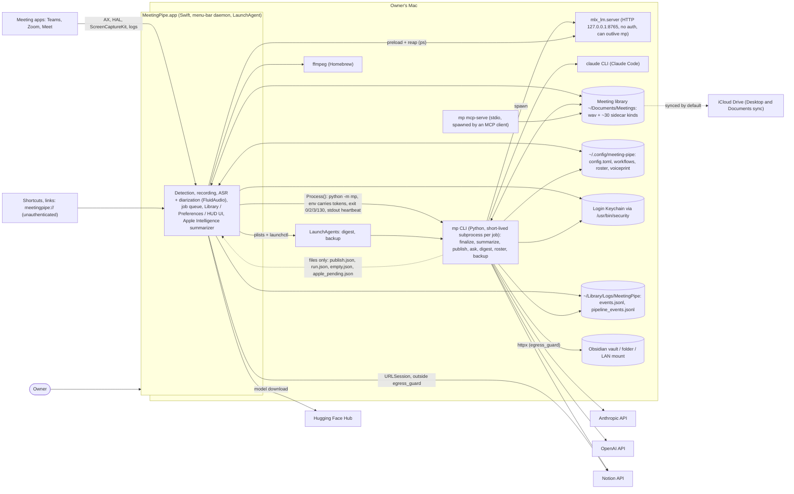
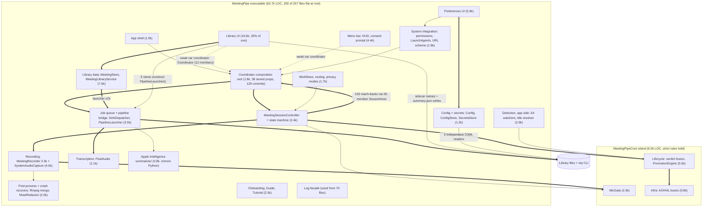
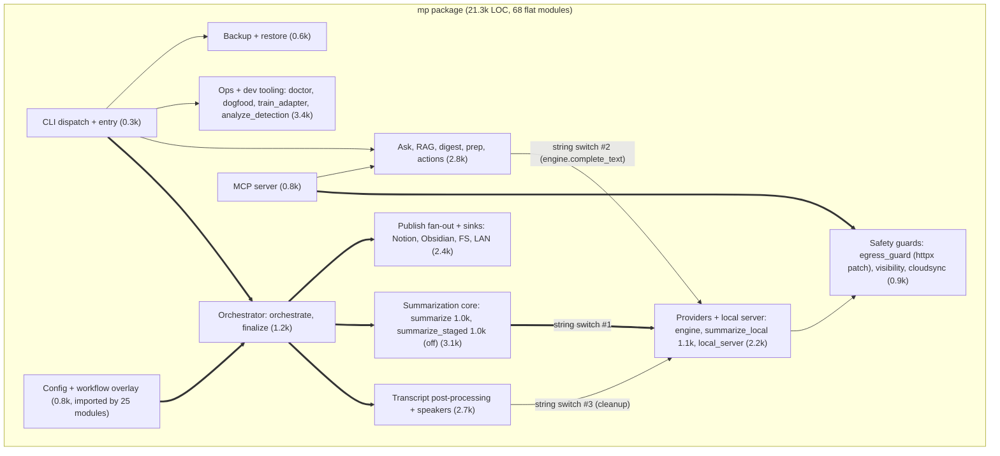

# Architecture review, 2026-10-24

Scope: the whole repo (Swift daemon, Python pipeline, the boundary between them, the AI harness). Method: one mapping agent plus six read-only review lenses (coupling and modularity, bloaters and growth, macOS infrastructure, security and privacy, pipeline architecture, AI-driven development and harness drift), each followed by an adversarial verifier told to refute every finding in code. 13 agents, 710 tool calls. Of 73 raw findings, 0 were refuted outright, 26 were downgraded, and several numbers were corrected; the severities below are the post-verification ones, merged across lenses. The top items were then re-checked by hand. Comments and docs were treated as claims to test, not facts. Nothing here is filed or changed.

## Summary

**Verdict: a sound core with a disorganised spine, and a process that produces more text than structure.** The parts that matter most hold up: the `MeetingPipeCore` island follows its own rules (6.5k LOC, Foundation plus TOMLKit, one AppKit import), the recording path is defensive, almost no dead code exists, and DIST4 and CI8 really did fix what they claimed (no `Bundle.module` at runtime, CI runs from the lock, blocking engine calls are off the cooperative pool). Security in-process is better than average for an AI-built app: the MCP server is stdio-only with an allowlist, MLX binds to loopback, restore extracts with `filter="data"`, and there is no `shell=True`.

The architectural problems are of three kinds:

1. **Growth went into a few hubs instead of new structure.** `MeetingRecorder` (2,328 LOC, from 1,009 in June), `MeetingSessionController` (1,622, new since June), `PipelineLauncher` (1,483), `MeetingLibraryService` (1,366) and `TranscriptTab` (1,573) absorbed almost every incident fix. 200 of the 257 executable files sit flat in one folder. The July "extraction" moved code out of `Coordinator` without shrinking the spine: the controller still reaches back 150 times through a 26-member `SessionHost`.
2. **There is no owner for anything shared between the two trees.** `config.toml` is parsed in 5 places in Swift plus once in Python, with different failure behaviour, and the main Swift reader fails open and can overwrite the file. The per-meeting file contract (~30 sidecar suffixes, `.summary.json` spelled out in 30 Swift files, `meta.json` read as `[String: Any]` in 18) has no type. Summarization, the zero-egress policy, prep and doctor exist in both languages and are kept in sync by 10 golden fixtures, which is a tax and already shows drift. The Swift/Python split is justified for about 4.8k LOC of ML-bound Python; the rest is there by inertia.
3. **AI-development side effects now drive the drift they were meant to prevent.** About 43 to 49% of Swift source bytes are comments, 2,612 comment lines cite ticket IDs (which `CONVENTIONS.md` forbids), and several security-relevant comments and always-loaded rules are false in code. Tracked Markdown (4.35 MB) now outweighs all source code (4.29 MB), and 216 of the last 400 commits touch no source file. Fences that grep source text stand in for behaviour tests, and the key wiring fence passes silently when its target is renamed.

**Highest-value moves, in order:** (1) make off-the-record redaction fail closed (S1); (2) make config reading single-owner and fail closed (A3); (3) put the provider choice behind one table (A6); (4) stop growing `MeetingRecorder` and the session spine, and extract along existing MARK seams on the next touch (A1, A2); (5) one move-only commit into feature folders (A9); (6) a comment and docs diet with a ratchet, plus replacing count-style rules with allowlist fences (D1, D2, D7, H1).

No critical findings survived verification. Most items are S to M effort.

## Diagrams

### Container diagram (C4 level 2)

### Component diagram: daemon (C4 level 3)

Line counts are approximate. Heavy arrows are strong coupling (many call sites or concrete back-references).

### Component diagram: pipeline (C4 level 3)

## Findings

Severity is post-verification. "Known" points at an earlier audit (`go-live` = 2026-10-21 assessment, `harness` = 2026-10-24 harness audit) when the item was already there; it was re-checked in code and is still true unless noted.

### Architecture and coupling

| ID | Finding | Antipattern | Severity | Suggested action | Known |
|---|---|---|---|---|---|
| A1 | Session spine is one god object in three files. `Coordinator.swift` is 851 LOC with 38 stored properties and two implicitly unwrapped properties wired after `super.init` (l.60, l.66), and it has 129 commits. `MeetingSessionController` (1,622 LOC) calls back into it 150 times across all 26 `SessionHost` members, so the protocol is a service locator rather than a seam. | God Object hidden by extension sprawl; Service Locator | Medium | Over 2 or 3 green-to-green commits, move the meeting-scoped subsystems (state machine, MicGate, lifecycle coordinator, backstop, teardown, consent) into the controller's init. Shrink `SessionHost` to the UI and IO ports plus one `LiveConfig` snapshot value. Stop adding members to it now. | go-live SA-4 (partly) |
| A2 | `MeetingRecorder` is a 2,328-line class with 45 methods and 10 MARK concerns (mic chain, SCStream, power and wake, liveness watchdog, input-device recovery of ~370 lines, tap watchdog of ~570 lines, MicGate, metering). `stop()` is 265 lines. It has grown from 1,009 lines in June, with 58 commits; every REC and END fix lands here. | Large Class, Divergent Change, Malignant Growth | **High** | Do not rewrite. On the next REC task, extract `InputDeviceRecovery` and `MicTapLivenessWatchdog` (then `SystemAudioChannel`) along the existing MARK seams, pinning behaviour with the current recorder tests first. Split `stop()` into named steps. | go-live SA-4 |
| A3 | `config.toml` has 5 independent Swift readers (`Config.swift:64`, `ConfigStore.swift:179`, `PipelineLauncher.swift:1176` with a hard-coded path, `PipelineLauncher.swift:1370`, `WorkflowMigrator.swift:56`) plus Python's `config.py`. `ConfigStore` turns a malformed file into an empty document, and the next Preferences edit writes defaults over the user's file (dropping `regulated_mode`, team context, sinks). `cloudSecretPolicy` defaults to `regulated=false`, backend `anthropic` on a parse error, so it fails open. Four lenses found this independently. | Multiple Sources of Truth, Shotgun Surgery, fail-open policy | **High** (each lens rated medium; merged, it combines silent data loss with a privacy fail-open) | Make `ConfigStore` the single Swift reader, returning a result that records whether parsing failed. On failure, keep the raw text, refuse to save, and show "config.toml has a syntax error at line N". Derive `Config` and the secret policy from it, and have the policy fail closed (strip both tokens). Delete the hard-coded path. | go-live PP-7, PD-12 |
| A4 | The per-meeting file contract has no owner type. There are ~30 sidecar suffixes; `.summary.json` is spelled out in 30 Swift files, `.meta.json` in 18, and `meta.json` is a `[String: Any]` dictionary read in 18 files (74 `JSONSerialization` calls in 31 files). SwiftUI views read, modify and write pipeline-owned `summary.json` with `try?`, which drops failures (`MeetingDetailView+Header.swift:864-891`, `SummaryTab.swift:609`). The job outcome is inferred from exit codes plus file presence (`apple_pending.json`, `empty.json`, `READY_FOR_MANUAL.md`, an `MP_FAILURE_PATH` temp file, a stdout sentinel). | Integration through a shared filesystem, Primitive Obsession, UI reaching into persistence | Medium | Add a `MeetingFiles(stem:dir:)` value type with named URLs, a Codable `MeetingMeta` with tolerant decoding, and one `SummaryDocument.update` as the only Swift writer (it refuses while a job for that stem is running). Have `mp` job subcommands write one `--result` JSON envelope (`outcome`, `skip_reason`, `paths`, `failure`), and branch only on it. Migrate call sites as they are touched. | go-live SA-10, PP-10 (adjacent) |
| A5 | Features are implemented in both languages. The Swift Apple Intelligence summarizer has its own prompt, schema string, JSON extraction, chunking and markdown renderer, and has already drifted: it never asks for WF7 extra sections and has no prior-meeting context or evidence repair. Prep (212 Swift vs 317 Python), doctor (415 vs 848) and the zero-egress policy (38 Swift files mention it) are also doubled. 10 cross-tree golden fixtures exist mainly to keep twins in sync. | Parallel implementations across a language boundary; Horizontalism by language | Medium | Write a short ADR fixing the boundary: Python owns model services plus the summarize-and-publish pipeline; Swift owns capture, UI and scheduling; no feature is implemented in both trees. Turn the Apple path into a provider only (`MeetingPipe fm-complete` reads a prompt on stdin), so Python renders everything. Have Swift ask `mp policy --json` instead of re-deriving egress rules. | go-live SA-11, DI-14 |
| A6 | The provider abstraction exists in name only. Backend choice is an if/elif over the same 6 strings in four places (`summarize.py:766`, `engine.py:167`, `diarize_cleanup.py:603`, `orchestrate.py:369`), plus an `isinstance` ladder to recover which backend answered. The cleanup switch only knows `local` and `anthropic` and raises for `openai` and `claude_cli`, and `orchestrate.py:480-492` swallows that as "non-fatal", so speaker cleanup silently never runs for two engines the UI offers. | Shotgun Surgery; Protocol without a factory | **High** | Add one `providers.py` table keyed by backend id (`locality`, `build_summary`, `build_text`), give clients `.backend_id`, and route summarize, engine and cleanup through it so an unsupported pairing fails loudly at config time. Delete `_identify_backend`. | new |
| A7 | `PipelineDriver` has 24 requirements and one production conformer. 16 of the defaults in its extension return an `NSError`, so a signature drift in `PipelineLauncher` becomes a runtime error instead of a compile error. Five SwiftUI views construct their own `PipelineLauncher()`, bypassing the shared one. | Fat Interface; test-only DI seam; inconsistent DI | Low | Split by caller into 3 or 4 role protocols, remove the defaults on the core run lane, and inject the one launcher through the SwiftUI environment. | go-live SA-12 |
| A8 | Library UI holds `weak var coordinator: Coordinator?` (concrete type) and uses 12 of its members, including chains like `coordinator?.preferencesWindow?.show(...)`. `MeetingLibraryService` is wired with 11 closures after init. | Law of Demeter; temporal coupling; closure-soup DI | Medium | Add one `LibraryHost` protocol with the ~8 things the Library needs (including `openPreferences(pane:)`), type the back-reference as that, and group the 11 closures into 2 or 3 small port structs passed at init. | go-live SA-8 (adjacent) |
| A9 | 200 of 257 executable files (50.8k LOC) sit flat in `Sources/MeetingPipe`. `Library/` holds 2 files while 10 `Library*` files sit at the root; 21 `Meeting*` and 12 `Workflow*` files are also there. A doc table in `ARCHITECTURE.md` stands in for folder structure, and about 68 files are not named in it. | Undermodularization (folder level); Big Ball of Mud layout | Low | One move-only `git mv` commit into feature folders (App, Detection, Recording, Transcription, Pipeline, Library, Workflows, Search, Speakers, Preferences, Design). The SwiftPM target is recursive, so nothing else changes. Then shrink the ARCHITECTURE file table to one line per folder. Do not add targets. | new |
| A10 | Three targets is the right count, and `MeetingPipeCore` is a real boundary. 123 exe files (20k LOC) import only Foundation, Core or TOMLKit, including `DetectionStateMachine` and the contract decoders. | Positive (neither over- nor under-modularized at target level) | Info | Keep 3 targets. Once A4 exists, put `MeetingFiles` and the contract decoders in Core so the contract has one home. | new |
| A11 | Because `mp` is short-lived, `mlx_lm.server` has two owners: Python spawns it (`summarize_local.py:750`) and the daemon preloads and reaps it (`LocalModelPreloader`, `LocalServerReaper` with `/bin/ps` scans). About 930 LOC of lifecycle code includes `lsof`/`ps` identity probing to learn which model a warm server is running. | Accidental complexity; missing long-lived owner | Medium | Make the daemon the only owner (start on demand, restart on model change, kill on quit). Python only connects, and fails with a clear "server not running" error that the daemon handles by starting it and retrying once. Then delete the Python spawn and probe paths. | new |

### Bloaters and malignant growth

| ID | Finding | Antipattern | Severity | Suggested action | Known |
|---|---|---|---|---|---|
| B1 | About 10k LOC (~11% of production code) serves secondary surfaces: digest 1.0k, stats 0.9k, tutorial 0.9k, in-app guide reader 0.8k, prep card 0.8k, facts 0.7k, voiceprint 0.6k, App Intents 0.5k, LAN sink 0.4k. Ask/RAG (2.4k) and MCP (0.9k) are heavier but used. | Feature Creep | Medium | Owner decision per surface: keep, put behind one "Experimental" toggle, or delete (git keeps it). Remove the matching GUIDE recipe in the same commit. | go-live SA-11 |
| B2 | `summarize_staged.py` is 1,010 LOC (plus 581 LOC of tests) from one commit on 2026-07-28, reachable only through the `MP_STAGED_LOCAL` env flag, which nothing sets. Its bake-off (LOCAL14) has not run. Dev tooling ships as product subcommands: `dogfood` 469, `train_adapter` 526, `analyze_detection` 751. Together this is ~2.8k LOC, about 13% of the pipeline. | Speculative Generality; Lava Flow | Medium | Set a date for the LOCAL14 verdict or delete the staged summarizer now. Move the dev tooling to `pipeline/tools/` or behind `mp dev ...`, excluded from the runtime bundle. Also drop the duplicated inner language retry in `summarize_local.py:541`. | go-live SA-11 (partly) |
| B3 | `summarize.py` (1,001 LOC, 51 commits, the most-churned module) mixes the Anthropic client and retry, prompt assembly, a library scan for prior meetings, backend selection, fallback, identity attribution, evidence verification, language repair, CLI and sidecar rewrite. `summarize_local.py` is 1,128 LOC. Five private `_helpers` are imported across modules. | God Module; Inappropriate Intimacy | Medium | Green-to-green: split into `prompting.py`, `provider_anthropic.py` and a ~200-line `summarize()`. Make the shared helpers public or move them into `json_extract` and `storage`. Pairs with A6 and A11. | new |
| B4 | Several SwiftUI and AppKit views are oversized: `PipelineSectionView` has a 262-line body, `TranscriptTab.swift` grew from 476 to 1,573 lines, and `MeetingPromptWindow.makeContentView` is 217 lines of hand-laid AppKit. | Long Method (view layer) | Low | Extract subviews when a file is touched for another reason; no sweep. Start with Preferences (one section per backend). | go-live SA-13, SA-14 |
| B5 | The summarization backend is a string. There are three Swift representations (`WorkflowBackend`, `SummarizationEngine`, `ConfigStore.summarizationBackend: String`), and hand-written predicates like `== "local" \|\| == "apple_intelligence"` appear in 5 places. Docstrings say "four backend values" while six are dispatched. | Primitive Obsession | Low | Type `ConfigStore.summarizationBackend` as the engine, and replace the predicates with `engine.locality == .onDevice`. Fix the stale docstrings. | new |
| B6 | The config schema is described in 5 places (`Config.swift`, `ConfigDefaults.swift`, `ConfigStore.swift` with 37 published fields, `config.example.toml`, `config.py` with 51 fields). Python models 4 daemon-only keys it never reads. | Shotgun Surgery | Low | Drop the daemon-only fields from `config.py` (`extra='ignore'` already tolerates them). Retire `Config.swift` as part of A3. | new |

### macOS platform and infrastructure

| ID | Finding | Antipattern | Severity | Suggested action | Known |
|---|---|---|---|---|---|
| M1 | System audio is captured with a ScreenCaptureKit display stream (2x2 video, discarded). But the TCC usage string in `install.sh:229` tells the user it uses "Apple's process-tap API ... no screen pixels are read", and `ARCHITECTURE.md:311` says "ScreenCaptureKit + ProcessTap". The process tap shipped in `ec57e17a` and was removed in `029abac0` (dropped channels on macOS 26). `LSMinimumSystemVersion` is 13.0 while the package requires macOS 14. | Infra ignorance; consent text drift | Medium (the user-facing consent claim is false) | Fix the usage string, ARCHITECTURE.md and the minimum version now. Revisit a CATap backend behind a flag once macOS 26 behaviour is stable, with its own audio-capture consent. | new |
| M2 | The app holds mic, Screen Recording and Accessibility grants, yet it is signed without hardened runtime (`codesign -dvv` shows `flags=0x0(none)`). The dev signing key is imported with `-A` (any app may use it without a prompt), and the LaunchAgent plist carries a user-writable `EnvironmentVariables` block. Any same-user process could therefore inject a library (`DYLD_INSERT_LIBRARIES`) or re-sign a binary and inherit those grants. | TCC trust-boundary ignorance | Medium | Sign with `--options runtime` plus an entitlements file containing `com.apple.security.device.audio-input`. Check that the embedded Python and MLX still load, and add library-validation exceptions only if they do not. Import the key with `-T /usr/bin/codesign` instead of `-A`. Re-grant TCC once afterwards. | go-live DI-6 (key half only) |
| M3 | `mp` installs no SIGTERM handler. A user Cancel sends SIGTERM (`PipelineLauncher.swift:639-657`), so no `finally` block runs and a multi-GB `mlx_lm.server` started with `setsid` is orphaned. The daemon reaps only on timeout, not on cancel, and the reaper's header comment says otherwise. | Process lifecycle ignorance; Comment Drift | Medium | In `__main__`, map SIGTERM to `sys.exit(143)` so cleanup runs. Call `LocalServerReaper.reapIfOrphaned()` on cancel too. Fix the comment. | new |
| M4 | The AX mute-button probe polls the meeting app's accessibility tree on the main run loop (`Timer.scheduledTimer`), making 3 cross-process attribute reads per poll under a 2 s system-wide messaging timeout. A busy Teams can stall the UI for seconds. `AXLeaveButtonSignal` already uses a queue scheduler. | Main-thread blocking IPC | Medium | Give `AXMuteButtonProbe` the same queue scheduler and hop to main only to publish the verdict. | go-live PD-8 (partly fixed) |
| M5 | 14 files hand-roll `Process()` with 4 different drain and timeout policies. `KeychainSecrets.swift:81` does an unbounded `waitUntilExit` on `/usr/bin/security` before `NSApplication` starts, so a stuck keychain prompt hangs launch. `MuteRedactor.swift:303` waits before draining stderr. The ffmpeg merge timeout abandons the child but never kills it. | Duplicated infrastructure; no subprocess primitive | Medium | Add one `ProcessRunner.run(exe:args:env:timeout:)` that drains both pipes concurrently, runs on GCD, and escalates SIGTERM then SIGKILL on timeout. Migrate Keychain and ffmpeg first, and add a fence against new raw `Process()` outside it. | go-live PD-7 (ffmpeg half) |
| M6 | CI8's rule against blocking the cooperative pool was applied to the engine only. `Coordinator.swift:699-703` still runs a `Task.detached` that sleeps (`Thread.sleep` 0.5 s x20), runs `ps`, and transcodes with ffmpeg synchronously. | Blocking work on the cooperative pool | Low | Route these through `runBoundedSync` or a GCD hop. Add a line to `daemon/CLAUDE.md`: "Task.detached is not off-pool." | go-live QG-2 (rest fixed) |
| M7 | Quit exits with code 1 by default so that launchd relaunches the app (`App.swift:62-64, 281`). There is no crash-loop breaker beyond the 10 s throttle. | launchd misuse (overloaded exit status) | Low | Exit 0 on Quit, and implement relaunch as an explicit `launchctl kickstart`. Add a small breaker: more than 5 launches in 60 s means stay idle and notify. | go-live UX-13 |
| M8 | The file logger is not thread-safe. Each line does `stat`, `FileHandle(forWritingTo:)` without `O_APPEND`, `seekToEnd`, `write`, with no lock, from 376 call sites across main, audio, GCD and pipe-reader threads. Rotation can double-shift, and concurrent lines can overwrite each other in `events.jsonl`. | Reinvented logging without its guarantees | Low | Keep the files, but route every append through one serial queue on an `O_APPEND` descriptor, and give each `mp` spawn its own log or the same queue. | new |
| M9 | The library sits in iCloud-synced `~/Documents` (verified via the `com.apple.icloud.desktop` xattr), yet there is no dataless or eviction handling and no file coordination. Atomic writes look like delete plus create to iCloud. | File-provider ignorance | Low (privacy side is S2) | Default the library outside synced roots and offer the existing `LibraryMover` one-click move. If kept in iCloud, check `ubiquitousItemDownloadingStatus` before heavy reads. | go-live PD-10, SEC12 |
| M10 | Concurrency checking is Swift 5 mode with `-strict-concurrency=targeted`. Unlocked statics in `SystemAudioCapture` (`cachedContent`, `permissionState`) are written from main, from a detached prewarm and from the pool. | Unsynchronized shared state | Low | Guard the two statics with `OSAllocatedUnfairLock` (already used in `RunWithTimeout.swift`). Try `complete` mode on Core only, as a measurement. | go-live SA-3 |
| M11 | The termination ceiling calls `exit()` from a background thread after 9 s, possibly while main is also exiting and audio threads are live. | Unsafe process teardown | Low | Use `_exit(code)` in the ceiling. | new |
| M12 | The consent prompt opens the mic with a second `AVAudioEngine` only to draw a level meter, before the user has consented. `installTap` aborts were the cause of all four crash reports on the owner's machine. | Hardware access for decoration | Low | Use a static glyph, or drive the meter from the existing mic-activity signal without opening the device. That deletes `MicLevelMonitor`. | new |
| M13 | An `LSUIElement` LaunchAgent app with timer-driven detection between meetings has no App Nap opt-out and no `ProcessType` in its plist. | Energy and scheduling ignorance (unverified) | Low | Check Activity Monitor's App Nap column once. If it says Yes, hold a `beginActivity` token and set `ProcessType=Interactive`. | new |

### Security and privacy

| ID | Finding | Antipattern | Severity | Suggested action | Known |
|---|---|---|---|---|---|
| S1 | Off-the-record and mute redaction fail open. `SinkDispatcher.swift:378` discards the result of `MuteRedactor.redactIfNeeded`; if ffmpeg is missing or fails, the job transcribes and publishes the unredacted WAV, and the only trace is a log line. The filter also silences only the mic channel (`MuteRedactor.swift:70-73`), so everything the other participants say during an off-the-record stretch is still transcribed, summarized and published. `GUIDE.md:70` promises the stretch is cut. | Fail-open privacy control | **High** | Treat a failed redaction of a timeline with manual spans as a hard job failure, and quarantine the recording the way `.offrecord` recovery does. Decide with the owner whether off-the-record covers both channels; if it does, silence `[R]` too. Fix the GUIDE and README copy in the same commit. | go-live fix 5, PD-6 |
| S2 | Zero-egress (regulated or NDA) is only an HTTP promise. Under NDA, `effective_sinks` drops only Notion, so the Obsidian, filesystem and LAN sinks still run (`config.py:461-473`); the BYO bundle and backups have no gate; iCloud sync is a `doctor` [FAIL] line that still exits 0. `install.sh:227` tells the user "Audio never leaves your Mac". Latent today: the owner runs with `regulated_mode=false` and no NDA workflow. | Leaky security boundary | Medium | Make it a gate: under zero-egress, refuse to record into a synced library root (or badge it clearly) and offer the move. Clamp file sinks under NDA unless their target passes the same sync check. Skip BYO bundles under NDA. Fix the install text. | go-live fix 9, DI-11 |
| S3 | The egress guard is a monkeypatch on httpx transports (`egress_guard.py:140-164`). It only stays valid because `anthropic<1` and `httpx<1` are pinned (anthropic 1.0 moved to httpx2). The Hugging Face stack is held back by an env flag only. | Security control at the wrong layer | Medium | Also patch `socket.connect` and `create_connection` to reject non-loopback addresses (library-agnostic, ~30 LOC). Keep the httpx patch for a clear error message. Add one `urllib` test, then lift the caps in a separate lock bump. | go-live PP-1 (caps done, structure not) |
| S4 | The `claude_cli` backend spawns a full Claude Code agent. `--allowed-tools ""` only pre-approves tools; it does not disable the built-in read tools. The cwd is `/` (inherited from launchd), the user's MCP servers and hooks load, every summary is saved as a session, and `ANTHROPIC_API_KEY` is passed even though comments say this backend "needs no API key". | Excessive agency; false assurance comment | Low (prompt injection from a transcript could read files, but the output only goes to the summary) | Spawn with `--tools ""`, `--strict-mcp-config` with an empty config, no session persistence, an empty temp cwd, and tokens stripped (or keep the key on purpose and say so). Fix both comments. | go-live PP-2 |
| S5 | The MCP server never checks global `regulated_mode`. Visibility reads only per-meeting flags, so meetings recorded before regulated mode was switched on stay visible to a cloud MCP client. Latent: MCP is off on the owner's machine. | Policy bypass | Low | When `zero_egress(cfg)` is true, serve zero stems and show the reason in Preferences. Add one test. | new |
| S6 | `meetingpipe://` and App Intents are unauthenticated. Any link or app can stop a live recording, start one, trigger a digest (a cloud call) or auto-run an Ask. The question goes into argv without `--`. | Confused deputy | Low | Keep `open` and `library`. For record, stop, digest and ask from outside, require a one-click confirm, or prefill Ask without submitting. Add `--` before the question. | go-live PP-8 |
| S7 | NDA classification fails open. No rule match falls through to the default workflow, an empty title scores 0, an invalid regex silently matches nothing, and `workflow_nda_mode` is stamped only at record time (turning NDA on later does not cover past meetings). Latent today. | Fail-open default; stale policy snapshot | Low | When an NDA workflow exists and the match was a fallback, hold the auto-summary for a confirm or default to local. Surface invalid regexes in the inspector. Re-stamp past meetings when a workflow becomes NDA. | new |
| S8 | Voiceprints (biometric data) are written world-readable. `voiceprint.json` is `-rw-r--r--` on this Mac, because four hand-rolled writers (`voiceprint.py:101`, `roster.py:238`, `orchestrate.py:679`, `roster_cmd.py:130`) bypass the 0600 `storage.atomic_write_text` helper (53 `write_text` calls vs 15 helper calls). `roster forget` removes the roster entry but leaves per-meeting embeddings. | Reinvented helper; inconsistent data classification | Low (single-user Mac; matters before any wider release) | Route all four through the helper, `chmod 0700` the config dir at install, and make `forget` cascade into `<stem>.embeddings.json`. | go-live PP-4 |
| S9 | Every 0.5 s debounce in Preferences rewrites all three tokens through `/usr/bin/security ... -w <value>`, which puts them in `ps` output. The daemon also `setenv`s them into its own environment. | Secret sprawl | Low | Write only the field that changed, build child environments per spawn, and delete the stale `secrets.env` comment. | go-live DI-17, PP-11 |

### Pipeline reliability

| ID | Finding | Antipattern | Severity | Suggested action | Known |
|---|---|---|---|---|---|
| P1 | Notion publish is idempotent only on the client side. The create call is deliberately not retried (a 502 can follow a committed write), but no sidecar is written in that case, so "Retry publishing" creates a duplicate page. A page deleted in Notion makes every later update fail with no recovery path. | Non-idempotent retry; missing natural key | Medium | Store the stem in a Notion property, query by it before creating, and adopt any page found. On 404 or archived, clear the sidecar and create. Write the sidecar atomically. | go-live UX-12 (adjacent) |
| P2 | Tests reach in through 269 `monkeypatch.setattr` calls (17 on private names), because `run_all` takes no client or publisher. The orchestrator's real wiring is stubbed in its own tests. Production `events.py` checks `'pytest' in sys.modules`. | Test-induced coupling; test logic in production | Medium | Give `run_all` and `summarize` a `deps` argument (provider table from A6, publishers list). Add one fake provider and one recording publisher in `conftest`, set the logs dir to `tmp_path` there, and remove the pytest check from `events.py`. | harness #3, go-live QG-8 |

### AI-driven development antipatterns

| ID | Finding | Antipattern | Severity | Suggested action | Known |
|---|---|---|---|---|---|
| D1 | Comments are a changelog. 43% of Swift source bytes are comments (18,645 of 70,160 lines), and 2,612 comment lines cite ticket IDs. Python adds 658 ticket mentions. `MeetingRecorder` alone has 894 comment lines. `CONVENTIONS.md:9-15` forbids exactly this ("Don't reference the current task ... Those rot."). The volume hides the invariants and is where most of the drift below lives. | Comment Archaeology; Changelog-in-Code | Medium | Do not mass-rewrite. Add a ratchet to `truth_fences.py`: the count of ticket-ID tokens in comments may not go up. Add one line to `/tech-task`: when you edit a function, replace its ticket narration with the invariant in at most 3 lines; history goes to git and `gotchas.md`. | go-live SA-6 (docs only) |
| D2 | Comments and always-loaded rules are false in code, several of them security-relevant: "`--allowed-tools ""` disables tool use"; "claude_cli needs no API key" (`SecretsStore.swift:15`, `provider_claude_cli.py:4`); "Don't call Notion from the daemon" (`NotionDatabaseList.swift:120` does); "Two @unchecked Sendable, don't add a third" (there are 7, plus `uncheckedState:` and `nonisolated(unsafe)` escape hatches, one added explicitly to keep the count); "heavy imports are lazy" (numpy and tenacity are top-level); the ProcessTap consent text (M1); a `secrets.env` comment after the Keychain migration; a doc comment attached to the wrong property (`MeetingSessionController.swift:57-68`); `backend_fallback.py:61` "exits the process" (it raises). | Comment Drift; Goodhart's Law on count rules | Medium | Fix these lines in one commit. Replace numeric rules with allowlist fences (each `@unchecked Sendable`, `URLSession` and raw `Process()` site listed by file with a reason; fail on a new one). Get an owner call on the Notion picker: allow it in the rule, or move it behind `mp`. | harness #9 (two of these) |
| D3 | 26 daemon test files assert on Swift source text rather than behaviour (`view.contains("ScrollViewReader { proxy in")` and similar). The END9 wiring fence (`CoordinatorWiringFenceTests.swift:35-37`) throws `XCTSkip` when `func start()` is renamed or reindented, so it passes silently, and `ci-local.sh` treats a skip as green. | Implementation-pinning tests; fail-open fence | Medium | Change that `XCTSkip` to `XCTFail` now. Next, extract a headless wiring seam so a behaviour test can assert each watcher's `start()` ran against fakes. Keep source fences only where no seam exists, and say so in the test. | go-live QG-4, harness #3 |
| D4 | End-of-call logic grows one incident patch at a time: 11 END commits on `MeetingPipeCore/Lifecycle` from TECH-END1 to END14, each adding a rule (corroboration, correlated pair, oracle, flush clock, cap veto, live veto), with the recording stack patched alongside. There is no replay harness, so each fix is validated by the next real meeting. | Patch-on-Patch | Medium | Pause new END rules until END9 to END14 are field-confirmed. Build a replay test that feeds the redacted traces from `scripts/extract_detection_trace.py` through `PromotionEngine` and the hold, and require it to pass for any END or REC change. Move `TeardownHold`'s timer policy into Core with an injected clock. | go-live PD-1, harness #2 |
| D5 | Consolidation sweeps fix one copy and leave the siblings. PIPE7 merged the fallback ladder but left three Anthropic client policies: 120 s and 0 SDK retries in `summarize.py:407`, a custom timeout with 2 retries in `engine.py:80`, and SDK defaults (~600 s, 2 retries) in `diarize_cleanup.py:543`. | Incomplete consolidation | Low | One `make_anthropic_client()` factory used at all three sites, plus a test on its timeout and retry settings. | new |
| D6 | Process and documentation now outweigh the code. Tracked Markdown is 4.35 MB against 4.29 MB of source. `docs/backlog/q6-final.md` is a single 1.43 MB file. 216 of the last 400 commits touch no source file, and since August the backlog index has 201 commits against 14 for the busiest Swift file. `gotchas.md` is 191 KB and `ARCHITECTURE.md` 188 KB, too large for an agent to read as orientation. | Process over product; documentation bloat | Medium | Stop copying full specs into `q*-final.md`; keep a one-line ship note and the commit sha (git keeps the spec). Freeze new filings while more than a few P1s await owner verification. Split `ARCHITECTURE.md` per subsystem so `/tech-task` reads only the relevant part. Keep `truth_fences.py` and `ci-local.sh`, which earn their keep. | go-live SA-5, SA-6 |

### AI harness drift

| ID | Finding | Antipattern | Severity | Suggested action | Known |
|---|---|---|---|---|---|
| H1 | Always-loaded instructions have accreted. `daemon/CLAUDE.md` is 22.4 KB (93% of the 24 KB cap) with 63 rules and 128 commits; many are one-off SwiftUI layout incidents. The CLAUDE.md entry fence only measures lines starting with `- ` or `\| `, so root `CLAUDE.md` paragraphs of 1,341, 1,012 and 959 B escape the 800 B cap. | Instruction bloat; fence gap | Medium | Move the UI and layout rules into a nested `CLAUDE.md` beside the views, so they load only there. Make the fence measure every paragraph. Move the Tutorial carve-out paragraphs out of the root file. | harness (paragraph gap) |
| H2 | Most of this morning's harness-audit defects are still open after CI8 and DIST4: `tech-task.md:28` says "12 KB budget" (the cap is 24,000 B); its docs-sync step omits `GUIDE.md` and `SETUP.md`; four docs say CI fails on em-dashes, but no CI step does that, and `pipeline/src` contains 57 lines with U+2014 (only a local pre-commit hook enforces it); the two "mandatory" shell test scripts are not run by `ci-local.sh`; `prune-worktrees.sh:10` still says "step 1". | Harness drift | Low | One small commit: fix the figure, add GUIDE and SETUP to the sync list, add an em-dash diff check to `ci-local.sh` (or delete the claims), call the two scripts from `ci-local.sh`, and move step 0 and the landing procedure into one shared file. | harness (defects list) |
| H3 | Global and project instructions still conflict: the global rules demand Plan Mode and feature branches, while the project says work on `main`; `/tech-task` subagents cannot reach the owner for Plan Mode; the global ADR format and docs root do not match `docs/decisions/`. | Conflicting instruction sources | Low | Add one precedence paragraph to the root `CLAUDE.md` ("in this repo, `/tech-task` gates replace Plan Mode; commit on `main`; ADRs live in `docs/decisions/`"). | harness (conflicts section) |

## What is fine and should stay

- The `MeetingPipeCore` island and its pure `decide()` rules, the three-target split, and the TOMLKit-only dependency floor.
- `ci-local.sh` as the single CI step list, and `truth_fences.py` for config keys, event categories and links.
- Recording-path defensiveness (crash recovery, bounded engine start, GCD for blocking AVAudioEngine calls since CI8).
- MCP over stdio with a visibility allowlist, MLX on loopback, `filter="data"` restore, slugified filenames, 0600 logs.
- Almost no dead code: the growth problem is concentration and duplication, not abandoned code.

## Premise corrections from the review

- There is no LAN publish server: `publish_lan.py` writes to an already-mounted SMB or NFS share.
- The daemon does make outbound HTTP calls (the Notion picker, FluidAudio model downloads), despite `CONVENTIONS.md` and `daemon/CLAUDE.md`.
- Summarization runs in both processes: with `apple_intelligence`, `mp` writes a sentinel, the daemon summarizes in Swift, then calls `mp publish`.
- Markdown volume is best measured in bytes: 23k tracked lines, but 4.35 MB, because paragraphs are single lines.
